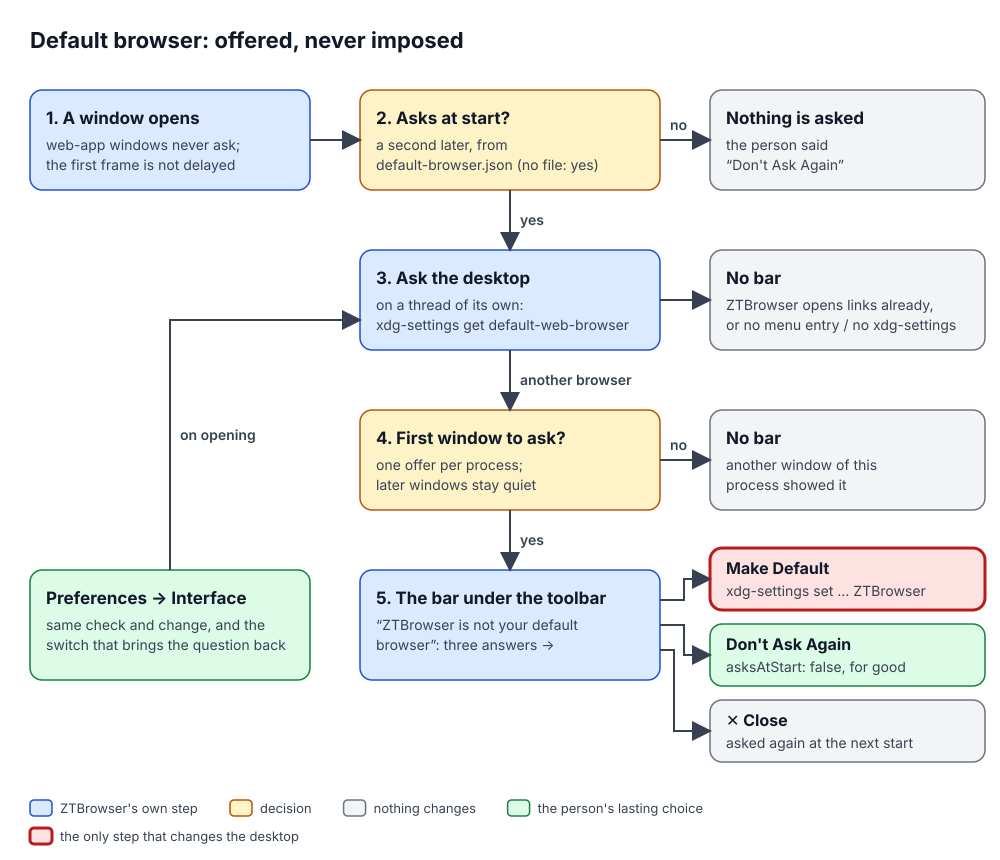

# Default browser

ZTBrowser can be made the browser that opens the web links of other programs: a link in a mail, a chat message or a
document. This document explains how ZTBrowser offers that change, how it carries it out, and why it never makes the
change on its own. Code: `crates/ztbrowser-qt/src/default_browser.rs`, the bar `qml/DefaultBrowserBar.qml`, the
preference rows in `qml/PreferencesDialog.qml`, the question at the end of `./install`. Tests:
`crates/ztbrowser-qt/tests/default_browser.rs` and `tests/default_browser_bar.rs` (with `tests/qml/tst_default_browser_bar.qml`).

## 1. The problem

A person who likes ZTBrowser wants links from other programs to open in it, and finding the desktop's setting for
that (KDE's *Default Applications*, GNOME's *Default Apps*, a `mimeapps.list` file) is not obvious. Browsers solve
this by asking, and many ask too often or make the change on their own. ZTBrowser must make the change easy and
never impose it: the person decides, nothing changes without their click, and a "no" is final until they say
otherwise. Asking must also cost nothing at start-up: the first frame has to appear in under 0.3 seconds
(see [window start-up optimizations](../plans/2026-11-06-window-startup-optimizations-plan.md)).

## 2. Vocabulary

| Term | Meaning |
|---|---|
| **Default browser** | The program the desktop starts for a web link clicked outside any browser. Each desktop keeps the choice in its own place: KDE in `kdeglobals` (`BrowserApplication`), every freedesktop desktop in `mimeapps.list` (the handlers of `x-scheme-handler/http`, `https` and `text/html`). |
| **`xdg-settings`** | A program of the `xdg-utils` package that reads and changes such desktop settings, with one implementation per desktop (KDE, GNOME, Xfce, LXDE, Deepin and a generic one). `xdg-settings get default-web-browser` prints the menu entry of the current browser; `xdg-settings set default-web-browser <entry>` makes another entry the default. |
| **Menu entry** | A `.desktop` file in an `applications` folder (`/usr/share/applications`, `~/.local/share/applications`). The desktop can only choose a program that has one: the packages install `io.github.ztbrowser.ZTBrowser.desktop`, the AppImage writes it for itself (see the README), a build run from source has none. |
| **The bar** | A strip under the toolbar, in the style of libadwaita's banner: "ZTBrowser is not your default browser", with *Make Default*, *Don't Ask Again* and a close button. |
| **The question at start** | Whether the bar may appear at all; kept in `default-browser.json` (`{"asksAtStart": false}`) in ZTBrowser's data folder, shared by every profile. A missing file means "ask". |

## 3. How it works

1. **Start-up.** `BrowserApplication::run` opens `DefaultBrowserChoice` with the desktop's tool and the menu folders
   (`DefaultBrowser::for_environment`) and reads `default-browser.json`. That is one small file read; nothing is
   asked yet.
2. **A second after a browser window opened**, the bar asks the bridge whether the person wants the question. If not,
   nothing more happens. Web-app windows never ask: they show one site and are not the browser.
3. **The desktop is asked on a thread of its own.** `xdg-settings` is a shell script that runs further programs; it
   takes 50 to 90 milliseconds on KDE Plasma, long enough to make a page stutter if the drawing thread waited for it.
   The bar polls the answer every 100 ms instead. `DefaultBrowser::state` returns one of four answers:
   - `ThisBrowser`: the desktop names ZTBrowser's entry;
   - `OtherBrowser(name)`: another entry, with its `Name=` when ZTBrowser finds the entry (so the preferences can
     say "Links from other programs open in Brave"), or no entry at all;
   - `Unregistered`: no `io.github.ztbrowser.ZTBrowser.desktop` in any menu folder, so the desktop could not choose
     ZTBrowser even if asked (a build run from source); the tool is not even started;
   - `Unknown`: `xdg-settings` is missing or failed.
4. **One offer per process.** `DefaultBrowserChoice::takes_offer` says yes only to the first window that asks once the
   desktop named another browser. A window opened later in the same process, or a window that asks before the
   answer arrived, gets no bar.
5. **The person answers.**
   - *Make Default* runs `xdg-settings set default-web-browser io.github.ztbrowser.ZTBrowser.desktop` on the worker
     thread, then asks again what the desktop says. A failure shows a toast with the tool's own message.
   - *Don't Ask Again* writes `{"asksAtStart": false}`: no later start shows the bar.
   - The close button hides the bar for this process only; the next start asks again.
6. **Preferences → Interface** show the same answer each time the dialog opens ("ZTBrowser opens links from other
   programs", "Links from other programs open in Brave", "Only an installed ZTBrowser can open links from other
   programs", "The desktop does not say which browser opens links"), offer *Make Default* while another browser or
   an unknown one opens links, and hold the *Ask When ZTBrowser Starts* switch that brings the question back.
7. **`./install`** asks at its end, on a terminal only: "Make ZTBrowser your default browser, so it opens links from
   other programs? [y/N]". Enter keeps the current browser. It does not ask as root (that would change root's
   setting) nor when ZTBrowser already is the default.

## 4. Decisions and rejected alternatives

- **`xdg-settings`, not writing the files ourselves.** Every desktop keeps the setting elsewhere, and some keep it in
  two places at once (KDE reads `kdeglobals` and `mimeapps.list`). `xdg-utils` already knows all of them and is
  present on practically every Linux desktop; the packages depend on it. Writing `mimeapps.list` directly would
  work on GNOME and miss KDE's own key.
- **Comparing `get` with ZTBrowser's entry, not `xdg-settings check`.** `get` answers in one call both whether
  ZTBrowser is the default and which browser is, which the preferences show; `check` would need a second call for
  the name.
- **A worker thread and polling, not a Qt signal.** The bridge objects have no signals yet; a 100 ms timer that reads
  a mutex-guarded answer is the same pattern the downloads list uses, and the delay is invisible next to the
  one-second wait before asking. Only the newest question may write its answer, so a check started before a change
  never overwrites what the change found.
- **The AppImage's libraries are hidden from the tool.** The AppImage points `LD_LIBRARY_PATH`, `QT_PLUGIN_PATH` and
  the QML import paths at its own Qt. `xdg-settings` on KDE runs `kwriteconfig6` and `qtpaths`, built against the
  system's Qt, which fail to start with another Qt; the tool is started without those variables when ZTBrowser runs
  from an AppImage.
- **One offer a process, not a nag.** Chrome and Edge ask in every window and on a schedule; Firefox asks on every
  start unless the box is unticked. ZTBrowser asks once per start in the first window, and *Don't Ask Again* is a
  button, not a hidden checkbox. The setting is global, not per profile, because the desktop's default browser is
  global too.
- **No offer for a build without a menu entry.** `xdg-settings set` would write a name the desktop cannot start, and
  links would stop opening anywhere. `make_default` refuses before calling the tool.

## 5. Tests

`crates/ztbrowser-qt/tests/default_browser.rs` replaces `xdg-settings` with a stand-in script in a temporary folder:
it answers `get` from a file, stores what `set` names, can refuse, and records every call. No test reads or changes
the default browser of the machine that runs it. The scenarios cover the four answers, the name of the other
browser, the AppImage's own menu entry, the change and its refusal, the one offer per process, "don't ask again"
across processes and back, and the JSON the window reads.

`tests/default_browser_bar.rs` runs `qmltestrunner` on the real `DefaultBrowserBar.qml` with a stand-in bridge: the
bar appears once the desktop names another browser, never asks when the person does not want it or in a web-app
window, stays hidden when another window already offered, and each button does exactly one thing.
