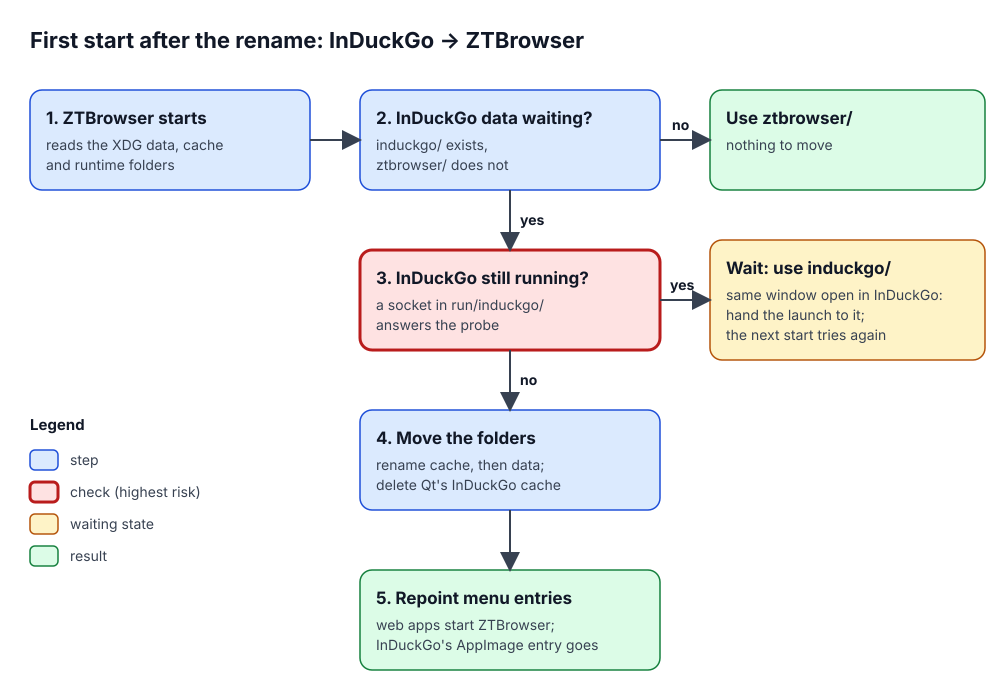

# Moving from InDuckGo to ZTBrowser

ZTBrowser was called **InDuckGo** up to version 1.2.4. This document explains how a person who used InDuckGo
keeps everything (profiles, logins, installed web apps, settings) when ZTBrowser replaces it, and why the move
is built the way it is. Code: `crates/ztbrowser-qt/src/induckgo_migration.rs`, tests:
`crates/ztbrowser-qt/tests/induckgo_migration.rs`.

## 1. The problem

The browser's name is part of many file names and identifiers, not only of the text on screen:

- the person's data lives in folders named after the program: `~/.local/share/induckgo` (profiles with cookies,
  logins and site data, installed web apps, settings) and `~/.cache/induckgo` (page caches, downloaded protection
  data);
- the desktop finds a window's icon through an **application id** (`io.github.induckgo.InDuckGo`), and every web
  app the person installed has a menu entry `io.github.induckgo.InDuckGo.WebApp.<app>.desktop` that starts the
  old program and shows an icon from the old data folder;
- an InDuckGo AppImage wrote a menu entry for itself, `io.github.induckgo.InDuckGo.desktop`.

ZTBrowser uses `ztbrowser` folders and `io.github.ztbrowser.ZTBrowser` ids. Without a migration, the first start
would look like a fresh installation: no profiles, no logins, and web-app menu entries that start a program that is
no longer installed.

## 2. Vocabulary

| Term | Meaning |
|---|---|
| **XDG folders** | The standard places for a person's files on Linux: data (`$XDG_DATA_HOME`, default `~/.local/share`), cache (`$XDG_CACHE_HOME`, default `~/.cache`) and the session's runtime folder (`$XDG_RUNTIME_DIR`, e.g. `/run/user/1000`). |
| **Application id** | The reverse-domain name a window announces to the desktop; the desktop takes the window's icon from the `.desktop` file of that name. |
| **Menu entry** | A `.desktop` file in `~/.local/share/applications`; the application menu lists it and its `Exec=` line says which program to start. |
| **Single-instance socket** | A Unix socket each running window process listens on in the runtime folder; a second launch of the same profile or web app hands its addresses over and exits, so a profile's files are never open twice. |
| **Pending migration** | InDuckGo's data folder exists and ZTBrowser's does not: the person's data still waits under the old name. |

## 3. How it works

Every ZTBrowser start runs the same steps, at the very beginning of `BrowserApplication::run`, before anything
reads a file:

1. **Is a migration pending?** Only when `~/.local/share/induckgo` exists and `~/.local/share/ztbrowser` does
   not. A person who never used InDuckGo, or whose data already moved, passes this check with two `stat` calls.
2. **Does a process still run on InDuckGo's folders?** Each running InDuckGo window listens on a socket in
   `$XDG_RUNTIME_DIR/induckgo`. If any of them answers, the folders stay where they are (see section 4 for why),
   and this ZTBrowser process uses InDuckGo's folders, including the runtime folder, so its own socket sits
   beside InDuckGo's and the move also waits for this process. A launch whose window InDuckGo already shows (the
   same profile or web app, recognised by the old application id) is handed to that InDuckGo, exactly as a second
   launch is handed to the first one. The next start checks again.
3. **Move the folders.** The cache folder is renamed first, then the data folder. Renaming the data folder is the
   step that completes the migration: if it fails, the data stays under the old name, is used from there, and the
   next start tries again. Qt's own cache of compiled QML and shaders (`~/.cache/InDuckGo`) is deleted; Qt rebuilds
   it under the new name.
4. **Repoint the menu entries**, once the data is ZTBrowser's and the interface language is known. Every web app in
   the catalogue that still has an InDuckGo menu entry gets a ZTBrowser entry, written by the same `DesktopEntry`
   type the installer uses: it starts the current program (the AppImage file when running from one) and shows the
   icon from the moved folder. The InDuckGo entry is then removed, so the menu lists the app once. The entry an
   InDuckGo AppImage wrote for itself is removed with its icon, but only when it carries the `X-InDuckGo-AppImage`
   marker: an entry the person wrote under that name stays.

## 4. Decisions and rejected alternatives

- **Rename, do not copy.** The old and new folders share a parent folder, so `rename` is instant and needs no
  free space; copying gigabytes of profile data at start-up would delay the first window and could fill the disk.
- **Never move under a running process.** A running process keeps using the paths it opened. Chromium writes new
  files into the profile by path while the browser runs (journals, cache entries), so after a move those writes
  would land in a re-created, half-empty `induckgo` folder, and a second process opening the moved profile would
  share databases with the first. Both lose data. Upgrading the package while InDuckGo is open is common, so the
  move waits.
- **Waiting, not refusing to start.** Refusing would need a dialog before any window exists, and would block the
  person until they find and close InDuckGo. Using InDuckGo's folders meanwhile keeps every profile and web app
  available and is exactly as safe: two processes never share one profile, because the single-instance check
  covers both names.
- **A probe that brings windows forward.** Checking whether InDuckGo runs connects to its sockets; the receiving
  window treats an empty request as "come forward". Telling running processes apart in another way (reading
  `/proc`) would depend on process names and is fragile. The side effect only appears while InDuckGo is still open.
- **Re-render web-app entries rather than edit them.** Editing the text would keep the old `Exec=` path, which is
  wrong after a package upgrade (`/usr/bin/induckgo` is gone) and dangerous for an AppImage (the old AppImage file
  would still start InDuckGo).
- **Existing ZTBrowser folders win.** If the person already has ZTBrowser data (a test run, for example), nothing
  is merged and InDuckGo's folders stay untouched; merging two profiles' databases is not possible safely.

## 5. Packages

| Package | How it replaces InDuckGo |
|---|---|
| Arch (`PKGBUILD`) | `conflicts=('induckgo')` and `replaces=('induckgo')`: `pacman -U` (used by `./install`) offers to remove InDuckGo. |
| Fedora (`ztbrowser.spec`) | `Obsoletes: induckgo <= 1.2.4`: `dnf install` removes every InDuckGo version. |
| AppStream (`metainfo.xml`) | `<replaces><id>io.github.induckgo.InDuckGo</id></replaces>`: software centres show ZTBrowser as the successor. |
| AppImage | Nothing to replace; the old AppImage file can be deleted by hand. Its menu entry is withdrawn at the first ZTBrowser start. |

`./uninstall` removes the package under either name, so a machine that still has InDuckGo installed is cleaned in one
run. `./uninstall --purge` deletes the data under both names too: the data and cache folders, Qt's caches, the web-app
menu entries and the menu entries an AppImage wrote for itself (only those carrying the `X-ZTBrowser-AppImage` or
`X-InDuckGo-AppImage` marker), so a purge is complete even if ZTBrowser never ran after the upgrade.

## 6. Tests

`crates/ztbrowser-qt/tests/induckgo_migration.rs` runs each scenario in its own temporary XDG folders:
data and cache move; nothing is created on a fresh machine; nothing moves while an InDuckGo socket answers, and the
process then uses and listens in InDuckGo's folders; a socket left by a crashed InDuckGo does not block the move;
existing ZTBrowser folders win; a web-app entry starts ZTBrowser and shows the moved icon; InDuckGo's AppImage
entry is withdrawn only when marked; a launch is handed to the InDuckGo that shows the same window.

## 7. When to remove this code

Once the data has moved, the migration costs a few file checks per start: two folder checks, reading the small
web-app catalogue, one check per installed web app and one for the AppImage entry. It can be removed when no supported
installation is expected to hold `induckgo` folders any more. That is the maintainer's decision; until then, keep
the module and its tests unchanged.
