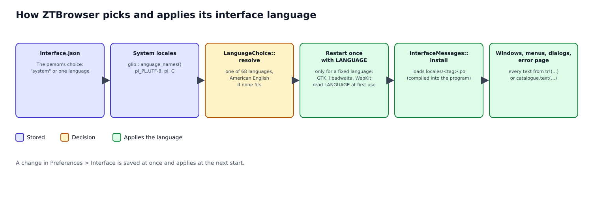

# Interface language

ZTBrowser's menus, dialogs, messages and error pages speak one language at a time: the person's choice in
*Preferences → Interface*, or by default the language of the desktop. This document explains why that needed
more than translated strings, how a language is picked and applied, and how to add or fix one.

## 1. The problem

Before this work the interface was English only (architecture overview §9). On a Polish desktop it still came out
as a mix, because three different sets of texts take part in one window:

1. **ZTBrowser's own texts** (menu items, the toolbar, dialogs, the error page): all English.
2. **GTK and libadwaita's texts** (the About dialog's buttons, "Cancel", dialog chrome): translated by GTK
   according to the *system* language, so Polish.
3. **WebKit's texts** (the page context menu, certificate and file dialogs): also translated by WebKit
   according to the system language.

A window that shows English buttons beside Polish dialog chrome is worse than a fully English one. The goal is
the opposite: **every text of every window in one language**, chosen by default from the system, switchable by
the person, over the same list of languages a person already finds in Chrome and Brave.

## 2. Vocabulary

| Term | Meaning |
|---|---|
| Locale | A system language setting such as `pl_PL.UTF-8`: language, country and character encoding. |
| BCP 47 tag | A language's short name as browsers write it: `pl`, `pt-BR`, `sr-Latn`. |
| Endonym | A language's name in that language (`Polski`, `Deutsch`), how a language picker lists it. |
| gettext, `.po` file | The standard translation system on Linux. A `.po` file pairs each English message with its translation. |
| `LANGUAGE` | An environment variable gettext reads to choose the language; GTK, libadwaita and WebKit use gettext. |
| Message | One user-visible sentence or label, written in English where it is used and acting as its own key. |
| Placeholder | A named hole in a message, `{host}`, that a program fills at run time; a translator may move it. |
| Mnemonic | The underlined key of a button label (`_Cancel`); the underscore marks the letter. |

## 3. The list of languages

The list is Brave's: the 68 languages its installation ships (`locales/*.pak`, counting each language once;
Chromium ships 82). It is an exact copy of what a Brave user sees, so nobody is offered fewer languages than
in the browser they come from. Each is listed by its endonym. English comes in two variants (`en-US`,
`en-GB`); both use the messages as written. Spanish (`es`, `es-419`), Portuguese (`pt-BR`, `pt-PT`),
Chinese (`zh-CN`, `zh-TW`) and Serbian (`sr`, `sr-Latn`) have separate translations because their variants
differ in everyday words.

## 4. How a language is picked

**The choice.** `LanguageChoice` is either *System* (the default) or *Fixed(language)*, stored in
`interface.json` in ZTBrowser's data directory. One file serves every profile and web app, because a person
speaks one language, not one per profile.

**Following the system.** The system's language list (most wanted first, as GLib reports it, e.g.
`pl_PL.UTF-8`, `pl`, `C`) is walked until a locale matches a supported language. The matching is in
`InterfaceLanguage::matching_locale` and covers the awkward cases: `pt_PT` is European Portuguese, a bare `pt`
is Brazilian; `es_MX` and other Latin American countries get `es-419`; `zh_TW`, `zh_HK` and `zh_MO` get
Traditional Chinese; `sr@latin` is Serbian in Latin script; `nn` and `no` are Norwegian Bokmål; `tl` is
Filipino; the old codes `iw` and `in` are Hebrew and Indonesian. If nothing matches, the interface is
American English.

**Applying it.** At the start of every ZTBrowser process, before GTK creates anything:

1. `InterfaceLanguageSetting::activate` reads the choice and resolves the language.
2. For a *fixed* language the process makes GTK, libadwaita and WebKit speak it by setting `LANGUAGE`. The
   program forbids `unsafe` code and changing one's own environment is `unsafe` in Rust, so the process
   **starts itself again once** with the variable set (`exec`, safe, replaces the process before it has made
   anything). WebKit's helper processes inherit the variable. For *System* nothing is set: GTK already follows
   the system.
3. `InterfaceMessages::install` loads the language's catalogue (compiled into the program) so that
   `tr!("…")` returns translations.

A change in the preferences is saved at once and applies at the next start: every window, menu and dialog is
built in the language of its process, and rebuilding live windows would be a second code path for what is
changed rarely. The preferences say so ("Applies the next time ZTBrowser starts").

The error page also follows the language: `<html lang="…" dir="…">` is filled from it, and Arabic, Persian,
Hebrew and Urdu get a right-to-left page.

## 5. Messages

In the application a message is `tr!("Close {name} first", name = profile)`; in the domain crate it is
`catalogue.text("…")` or `catalogue.text_with("…", &[("name", value)])`, because that crate has no GTK and
receives the catalogue it should use. The English text is the key, as in gettext, so no identifier has to
be invented and a reader sees what the screen says.

Rules that keep translations possible:

- A message is a **whole sentence**; texts are never glued from translated fragments, because word order
  differs between languages.
- Values go in **named placeholders**, so a translator can move them.
- **No plural forms**: a sentence is rephrased instead of counting.
- **Brand and protocol names** stay as they are (ZTBrowser, DuckDuckGo, Tor, Snowflake, obfs4, list names).
- A message read from outside (a GLib or WebKit error, Tor's own log line, a profile name) is data, not
  interface, and is shown as it came.

## 6. Adding or fixing a language

Every language is one file, `crates/ztbrowser-core/locales/<tag>.po`, embedded at build time; adding a file
adds the language to the build. `locales/template.pot` lists every message for translators.

1. After adding or changing a message in the code, rewrite the template:
   `ZTBROWSER_BLESS_TEMPLATE=1 cargo test -p ztbrowser-core --test message_catalogues`.
2. Add the new message to every `.po` file (translators can start from the template).
3. `cargo test -p ztbrowser-core` must pass. Its tests (`tests/message_catalogues.rs`) fail when a catalogue
   misses a message, keeps one the code no longer uses, or loses or invents a `{placeholder}`; this is what keeps a
   window from ever mixing two languages.

## 7. Limits

| Limitation | Why | Revisit when |
|---|---|---|
| Every translation (66 languages, Polish included) is machine-made and was not read by a native speaker. | There was no reviewer for 66 languages. | A contributor corrects a `.po` file; no code change is needed. |
| A language change applies at the next start. | Every widget is built once, in the process's language. | Live switching is worth a second code path. |
| The `.desktop` entries and the AppStream description follow the *system* language, not the choice. | The desktop reads them, not ZTBrowser. | Packaging generates them per language. |
| If the system locale is `C` (no `LANG`), the operating system ignores `LANGUAGE` and GTK's own texts stay in English. | gettext only honours `LANGUAGE` for a real locale. | Never expected on a desktop session. |
| Tor's own bootstrap messages are translated for the steps Tor documents; an unknown step, Tor's warnings and its log lines stay as Tor wrote them. | They come from the `tor` program. | Tor offers translated status text. |
