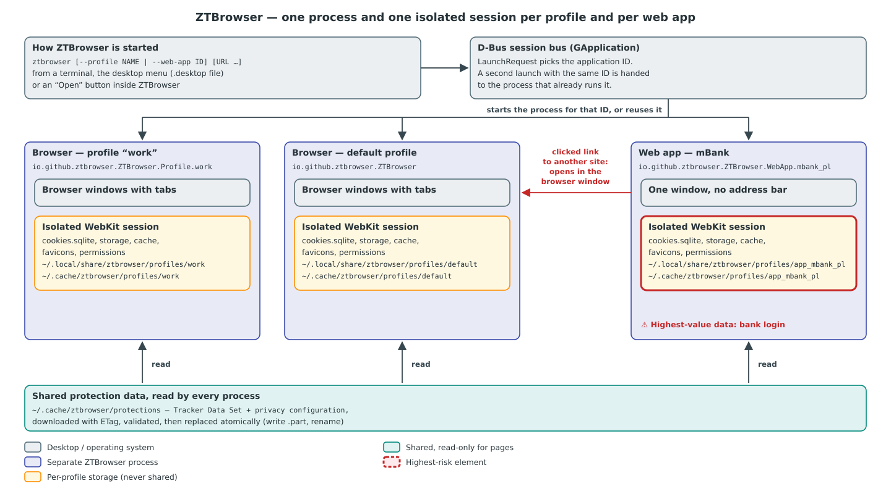

# ZTBrowser Architecture

This document explains how ZTBrowser is built and why it is built that way. It is written for a reader who
knows some programming but has never worked on a web browser. Every term that is not common knowledge is
defined in [Vocabulary](#2-vocabulary).

## 1. The problem

Most websites load code from companies whose business is following people from site to site: analytics,
advertising and "social" widgets. On Linux, the browsers that block this well are Chromium-based (Brave)
or Firefox-based, and both accept extensions, which are themselves a way to read every page you visit.

DuckDuckGo publishes its tracker protections as open source for its macOS browser: the list of trackers,
the rules that decide what to block, the per-site exceptions that keep sites working, and the scripts that
fight fingerprinting. That browser uses **WebKit**, the same engine Linux has as **WebKitGTK**. ZTBrowser
puts those protections into a WebKitGTK browser for Linux, with **no extension support at all**.

Two more goals shape the design:

- **Isolated profiles.** "Work" and "Private" never share a cookie, a login or a cache.
- **Any site as an app.** mBank, Gmail or any other site can be installed as its own desktop application,
  with its icon in the application menu. Each app gets a session of its own, so a phishing link clicked in
  the browser can never reach the bank's login. Brave's web apps (PWAs) share the browser profile's cookies,
  which is weaker.

## 2. Vocabulary

| Term | Meaning |
|---|---|
| WebKitGTK | The Linux edition of WebKit, the engine that downloads, renders and runs web pages. ZTBrowser uses its GTK 4 API, `webkitgtk-6.0`. |
| Content blocking rule | A JSON rule WebKit compiles and checks before a request leaves the machine: "if the URL matches this pattern, block it" (or upgrade it to HTTPS). Rules are grouped in *rule lists*. |
| Tracker Data Set (TDS) | DuckDuckGo's list of tracking domains, who owns them and which of their requests are allowed. Licensed CC BY-NC-SA 4.0, so ZTBrowser downloads it and never ships it. |
| Privacy configuration | DuckDuckGo's switchboard: which protection is on, and on which sites it must be off because it breaks them (*exceptions*). |
| Content Scope Scripts (C-S-S) | DuckDuckGo's JavaScript that runs inside every page and frame to block fingerprinting and announce GPC. Apache-2.0, version 20.0.0 is vendored in `assets/`. |
| GPC (Global Privacy Control) | A signal telling websites "do not sell or share my data"; legally binding in some US states. |
| ITP (Intelligent Tracking Prevention) | WebKit's built-in limits on cookies and storage of sites classified as trackers. |
| HTTPS upgrade | Loading `https://` when a page asks for `http://`, so nobody on the network can read or change the page. |
| Tracking parameter | A query parameter added to links to follow the click, such as `utm_source`, `fbclid` or `gclid`. |
| Profile | A separate browser identity with its own cookies, storage, cache, history and site permissions. |
| Web app (PWA) | A site installed as a desktop application: its own window, icon and menu entry. |
| Public suffix, registrable domain | `co.uk` and `github.io` are *public suffixes*: anybody can register a name under them. The *registrable domain* is the suffix plus one label (`bbc.co.uk`). Two hosts with the same registrable domain are the *same site*. |
| Application ID | The D-Bus name of a running GTK application, e.g. `io.github.ztbrowser.ZTBrowser`. GTK starts only one process per ID. |
| Desktop entry | A `.desktop` file in `~/.local/share/applications` that puts an application into the desktop's menu. |
| Fire | The button that erases a profile's browsing data in one click. |
| ZTBrowser Guard | ZTBrowser's own protections on top of DuckDuckGo's: community filter lists, the fingerprinting defences DuckDuckGo leaves off, and the GPC header (§5.6). |
| Filter list | A text file of blocking and hiding rules in Adblock Plus syntax (`\|\|ads.example^` blocks a domain, `##.ad` hides elements, `@@` marks an exception), maintained by volunteers. uBlock Origin, Brave and AdGuard read the same lists. |
| Fingerprinting | Recognising a browser without cookies, from what it gives away: how it draws a canvas, how its audio stack rounds numbers, its screen and fonts. |
| Link-click ping | The request `<a ping="…">` sends when a link is clicked, telling the site's analytics which link it was. |
| Tor | An anonymity network of volunteer relays. A connection is passed through three of them (a *circuit*: guard, middle, exit), each knowing only its neighbours, so the site sees the exit's address and nobody on the way sees both you and the site. |
| Onion service | A site reachable only inside Tor (`….onion`, RFC 7686). The connection never leaves Tor and is encrypted end to end, even over plain `http://`. |
| Bridge, pluggable transport | A *bridge* is an unlisted Tor relay for networks that block the listed ones. A *pluggable transport* (`obfs4`, `snowflake`, `webtunnel`, `meek_lite`) is a program that also disguises the connection to it. |
| SOCKS port, control port | The two local ports of a running `tor`: applications send their connections through the *SOCKS port*; the program that owns Tor configures and watches it over the *control port*. |

## 3. Two crates

The code is split into two Rust crates, and the dependency points one way: `ztbrowser` → `ztbrowser-core`.

- **`crates/ztbrowser-core`** holds the domain logic: building rule lists from the TDS, reading the privacy
  configuration, deciding HTTPS upgrades, finding tracking parameters, parsing the command line, cataloguing
  profiles and web apps, choosing icons, writing desktop entries and naming downloads. It knows nothing about
  GTK or WebKit, so every rule is checked by fast unit tests (`cargo test -p ztbrowser-core`).
- **`crates/ztbrowser`** is the GTK 4 + libadwaita application. Its types are adapters: they take a decision
  from the core and carry it out through WebKitGTK, libsoup (HTTP) or GIO (files, processes).

The engineering rules for both crates (Object Oriented Programming First, OO Given/When/Then tests, one
`use` per item) are in [engineering-rules.md](../engineering-rules.md).

## 4. Processes and isolation

Every profile and every installed web app runs as **its own process with its own application ID**:

| What runs | Application ID | Profile directory |
|---|---|---|
| Browser, default profile | `io.github.ztbrowser.ZTBrowser` | `profiles/default` |
| Browser, profile "work" | `io.github.ztbrowser.ZTBrowser.Profile.work` | `profiles/work` |
| Web app "mBank" | `io.github.ztbrowser.ZTBrowser.WebApp.mbank_pl` | `profiles/app_mbank_pl` |
| Tor window | `io.github.ztbrowser.ZTBrowser.Tor` | none: the session lives in memory (§4.1) |

`LaunchRequest` (core) turns the command line `ztbrowser [--profile NAME | --web-app ID | --tor] [URL …]` into one of
these IDs. GTK then asks D-Bus whether that ID already runs: if it does, the new command line is handed over
to the running process (which opens the URL in a window) and the new process exits.

Each process owns exactly one WebKit *network session* stored in the profile's directories
(`~/.local/share/ztbrowser/profiles/<id>` and `~/.cache/ztbrowser/profiles/<id>`). It holds the cookie
database, local storage, IndexedDB, cache, favicons and HSTS records. Third-party cookies are refused and ITP
is on. Nothing in this session is ever visible to another profile or app.

**Why one process per profile, not several sessions in one process?** An operating-system process boundary is
the strongest separation Linux offers without containers: a crash, a memory leak or a WebKit bug in the
bank app cannot touch the browser. The desktop also sees each app as a separate application (its own dock
icon, window grouping through `StartupWMClass`), which is what "install as app" promises.

The only shared data is the **protection feed** in `~/.cache/ztbrowser/protections`: the TDS, the privacy
configuration and Guard's filter lists (`filter-lists/*.txt`). Every process reads it. A download replaces a file atomically (write `name.part`, then
rename), so a process never reads half a file.

Before deleting a profile or uninstalling an app, ZTBrowser asks D-Bus whether its application ID is still
running (`RunningInstances`) and refuses to delete data that a live process uses.

### 4.1 The Tor window

`ztbrowser --tor` (also the menu's **New Tor Window**, `Alt+Shift+N`, or the desktop entry's action) opens a
**Tor window**: a browser window whose every request goes through Tor, so the sites it visits see a Tor exit
relay's address instead of the user's. It is a process of its own, `io.github.ztbrowser.ZTBrowser.Tor`, like a
profile, but it has no profile directory: its session lives in memory and is gone when the process ends.

**ZTBrowser's own Tor, never the system's.** The process starts its own `tor` program and nothing else on the
machine uses it; a system-wide Tor service is neither needed nor touched. `TorPrograms` (core) looks for `tor`
first in `lib/ztbrowser/tor/` next to ZTBrowser's `bin/` (where the Debian package and the AppImage put their
copy), then in `/usr/bin`, `/usr/sbin` and `/usr/local/bin`. It never searches `PATH`: a program planted in a
user-writable directory on the `PATH` must not become the Tor window's Tor. `TorConfiguration` (core) writes
the configuration file, and Tor starts as `tor -f <data directory>/torrc --defaults-torrc /dev/null`, so
neither `/etc/tor/torrc` nor a defaults file can change it. Tor runs as a client only, picks free loopback
ports for SOCKS and control itself (`auto`), writes the control port into a file ZTBrowser waits for, protects
the control port with a cookie file, and exits when ZTBrowser does (`__OwningControllerProcess`, and the
control connection takes ownership with `TAKEOWNERSHIP`). Its data directory,
`~/.local/share/ztbrowser/tor`, persists: it keeps Tor's entry guards (choosing new ones every run would make
meeting a malicious one likelier) and the cached relay directory, which makes later connections take seconds.

**Following the connection.** `TorConnection` (app) starts Tor, reads the control port file, proves access
with the cookie (`AUTHENTICATE`), takes ownership, subscribes to client status events and asks where Tor
listens for SOCKS. `ControlReplyReader` (core) assembles Tor's reply lines, `BootstrapStatus` reads the
`BOOTSTRAP PROGRESS=… SUMMARY=…` reports and `TorEndpoint` accepts only loopback addresses. Every window of
the process covers its tabs with the connection page (`TorConnectionPage`), showing how far Tor got and any
problem it reports, until Tor reaches 100 %; then the session is told the proxy address and the tabs appear.
If Tor fails to start or stops later, the page returns with the reason and **Try Again**.

**Fail closed.** Nothing leaves the window before Tor is connected, and nothing ever goes around it.
`ProfileSession::start_tor` builds a session whose loads wait until protection is active *and* the route
through Tor is set; the `HttpClient` that downloads protection data holds its requests until then too. There
is no fallback to a direct connection. Whenever Tor is not connected (before it first connects, while it
restarts with other bridges, after it stopped) the session's proxy is `ClosedProxy`: a loopback port that
ZTBrowser itself holds for as long as it runs and that closes every connection at once. Addresses opened in
the meantime wait for Tor; requests of pages already open (their own requests, a reload, a followed link)
fail at once and show the error page, whose **Try Again** loads them once Tor is back. No other local program
can take over a freed Tor port to read them. Measured on the AppImage: after Tor was killed, a request
through `ClosedProxy` was refused within 4 ms and a reload ended on the error page.
Host names travel inside the SOCKS request (GLib's SOCKS5 client sends names, not addresses), so Tor
resolves them and the system's DNS resolver never learns which sites the window visits. Measured on the
AppImage while it opened DuckDuckGo's onion service: for 60 seconds, sampling every 0.2 s, the UI and WebKit
network processes held connections only to Tor's SOCKS and control ports on 127.0.0.1, and none to
`systemd-resolved` (sampling can miss a very short-lived socket, so this is evidence, not proof).

**Nothing on disk.** The WebKit session is ephemeral: cookies, storage, cache and HSTS records are kept in
memory. Site zoom, sites with protections off and the search engine are kept in memory too
(`StoredFile::discarded`). The compiled rule lists and the window's own copy of the protection data go to
`$XDG_RUNTIME_DIR/ztbrowser/tor-session` (memory that the system empties at logout) and are deleted at start
and on quit, because the rule lists name visited sites (hosts that failed over HTTPS, sites with protections
off). The protection data is copied from the profiles' cache without its `ETag` files, the Tor window's
client never sends an `ETag`, and its downloads never go into the profiles' cache: a validator that a server
handed to one side would otherwise let it link the Tor window to the user's direct connection. Only Tor's own state and the bridge choice
(`tor-connection.json`) are stored.

**Leaks and linking.** WebRTC and media capture are off: WebRTC sends its own UDP traffic around any proxy and
can reveal local addresses. The window asks sites for English (`Accept-Language: en-US`), as Tor Browser
does, because the system's language would set its users apart. Onion services are never upgraded to HTTPS
(`DomainName::is_onion`) and their plain `http://` pages show the padlock in this window only, since Tor encrypts them end to end.
The address bar searches DuckDuckGo's onion service. Web apps, profiles and the search engine choice are not
offered: they would take browsing out of Tor. For the same reason links to other applications (`mailto:`,
`zoommtg:` and the like) do not open from the Tor window, and location requests are refused without asking:
the location would give away what Tor hides.

**New Identity.** In the Tor window the Fire button gives a new identity: it deletes all of the session's data
(HSTS included), closes the tabs, sends `SIGNAL NEWNYM` (new circuits for new connections) and moves the
session to new SOCKS credentials (`identityN:tor`). Tor puts connections with different SOCKS credentials on
different circuits (`IsolateSOCKSAuth`, on by default), so nothing that follows shares a circuit with what
came before.

**Bridges.** Where Tor is blocked, **Tor Connection…** (menu or connection page) offers Snowflake, obfs4 with
the bridges Tor Browser ships (`BuiltInBridges`, copied from `tor-browser-build`), or bridges the user pastes.
`BridgeLine` (core) accepts a pasted line only in the exact shape of a bridge line: the lines end up in Tor's
configuration file, where a line break, `#` (a comment) or `\` (a line continuation) could otherwise smuggle in
options of their own. Saving the choice restarts Tor with it. `TorPrograms` finds the transport programs
(`lyrebird` or `obfs4proxy`, `snowflake-client`) in the same directories as `tor`, and the dialog names the
package to install when one is missing.

**Packages.** The Arch and Fedora packages depend on the distribution's `tor`, which starts no system service
by itself. Debian's `tor` package would start a system-wide Tor service at every boot, so the Debian package
carries Debian's own `tor` build in `/usr/lib/ztbrowser/tor` instead (its libraries are ordinary package
dependencies) and recommends `obfs4proxy` and `snowflake-client`. The AppImage carries `tor`, the libraries it
needs except the C library, `obfs4proxy` and `snowflake-client`, with their licences in
`usr/share/doc/ztbrowser/third-party`. Measured on the AppImage: Tor connected directly in about 5 s, through
the built-in obfs4 bridges in about 30 s and through Snowflake in about 50 s, and `check.torproject.org`
confirmed each time that the window was using Tor.

## 5. From DuckDuckGo data to protected pages

### 5.1 Downloading the data

`ProtectionFeed` downloads `macos-tds.json` and `macos-config.json` from `staticcdn.duckduckgo.com` through
`HttpClient` (libsoup, the HTTP library WebKitGTK itself uses). The network is treated as hostile:

- the request carries no cookies, has a 30-second timeout and stops reading after 32 MiB;
- a reply replaces the cached copy only if it is valid JSON with the expected top-level key (`trackers`,
  `features`);
- refreshes send the stored `ETag`, so an unchanged file costs one tiny request; they run every 12 hours,
  and every 30 seconds while a profile has no protection data at all.

Pages do not load until protections are active (`ProfileSession::when_protected`), so the first page of a
new profile is never loaded unprotected.

`FilterListFeed` downloads Guard's filter lists under the same rules (§5.6). Both feeds share `FeedDocument`,
which keeps the last good copy of one document and replaces it only with a download it recognises.

### 5.2 Three rule lists

WebKit's `ignore-previous-rules` action (an exception) only cancels rules *of its own list*. ZTBrowser
therefore builds three separate lists, so the exceptions of one feature cannot disable another feature:

1. **`trackers`** — `ContentBlockerRulesBuilder`, a port of DuckDuckGo's `TrackerRadarKit`, blocks
   third-party requests to tracking domains, honouring the TDS allow-rules, the configuration's
   `contentBlocking` exceptions, the tracker allowlist, and the sites the user switched protection off for
   (shield button; in a web app, *Protect This Site* in its menu).
2. **`https`** — `HttpsUpgradePolicy` emits one `make-https` rule for every `http://` URL, followed by
   exceptions for IP addresses, single-label and local names (`localhost`, `.local`, `.lan`, `.internal`,
   `.home.arpa`), the configuration's `https` exceptions and hosts whose upgrade failed before. Every
   exemption pattern ends at the host and an optional port, so user info cannot pose as an exempt host:
   `http://localhost:1@example.com/` goes to `example.com` and is upgraded.
3. **`links`** — `TrackingParameterRemover` emits one rule per tracking parameter that blocks a *top-frame
   document* navigation carrying it, except on the sites the configuration exempts.

`PageProtections` compiles each list with WebKit's `UserContentFilterStore`. Compiling the tracker list takes
about a second, so the compiled result is kept on disk next to a fingerprint (hash) of the source; an
unchanged list is loaded instead of compiled. ZTBrowser Guard adds three more lists of its own (§5.6).

Even an unchanged tracker list costs something: building its 7,000 rules and serializing them (4.7 MB of
JSON) to compute the fingerprint takes 0.1–0.2 s of processor time, more on a busy machine. That work runs
on a worker thread (`gio::spawn_blocking`), and a start does not wait for it: like DuckDuckGo's macOS app,
the session first activates the tracker list compiled last time, so pages load at once, and swaps in the new
list when it is ready and differs. The `https` and `links` lists are always built fresh before the first
page — they take well under a millisecond, and a stored `https` list could still exempt hosts the user
allowed to load insecurely in an earlier session. Only the very first start, with nothing compiled yet, waits
for the whole compilation.

### 5.3 Reacting to blocked and failed loads

The rules act before a request leaves the machine. Two of them need help from the page afterwards
(`PageView`):

- **Tracking links.** When the `links` list blocks a navigation, WebKit reports a failed load with a policy
  error. `PageView` then loads the same address with the tracking parameters removed. A guard remembers the
  last cleaned address, so a disagreement between rule and cleaner can never cause a loop.
- **Sites without HTTPS.** When an upgraded load fails, a banner says "*host* does not offer a secure
  connection" with a **Load Insecure Page** button. Only after that click is the host added to the profile's
  failed hosts, the `https` list rebuilt and `http://` loaded. Falling back silently would let an attacker on
  the network force any site down to plain HTTP by breaking its HTTPS.

**Error pages.** Every other failure gets an ZTBrowser error page instead of WebKit's built-in one, which is a
bare heading on white. WebKit, libsoup and GLib report failures as error codes from several domains: the
resolver, I/O, TLS, and WebKit's own network and policy errors. `ErrorPageView` (app) turns these codes into a
few causes a person can act on (`FailureCause` in core):

- offline;
- host not found;
- connection refused, timed out or interrupted;
- restricted port;
- untrusted certificate, with each reason;
- page crashed or out of memory;
- an HTTP error status with an empty body;
- file not found.

The page names the problem in one heading, says which site it concerns and lists what to check. It offers
only actions that help: Try Again or Reload, a search with the profile's search engine for a host that does not
exist, and Go to Home Page for an empty 404. It is drawn in the browser's current light or dark style with the desktop's accent
colour. The page is loaded as WebKit's *alternate HTML* for the failed address, so the address bar, Reload and
Back behave as for the page that failed.

Four details matter:

- An error status with `Content-Length: 0` is stopped at the response policy. The load then fails and its
  error page takes the history entry, like any other failed load. Shown after the empty page, it would add a
  second entry, and Back would return to the empty page and explain it again, forever.
- Certificate failures arrive through `load-failed-with-tls-errors` with every reason GLib found. The page
  lists them all. There is no "proceed anyway": WebKit never loads such a page, and offering a bypass would
  train users to click through the warning an attacker relies on.
- A connection to a server that never answers is cancelled by libsoup (`G_IO_ERROR_CANCELLED`), not timed out.
  It is therefore explained as a time-out, while a load the user stopped (`WEBKIT_NETWORK_ERROR_CANCELLED`)
  shows nothing.
- The address bar shows no padlock and no install button over an error page, since the page proves nothing
  about the connection. Plain HTTP keeps its warning: the page runs in the site's origin, so the site's other
  windows can still rewrite it.

The page runs in the failed site's origin, so it must not be able to harm anyone. Everything taken from the
failure is HTML-escaped: the address, the host and GLib's message. The template is filled in one pass, so a
value containing `{{…}}` is never expanded. A Content Security Policy (`default-src 'none'`) forbids scripts,
forms and every remote load. Retry links are only emitted for `http`, `https` and `file` addresses.

### 5.4 Content Scope Scripts, GPC and cookies

`ContentScopeScript` fills the C-S-S template with the privacy configuration, the user's unprotected sites
and the preferences (GPC on, a random session key and message secret per process, the UI language). It runs
at document start in every frame, in the page's own JavaScript world, as DuckDuckGo's macOS app does. The
configuration it embeds has Guard's fingerprinting defences switched on (§5.6).

Because every frame parses the embedded configuration again, `ContentScopeScript` embeds only the features
the bundled `apple` build runs (`platformSupport.apple` plus their `featureConfigDependencies`). The bundle
itself discards all other features first thing (`pruneConfigFeatures`), so the result is identical, but each
frame now reads about 165 KB of configuration instead of 840 KB (`autoconsent` alone is 520 KB) and the script
shrinks from 1.36 MB to 0.67 MB. A test reads that feature set out of the vendored bundle, so updating C-S-S
cannot silently drop a feature. Its messages arrive at the `contentScopeScripts` handler, which answers notifications with `{}` and requests
with an error object, since ZTBrowser implements none of the native features they ask for.

### 5.5 Fire

The Fire button (in each window's header) closes the profile's other windows and erases all of the
profile's website data — cookies, storage, cache, favicons, the zoom given to sites — except the **HSTS** records: those remember
which sites demand HTTPS, and forgetting them would only weaken the next visit. The current window then
starts over with an empty tab.

### 5.6 ZTBrowser Guard

DuckDuckGo's rules block the trackers DuckDuckGo has catalogued, and only when they load as a third party.
Brave Shields also read community filter lists, which is why Brave blocked more in our measurement. Guard
closes that gap and goes past it in four ways: more lists, rules that also apply to a site's own requests,
fingerprinting defences DuckDuckGo leaves off, and the GPC header.

**Filter lists.** `FilterListFeed` downloads nine lists from their publishers. Several of their licences do not
fit ZTBrowser's GPL-3.0-or-later package: CC BY-NC-SA 4.0 forbids commercial use and CC BY-SA 3.0 is
incompatible with the GPL. So, like the TDS, they are never bundled:

| List | Blocks | Licence |
|---|---|---|
| EasyList | ads | GPL-3.0 or CC BY-SA 3.0 |
| EasyPrivacy | trackers and analytics | GPL-3.0 or CC BY-SA 3.0 |
| uBlock filters, Privacy, Badware risks | ads, trackers, scam and malware sites | GPL-3.0 |
| uBlock filters – Unbreak | nothing: exceptions that repair sites the other lists break | GPL-3.0 |
| Peter Lowe's list | ad and tracking servers | the publisher's terms (pgl.yoyo.org) |
| Polish Filters | the ads of Polish sites | CC BY-NC-SA 4.0 |
| EasyList Cookie List | cookie consent notices | CC BY 3.0 |

A download replaces the cached copy only if its first line is a list header or comment, so a hotel Wi-Fi login
page served in its place is rejected. One list that fails to refresh keeps its old copy and does not stop the
others.

`GuardRuleList` (core) groups the lists into three WebKit rule lists: `guard-ads` (EasyList, uBlock filters,
Badware risks, Peter Lowe, Polish Filters), `guard-privacy` (EasyPrivacy, uBlock Privacy) and
`guard-annoyances` (the cookie list). There are three for the same two WebKit limits that separate DuckDuckGo's
lists: a list holds at most 150,000 rules, and an exception only cancels rules of its own list. That is why
uBlock's Unbreak exceptions are read into every list, and why every list ends with one rule that stands it down
on the sites the user switched protection off for. Brave's `adblock` crate (MPL-2.0, the converter Brave uses
for its iOS browser) turns Adblock Plus syntax into WebKit JSON. Filters without `$third-party` also apply to a
site's own requests and pages; Brave Shields do that only in their "aggressive" mode. `guard-privacy` also
blocks every link-click ping.

Three findings shaped the conversion:

- `adblock` closes its output with an exception for first-party documents, so that no filter can block the page
  the user asked for. WebKit decides which elements a page hides on that same load, so at the end of the list
  the exception cancels every element-hiding rule. In a test page, a hidden `.ad_banner` stayed visible
  until `GuardRuleList` moved the exception ahead of the first hiding rule.
- WebKit rejects a list of more than 150,000 rules, and also an empty one ("Empty extension"). Should lists
  outgrow the limit, `GuardRuleList` drops blocking rules just before the first exception and keeps every
  exception. A list with nothing downloaded is not compiled at all (`has_rules`).
- WebKitGTK files `navigator.sendBeacon` under `raw`, with every other script request, and only `<a ping>`
  under `ping`. Beacons to known trackers are blocked by address like any request. Blocking all beacons
  would also drop what web apps send when a tab closes (a draft, a read receipt), so Guard does not.

**Compiling without slowing pages down.** Converting the three lists takes 0.2 s of processor time and about
75 MB of memory at its peak. Compiling them in WebKit takes about 9 s. Neither may delay a page, so a Guard list
is identified by a **fingerprint of its inputs**: the texts of its filter lists, the user's unprotected sites and
a conversion revision. Computing it takes under a millisecond. When the stored compiled copy was made from the
same inputs, it is loaded and nothing is converted: a start with unchanged lists protects pages in 0.5 s. When
a list changed, it is built on a worker thread and compiled in the background, and the previous compiled copy
protects pages in the meantime. The user's shield is the exception, in both directions, because every Guard
list carries the user's unprotected sites. When the user switches protection off for a site, the previous copy
would go on blocking that very site, so the changed Guard lists are left out for those few seconds while
DuckDuckGo's lists stay active, and the page reloads at once. When the user switches it back on, the previous
copy still exempts the site, so the page reloads only once the new lists are compiled, about 10 s later.
Rebuilds overlap (a background list refresh can start while the lists of the user's click still compile), and
a newer rebuild supersedes an older one. So these promises, a reload and Guard left out, are kept by the profile
(`PendingRuleChanges`), not by the rebuild that made them, and whichever rebuild activates the rules keeps them.
Without this, a refresh that landed during those seconds made the reload vanish. Serialising rules one by one,
instead of building a
`serde_json::Value` of the whole list first, cut the peak memory from 243 MB to 84 MB. This matters because
glibc keeps the memory of the worker thread.

**Generic element hiding, applied lazily.** WebKit matches every `css-display-none` selector of a content
blocker against every element at every style recalculation. Guard's lists hold about 30,000 generic selectors
(`##.ad-banner`, naming no site), and with them a full style recalculation of a 10,000-element page took 229 ms
instead of 35 ms. So `GuardRuleList` keeps generic hiding out of WebKit and stores it as
`<list>.generic-hiding.json` (`GenericHiding`, indexed by the class or id a selector needs). Guard's page script
(`assets/guard/generic-hiding.js`) runs in its own script world and works in four steps:

1. At document start it checks one probe rule per list. WebKit hides the probe wherever that list applies, so
   exceptions and the user's shield are decided by WebKit itself.
2. It reports the classes and ids the page uses to the `ztbrowserGuard` message handler.
3. It inserts the answer into an adopted style sheet.
4. It tests the selectors that no class or id narrows down on elements as they are added.

Two things `adblock`'s WebKit conversion drops are honoured here: `$generichide` exceptions and `#@#` element
exceptions. Measured after the change (normalised to a fixed JS workload): layout 0.64 and style recalculation
0.20 with Guard, against 0.66 and 0.25 without it. The excluded domains of a generic selector are compared with
the host of the frame the script runs in.

**Fingerprinting defences.** DuckDuckGo's macOS configuration leaves the canvas, audio, battery, screen size,
temporary storage and referrer defences of C-S-S off, because Safari's WebKit adds noise of its own on macOS;
WebKitGTK does not. `FingerprintHardening` (core) switches them on and keeps DuckDuckGo's site exceptions
(for example banks whose fraud checks read the canvas) and settings. Canvas noise also waits for the
`additionalEnabledCheck` setting, which DuckDuckGo's macOS configuration does not contain. Measured: canvas and
audio readouts differ in every session, and stay identical within a page, so sites that draw do not break.

**GPC header.** C-S-S only sets `navigator.globalPrivacyControl`, which a site's servers never see. WebKit's
`GlobalPrivacyControl` feature, off by default, sends `Sec-GPC: 1` with every request. That header is the form
laws such as California's CCPA recognise. Measured: the header arrives.

**Measured against Brave.** Twelve news, shopping and weather sites (six Polish, six international) were loaded
once each through a logging proxy, which records only the host names a browser connects to. A host counts as a
tracker when Disconnect's list files it under advertising, analytics, fingerprinting, social or cryptomining.
"Third-party" means any host outside the visited site's registrable domain.

| Browser (November 2026) | Tracker hosts | Third-party hosts |
|---|---|---|
| Brave 1.98.63, Shields at their default ("standard") | 6 | 82 |
| ZTBrowser before Guard (DuckDuckGo protections only) | 14 | 146 |
| ZTBrowser with Guard | 3 | 70 |

The three hosts that still got through are `pub.doubleverify.com` (BBC) and `securepubads.g.doubleclick.net`
(weather.com), which Brave let through as well, and `m.stripe.network` (CNN), Stripe's fraud check for payments.
Brave's CNN load reached no third-party host at all, which looks like the site refusing a headless browser. Leaving
CNN out of both sums, the figures are 6 / 82 for Brave and 2 / 57 for Guard. This is one load per site, not a
benchmark, but it shows the direction: Guard contacts half as many trackers as Brave.

**What Guard does not do.**

- uBlock Origin's scriptlets (`##+js(…)`) and `$redirect`, `$removeparam` and `$csp` filters have no content
  blocker equivalent and are dropped in conversion. Brave runs scriptlets.
- Pages can still probe which fonts are installed. WebKit's `ShouldAllowUserInstalledFonts` flag made no
  difference, since Linux distributions install fonts system-wide. Brave limits fonts in its standard mode.
- AdGuard's Tracking Protection list (406,000 rules) exceeds WebKit's limit for one list.
- Each profile and web app compiles its own copy of the Guard lists, about 67 MB in its cache directory.

## 6. Web apps

**Installing.** "Install Site as App" (the button at the right end of the address bar on every web page, or
the window menu) reads the page's title, manifest link and icon links with a script
running in an *isolated JavaScript world*, which the page itself cannot see or tamper with. The manifest and
icons are downloaded without cookies, with size limits (512 KiB manifest, 2 MiB icon). Only PNG icons are
decoded, and only after `PngHeader` confirmed sane dimensions (at most 2048 px per side), which stops
"decompression bombs". The chosen icon is re-encoded as PNG and saved. If no icon downloads, the favicon
WebKit already decoded is used. The result is a catalog entry, an icon and a desktop entry whose `Exec=` line
runs `ztbrowser --web-app <id>`.

Once installed, the app starts and the browser hands the site over to it: every browser window of the profile
closes the tab the install started from and every tab showing a page of the app (`InstalledWebApp::is_own_page`:
the same origin, meaning scheme, host and port, as the app's start address). A window left without tabs closes.
The test is deliberately narrower than the app's site: a Gmail app owns `mail.google.com`, so a Google Docs or Google
Calendar tab of the same site stays in the browser. Nothing closes if the app could not be started; the toast then
offers to open it.

**Navigating.** `WebAppNavigationPolicy` (core) decides where a navigation inside the app may go:

- a **link the user clicked** to another *site* (registrable domain) opens in the regular browser, so mail
  links and ads never run inside the bank's session;
- **redirects and script navigations** stay, because sign-in (Gmail via `accounts.google.com`) and card
  payments (3-D Secure pages) hop across sites;
- **pop-ups** opened by the app (OAuth, payment confirmation) open in a small window of the same app. They
  share the app's session, so they get the same gate, measured against the site the pop-up was opened for
  (links inside a 3-D Secure page keep working, a clicked link to a third site opens in the browser), and
  the same site indicator in their header.

Handing a page to the browser closes the window it *moved out of*, and only that one. **Open Page in
Browser** moves the app's current page, so the app window closes. A pop-up whose own page goes to the browser
closes as well, since it would only keep showing the page it left. The app window stays when a link in it
opens in the browser: the app is still on its page (a mailbox must survive clicking a link in a message), and
so does a pop-up whose link asked for a *new* window (`target=_blank`), because the pop-up's page — a payment
confirmation, say — is still needed. A window closes only after the browser was started.

Because a redirect may leave the app's site, the window's subtitle always shows the host of the page on
screen. When that page belongs to another site, the subtitle turns to the warning colour and gets an
explanatory tooltip. A bank app therefore cannot show a foreign page under the bank's name unnoticed.

The "same site" test uses the public suffix list of libsoup, the same one WebKit uses for cookies, so the
app agrees with WebKit about what a site is. Only `soup::tld_domain_is_public_suffix` is called. The
`soup::tld_get_base_domain` binding of the `soup3` crate (0.9) reads its result through a pointer into a
temporary string that has already been freed, and it crashed web apps on their first navigation.

## 7. Downloads, permissions and other applications

- **Downloads** are saved in the XDG Downloads folder under a cleaned name (`DownloadFileName`: no path
  separators, no control characters, no leading dots, at most 255 bytes, `name (2).ext` instead of
  overwriting). They are never opened automatically; the toast offers "Show in Folder".
- **Permissions** (location, notifications, clipboard, camera, microphone, screen sharing, storage access)
  are asked every time in a dialog and never granted silently. Pointer lock is allowed; everything else is
  denied.
- **Other schemes** (`mailto:`, `tel:`, `zoommtg:` …) are handed to the desktop only after a real user
  gesture, so a page cannot open applications by itself.
- **Search engine**: DuckDuckGo by default; Brave Search or Google can be chosen per profile (window menu →
  Search Engine, saved in the profile's `search-engine.json`). `SearchEngine` decides where a search typed into
  the address bar or passed on the command line goes, which home page a new tab opens, and which engine an error
  page offers for a mistyped name. A search is an ordinary navigation, so the protections apply to the engine's
  own pages too. A stored engine ZTBrowser does not offer reads as DuckDuckGo.
- **Toolbar buttons**: *Preferences…* (window menu, `Ctrl+,`) switches each button around the address bar on or
  off per profile (`ToolbarLayout`, saved in the profile's `toolbar.json`; `ToolbarPreferences` shares it with
  every window of the process, so a switch takes effect in all of them at once). The file lists the *hidden*
  buttons, so a button added by a later version shows up by itself. The address bar and the menu cannot be
  hidden, or the preferences could not be reached again. The onion button opens the Tor window (§4.1); the Tor
  window itself belongs to no profile, shows every button and offers no preferences.
- **Page zoom** steps through DuckDuckGo's sizes (`ZoomLevel`: 50, 75, 85, 100, 115, 125, 150, 175, 200, 250 and
  300 %) with Ctrl `+`/`-`/`0` (also on the keypad), Ctrl with the scroll wheel, or the zoom row of the window
  menu. A size other than 100 % shows as a badge next to the address bar (in a web app, in the header); clicking
  it returns to 100 %. As in DuckDuckGo's macOS browser, the size belongs to the *site* (`SiteZoomLevels`, keyed
  by registrable domain, saved per profile in `site-zoom-levels.json`): every page of the site opens at it, and
  changing it resizes the site's other open tabs at once. WebKit would otherwise carry one tab's zoom over to
  every site the tab visits next. Pages that are not on the web (`file:`, `about:`) open at 100 % and are not
  remembered. Ctrl with the wheel is caught before the page sees it, so a page (a map, say) cannot use that
  gesture for itself; pinching a touchpad still magnifies the page as WebKit does.

## 8. What WebKitGTK can and cannot do (measured on 2.54)

The design above follows from these measurements; each was checked with a running WebKitGTK 2.54 before the
code depended on it.

| Finding | Consequence |
|---|---|
| The `decide-policy` signal cannot tell a main-frame navigation from an iframe one, and shows no `Sec-Fetch-*` headers. | HTTPS upgrades and link cleaning are done with content rules, not in the navigation hook. |
| `make-https` works before the request, in all frames. | It is the HTTPS upgrade mechanism. |
| `redirect` (with `remove-params`) and `modify-headers` compile but have no effect. | Tracking parameters are blocked and the page reloads the cleaned URL. |
| The `GlobalPrivacyControl` feature (status "testable", off by default) sends `Sec-GPC: 1` with every request. | Guard switches it on; it is how the GPC header is sent. |
| `block` with `resource-type: document` and `load-context: top-frame` blocks only main-frame navigations, before the request, and reports policy error 104. | This is how `links` rules work. |
| For top-frame loads `unless-domain` is matched against the destination. | Exceptions of `links` rules name destination sites. |
| `ignore-previous-rules` only reaches back within its own rule list. | Separate lists for trackers, HTTPS, links and each Guard group. |
| An `ignore-previous-rules` rule that matches a page's own document load also cancels the `css-display-none` rules before it. | Guard moves `adblock`'s first-party-document exception ahead of the hiding rules. |
| A list may hold at most 150,000 rules; an empty list is rejected ("Empty extension"); `url-filter` has no `\|` alternation. | Guard groups its filter lists into three lists and fits each under the limit. |
| `resource-type: ping` matches `<a ping>` reports only; `navigator.sendBeacon` and `fetch(…, {keepalive})` are `raw`. | Guard blocks link-click pings; beacons are blocked by address only. |
| Compiling Guard's three lists (91,000, 59,000 and 27,000 rules) takes about 3, 4 and 1.5 s. | Compiled lists are stored and reused; pages never wait for them. |
| Switching off `gtk-enable-animations` inside the application leaves `prefers-reduced-motion` of pages unchanged. | Interface animations (tabs, dialogs, banners, toasts, find bar) are off in every ZTBrowser process for a snappier interface, and sites learn nothing new about the user from it. |

## 9. Known limitations

| Limitation | Why | Revisit when |
|---|---|---|
| Tracking parameters are not removed when the page that started the navigation is on an exception list (the macOS app checks the initiator). | Content rules see only the destination. | WebKitGTK exposes the initiator in rules or the navigation hook. |
| A `POST` form whose action URL carries a tracking parameter is retried as a `GET` of the cleaned URL. | The blocked navigation is reloaded with `load_uri`. | Real breakage is reported. |
| Permission answers are not remembered. | Asking every time is the safe default. | Per-profile permission storage is designed. |
| No session restore, bookmarks or history window yet. Guard hides cookie notices but does not answer them (DuckDuckGo's autoconsent clicks "reject"), so a site that locks scrolling until answered stays locked. | Not yet built. | The next milestone. |
| Guard does not run uBlock Origin's scriptlets, nor hide which fonts are installed (§5.6). | WebKit content blockers cannot express scriptlets; WebKitGTK offers no font restriction. | WebKitGTK gains either. |
| Every translation is machine-made, Polish included (see [Interface language](interface-language.md)). | No native reviewer for 66 languages. | Contributors correct the `.po` files. |
| Every profile appears as a separate application in the dock. | One application ID per profile process. | Users prefer grouping. |
| A sign-in that starts with a *clicked link* to another site inside a web app opens in the browser. | Clicked off-site links leave the app on purpose (phishing). Most sign-ins redirect or use a pop-up and keep working. | A real app needs it; then an allowlist per app. |
| The Tor window hides the user's address, not the fact that it is ZTBrowser: its fingerprint (WebKitGTK, window size, fonts) differs from Tor Browser's, whose users are made to look alike. | WebKitGTK has no letterboxing and none of Tor Browser's uniformity patches. | Use Tor Browser when being indistinguishable among Tor users matters. |
| Sites visited under one identity share Tor circuits (Tor Browser separates them per site). | WebKitGTK sets one proxy, and with it one set of SOCKS credentials, per session. | WebKitGTK offers per-request proxy credentials. |
| The Debian package and the AppImage carry their own `tor`, updated with ZTBrowser releases, not with Debian's security updates. | Debian's `tor` package would start a system-wide Tor service. | Debian ships the program without enabling the service. |

## 10. Trust boundaries

- **Network data** (TDS, configuration, filter lists, manifests, icons) is size-limited, parsed defensively and
  validated before use. The TDS and configuration are downloaded over HTTPS from DuckDuckGo's CDN only, the
  filter lists over HTTPS from their publishers. A filter list can only block or hide: the conversion keeps no
  scriptlets, so a hostile list could break sites but never run code in them.
- **Web pages** never see the installer's collector script (isolated world). C-S-S messages get only fixed
  answers, and pages cannot open other applications without a user gesture.
- **Files** ZTBrowser writes are created with `0600` permissions in `0700` directories. They are written to a
  `.part` file first and renamed into place, so a crash cannot leave a half-written catalog.
- **Desktop entries** are generated by `DesktopEntry`, which escapes names taken from websites. A page title
  can therefore never inject a line such as `Exec=` into the file.
- **The Tor window's Tor** listens on loopback only, and ZTBrowser accepts only loopback addresses from it. Its
  control port needs the cookie Tor writes into its `0700` data directory. Bridge lines are checked token by
  token before they reach Tor's configuration file, and `tor` and its transports are run only from fixed
  directories, never found through `PATH`.
