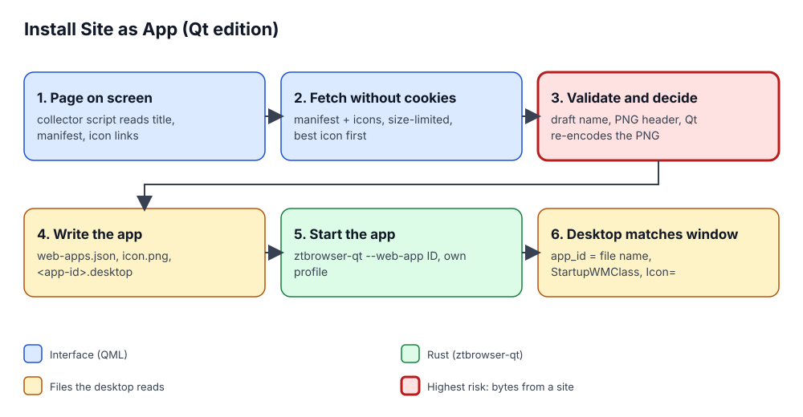

# Web apps in the Qt edition

A site can be installed as an app of its own: it gets an entry in the application menu, an icon, a window without
tabs or an address bar, and a profile that shares no cookie or login with the browser. This document describes how
the Qt edition (1.2) does it; the behaviour is the one the GTK edition had, down to the texts.

## 1. The problem

Three things have to line up for an installed web app to look right on the desktop, and the first version of any
implementation tends to miss one of them:

- the **icon** has to be a sound picture of the site (not the browser's own and not a blurry favicon when the site
  offers a 512 px one);
- the desktop has to **match the running window to the `.desktop` file** that carries that icon, or the task bar
  shows a generic Wayland or Chromium icon;
- a second launch (the application menu entry of an app that is already open, a link clicked in the app that belongs
  in the browser) must **reach the running process**, because Chromium's profile files cannot be opened twice.

## 2. Vocabulary

| Term | Meaning |
|---|---|
| **Manifest** | The JSON file a site links with `<link rel="manifest">`: the app's name, start page and launcher icons. |
| **Application id** | `io.github.ztbrowser.ZTBrowser.WebApp.<slug>`. The window announces it (Wayland `app_id`, X11 window class) and the desktop looks for `<application id>.desktop`. |
| **`StartupWMClass`** | A `.desktop` key naming the X11 window class of the app's window; it equals the application id. |
| **Isolated world** | A separate JavaScript environment of the same page: it sees the page's DOM, the page cannot see it. |
| **Single instance** | One process per application id; later launches hand their addresses over and exit. |

## 3. How it fits together

1. **Collect.** `PageMetadata::COLLECTOR_SCRIPT` runs in an isolated world of the open page and returns its title, its
   manifest link and its icon links (`WebAppInstallation.qml`).
2. **Fetch.** The interface downloads the manifest and the icons with `XMLHttpRequest`, which sends no cookies, with
   a size limit (512 KiB for the manifest, 2 MiB per icon) and a ten-second timeout.
3. **Decide and validate** (`WebAppInstaller`, `web_app_bridge.rs`). The manifest wins where it has an opinion, the
   page fills the gaps, and the start page must stay on the page's own origin (`WebAppDraft`). The icons are tried
   sharpest first (`SiteIconChoice`: regular over maskable, larger over smaller, manifest over apple-touch over
   favicon). A candidate is accepted only if its PNG header declares sane dimensions *and* Qt's own decoder reads it
   and writes it again (`reencode_png` in the engine hooks): the desktop's icon loader only ever sees bytes Qt wrote.
   The page's favicon is the last resort; a site with no usable icon gets ZTBrowser's own (`icon.svg`).
4. **Write.** The catalogue (`web-apps.json`, shared with the GTK edition), `web-apps/<id>/icon.png` and
   `~/.local/share/applications/<application id>.desktop`. The catalogue is saved last, so a failure half-way leaves
   no app that cannot start. Every value in the `.desktop` file is escaped (`DesktopEntry`): the name comes from a
   web page and must not be able to add an `Exec=` line.
5. **Start.** `ztbrowser-qt --web-app <id>` (the AppImage file when running from one) opens the app's window in the
   profile `app_<id>`. The browser then closes the tabs that showed the site.
6. **Match.** At start-up the process sets its application name, desktop file name and window icon from the app
   (`LaunchContext`, `BrowserApplication`), so the window class equals `StartupWMClass`, the Wayland `app_id` equals
   the file name, and the window carries the app's own icon.

## 4. The app's window

One page, no tabs and no address bar: back, reload, the page's title over its host, the zoom chip and a menu (zoom,
"Protect This Site", "Open Page in Browser", "Clear App Data…", "About ZTBrowser"). A clicked link to another site
opens in the browser and the app stays where it was; redirects and script navigations stay, since sign-in and
3-D Secure flows rely on them (`WebAppNavigationPolicy`). A page off the app's own site shows its host in a warning
colour, so a bank app cannot show a phishing page under the bank's name.

## 5. Decisions and rejected alternatives

- **Icons are decoded by Qt and re-encoded, not copied.** Copying a site's bytes into a file the desktop shell decodes
  would put a hostile decoder input outside the browser's sandbox.
- **Fetching in QML, deciding in Rust.** QML has an HTTP client without cookies; Rust has the policy and the tests.
  An HTTP crate in Rust would add a dependency and a second network stack for two small downloads.
- **A Unix socket for single instance, not D-Bus.** The socket needs no daemon and no extra library; it lives in the
  `0700` runtime directory and accepts only `http(s)` addresses.

## 6. The installed apps page

*Installed Apps…* in the main menu opens a tab with the installed apps as tiles (icon, name, host, *Open* and
*Uninstall*), as other browsers' apps pages do. The page is static HTML built by core's `InstalledAppsPage` from the
catalogue and loaded as text under `ztbrowser://apps`; each icon is inlined as a `data:` address, so the page needs no
file access, and a Content-Security-Policy allows no script and no network. Its links use two private schemes
(`ztbrowser-app-open:<id>`, `ztbrowser-app-uninstall:<id>`) that `BrowserTab` answers instead of navigating, and only while
that tab shows the apps page, so no other page can trigger them. Uninstalling asks first, then removes the catalogue
entry, the desktop entry, the icon and the app's cookies and storage (`InstalledWebApps::uninstall`); it refuses while the
app's window is open, which it finds by probing the app's single-instance socket. Opening, installing or uninstalling an
app refreshes an open apps page.

## 7. Not built yet

Pop-up windows an app opens (OAuth, payment confirmation) open in the app's own view instead of a small window that
keeps its opener, and the Tor window is still to come.
Revisit when the web-app plan task (Task 12 of the Qt plan) is finished.
