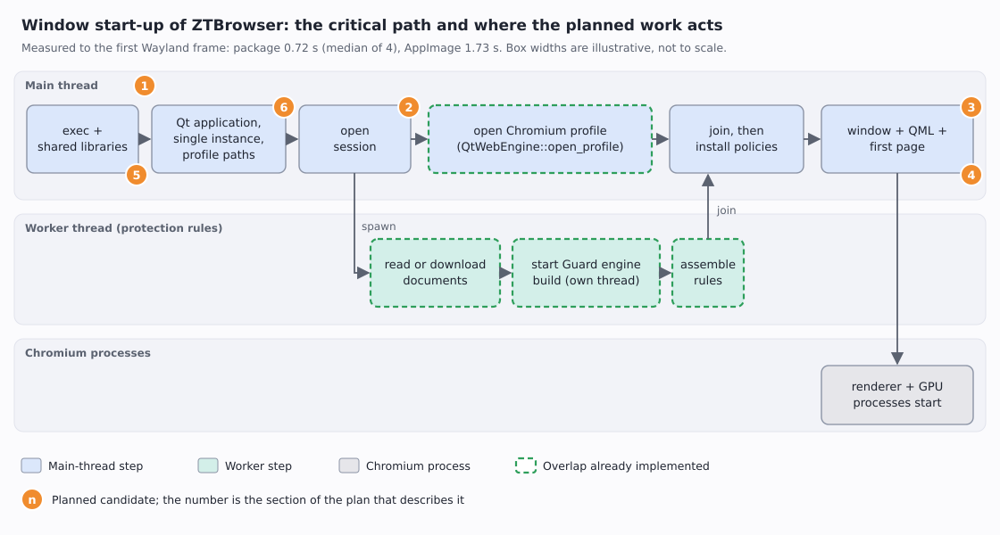

# Window start-up optimizations — plan

**Status:** proposals. **Requirement (owner, 2026-11-06): the window appears in under 0.3 s.** Nothing in sections
1–6 is approved or started; implementation begins only after explicit approval of the section it belongs to. Polish mirror: `docs/pl/plans/2026-11-06-window-startup-optimizations-plan.md`.

## The problem, in plain words

When you click ZTBrowser in the application menu, a window must appear. The time between the click and the first
picture on screen is the **time to first frame**. It is the delay a person feels, so it is what this plan tries to
shorten. A browser is slow to start for a structural reason: before it can show a page it must start a
user-interface toolkit (Qt), start Chromium (the web engine, which runs in several processes), and assemble the
privacy rules that every request will be checked against. A page must never load before those rules are in force,
so that last step cannot be skipped, only made faster or overlapped with other work.

## Vocabulary

- **First frame** — the first time the program hands a finished picture of its window to the Wayland compositor.
  Measured as the first `wl_surface#N.attach(wl_buffer#M…)` line in `WAYLAND_DEBUG=client` output.
- **Critical path** — the chain of steps that must finish one after another; only shortening a step *on* this
  path makes the whole start faster. Steps that run alongside it (in the worker thread) cost nothing until they
  become the longest chain.
- **Policies** — the objects that decide, for every request and cookie, whether it may pass (tracker rules,
  Guard's filter lists, the site allow-list). Chromium refuses everything until `QtWebEngine::install_policies`
  has handed them over; that refusal is what makes it safe to do other work meanwhile.
- **Guard engine** — the compiled form of the community filter lists (`SharedGuardEngine`); it is built on its own
  thread, and pages loaded before it is ready are not filtered.
- **AppImage / squashfs / FUSE** — an AppImage is one file holding a compressed read-only file system (squashfs).
  Starting it mounts that file system through FUSE (a user-space file-system driver) and decompresses the
  program's files on demand. A distribution package has none of that: its files are plain files on disk.
- **Cold page cache** — the operating system keeps recently read file contents in memory. A freshly mounted
  AppImage starts with nothing cached, so every launch pays the reading and decompression again.
- **Renderer and GPU process** — Chromium runs web content and graphics in separate processes, started roughly
  when the first web view is created (section 1 should confirm the exact moment).

## Baseline (measured 2026-11-06, KDE Plasma on Wayland, NVMe)

Time to first frame, interleaved runs, each with its own `XDG_*` directories and a copy of the protection cache
(so the first-start download is not counted):

| Build | Runs | Median | Range |
|---|---|---|---|
| Arch package (`/usr/bin/ztbrowser`, built with `target-cpu=native` and the Cargo profile's `lto = "fat"`) | 4 | 0.72 s | 0.55–0.89 s |
| AppImage 1.2.3 from `dist/` | 4 | 1.73 s | 1.23–2.12 s |

Earlier the same day, with another set of runs: package 0.61 s, AppImage 1.47 s, and the *same files extracted to
a directory* 0.65 s. A bare Qt Quick window opens in 0.11 s and one holding an empty web view in 0.50 s (requirement section below; the
176–275 ms in `docs/en/reports/performance-analysis.md` §4.2 are an older measurement of the GTK-era comparison),
so about 0.6 s of the package's start is more than a bare window needs and about 0.2 s more than a bare web-view window.
**Not measured yet:** the start through KDE's launcher, a second launch that only forwards to the running
instance, and where inside the 0.72 s the time goes (section 1).

## Requirement: under 0.3 s

The owner requires a start below **0.3 s**. This plan reads that as the **time to first frame** (the metric of the
baseline), not the time until a page is visible; the page cannot come that early (see below). Please confirm or
correct this reading before section 3 is approved.

**Is it reachable? Measured floors** (2026-11-06, same protocol as the baseline, 6 runs each, Qt's `qml6` runner,
so these are floors and not predictions for ZTBrowser's own start-up code):

| Minimal program | Median | Range |
|---|---|---|
| A bare Qt Quick window | 0.11 s | 0.10–0.15 s |
| A window holding an empty `WebEngineView` (`about:blank`) | 0.50 s | 0.33–0.54 s |
| ZTBrowser, Arch package (baseline above) | 0.72 s | 0.55–0.89 s |

What follows from it:

1. **QtWebEngine alone costs about 0.4 s** before a window that contains it can show its first frame. A first
   frame that waits for the web view therefore cannot meet 0.3 s, however well everything else is tuned;
   ZTBrowser is already only about 0.2 s above a bare web-view window.
2. **The target is reachable only by showing the window first and bringing the web engine up behind it** — the
   toolbar and tab strip appear, the content area is still empty. That is section 3, which the target turns from an
   option into the main work. The budget for everything on the way to that first frame (exec and dynamic linking
   of the large Chromium libraries, Qt, our QML, the single-instance check) is about 0.3 − 0.11 ≈ 0.19 s; section 1
   must measure how much of it is spent today.
3. **The page will still appear later**, after the policies are installed and the web view exists (about 0.5 s or
   more by the floor above). The plan tracks *time to page* as a second number next to the first frame, so that the
   target is never met by hiding the wait.
4. **The AppImage cannot meet 0.3 s with any option measured so far** (best: 0.65 s with the files extracted,
   section 5). Whether a window-first start also removes the AppImage's mount-and-decompress cost from the path to
   the first frame is not measured. Until it is, the requirement is read as applying to the packages.

## Already done

- **Rules and Chromium's profile overlap** (commit `4fee5c9`). The rules are assembled on a worker thread while
  the main thread opens Chromium's profile; the window opens only after both finish. The cached documents are
  read once instead of twice.
- **Guard's engine is built after the first-start download.** The overlap first built it from the cache before
  the worker had downloaded anything, so a first start would have run with empty Guard lists until the next check
  six hours later. `ProtectionUpdates::starting_protection` now builds it after the download; two scenario tests
  in `crates/ztbrowser-qt/tests/protection_updates.rs` fail if that order is lost.
- **The menu entry no longer shadows the package** (commit `d92f9a0`). An entry an AppImage wrote earlier took
  precedence over the installed package's entry and kept starting the slower AppImage; the AppImage now
  withdraws its entry when a package owns the entry system-wide.

## Tried and rejected for the AppImage (measured earlier, do not repeat)

| Idea | Result |
|---|---|
| zstd compression level 3 | −10 % start time, +28 MB |
| 1 MiB squashfs blocks | no gain |
| Reading the big libraries in the background from `AppRun` | no gain |
| lz4 compression | the type-2 runtime supports only zlib and zstd |
| Uncompressed squashfs | 0.79 s, but 542 MB |

## 1. Measure first: named milestones

**What.** Record the monotonic time at named points of the start — process start, `QGuiApplication` created,
session opened, worker started and joined, `open_profile` returned, policies installed, window created, first
frame — and print them when an environment variable asks for it. Turn the Wayland-log measurement used for the
baseline into a small committed developer tool next to `ztbrowser-test-report`, so every later number is
reproducible by anyone.

**Why.** The baseline says the package needs about 0.6 s more than a bare Qt Quick window, but not *where*.
Sections 2–4 are guesses until this breakdown exists, and a guess that shortens a step off the critical path
changes nothing. This section is the gate for 2 and 4: each starts only if its step shows up as a meaningful share
of the path to the first frame. Section 3 is required by the 0.3 s target in any case; the breakdown tells how much
of the 0.19 s budget is left for it. It also adds *time to page* as a second milestone.

**Done when.** A table in the performance report shows the share of every milestone, from at least ten runs.

## 2. Shorten what runs before the worker starts

**What.** `BrowserApplication::install_policies` calls `open_session` on the main thread before it starts the
worker. `open_session` finishes a burn the Fire button asked for and reads the profile's stored choices; the worker
needs from it only the unprotected-sites list and the session's Guard handle. If section 1 shows `open_session`
as a real cost, split it so the worker can start earlier.

**Risk.** A burn must still finish before anything opens the profile's files; the split must keep that order.

## 3. Show the window first, the page after (required for the 0.3 s target)

**What.** Today the window is created after the join, so the first frame waits for Chromium's profile, the rules
and the web view. The new order: Qt starts, the window **without any web view** is shown (toolbar, tab strip,
empty content area — the first frame), and only then does `open_profile` run next to the worker. After the join and
`install_policies` the first web view is created (its renderer and GPU processes start then) and the first page
load begins. In QML the tab's web view must therefore be created on demand (a loader that the application enables
after `install_policies`) instead of being part of the window from the start.

**Why.** The measured floors (requirement section) show that a first frame containing a web view cannot be faster
than about 0.5 s, and a bare window needs about 0.11 s. The GTK-era report proposed the same idea for its own
reasons (`performance-analysis.md` §6, proposal 2, "up to 200 ms to page").

**Risk, and the rules that stay.** Until policies are installed Chromium refuses every request, and the window
holds no web view until then, so nothing can load unprotected. The first page load must be *started* after
`install_policies`; the first start must still download before any page; the Tor window must still load nothing
before Tor is connected. A visible window with an empty content area for a few hundred milliseconds is a
user-interface decision: the empty area must look intentional (the tab's own background and the address bar
already filled), not broken, and Fire, find, zoom and downloads must not touch a web view that does not exist yet.

**Done when.** The first frame is below 0.3 s in the section 1 breakdown, and *time to page* has not become worse
than today's.

## 4. Check that the QML is compiled ahead of time

**What.** `crates/ztbrowser-qt/build.rs` lists the QML files of the interface. Qt can compile QML to bytecode or
C++ at build time (`qmlcachegen`) so that start-up does not parse and compile it; whether our build does that is
**unknown today**. Find out (Qt's QML logging categories can show whether compiled units were loaded), and if
they were not, enable it.

**Why it may matter.** The interface has about twenty QML files; parsing them at every start would be pure repeated work.
**Measure with** the milestone "window created" from section 1 before and after.

## 5. AppImage: extract once, run from the cache

**What.** The AppImage costs about one second more than the package (1.73 s against 0.72 s) because every launch
mounts the squashfs through FUSE and decompresses on demand; the same files extracted to a directory start in
0.65 s. `AppRun` could, on first start, copy the tree to `${XDG_CACHE_HOME:-~/.cache}/ztbrowser/appimage-<build>/`
(extract to a sibling directory, then rename it into place), and on later starts `exec` the cached copy.

**Costs to decide with the owner.** About 540 MB of disk per version (the uncompressed image is 542 MB), a slower
first start by the copy time (not measured), pruning of old versions, and trust: the cached tree is writable by the
person, so the same rule as for the menu entry applies (`AppImageIntegration`: only paths root or the person own
and nobody else can write). Packages remain the fast route on Arch and Fedora; this only helps the AppImage users.

## 6. Measure the launcher path and the second launch

**What.** Time the start through KDE's launcher (`kioclient exec <desktop file>`) against the direct binary, and
the time from a second `ztbrowser` invocation to the window of the instance that is already running (the
single-instance socket forwards the addresses). Nothing may need optimizing here; until it is measured, the
report would only be guessing.

## Rules every candidate must keep

- No request and no cookie may pass before policies are installed; no page loads unprotected (Chromium's refusal
  until `install_policies` is what makes overlapping safe).
- The first start still downloads the data before the first page, and Guard's engine is built from what was
  downloaded, never from an empty cache.
- The Tor window never loads before Tor is connected and never falls back to a direct connection.
- Chromium's sandbox, site isolation and GPU process stay on: no `--no-sandbox` and no `--single-process` to buy
  speed.
- Every change comes with a scenario test first (Given/When/Then), then the implementation.

## How to measure (the protocol behind the baseline)

1. Give every run its own `XDG_DATA_HOME`, `XDG_CACHE_HOME`, `XDG_CONFIG_HOME` and `XDG_RUNTIME_DIR`, so the
   person's real profiles and the single-instance socket are untouched; point `WAYLAND_DISPLAY` at the absolute
   socket path, because the private runtime directory has none.
2. Copy the real protection cache into the private cache directory, otherwise the first-start download is
   counted.
3. Start with `WAYLAND_DEBUG=client`, record the monotonic time of the process start and of the first
   `wl_surface#N.attach(wl_buffer#M` line. The log format differs between libwayland versions (`#` here, `@` in
   older ones): check one log by eye before trusting a table.
4. Interleave the builds being compared, run each at least four times (ten for a decision), report the median and
   the range, and kill the process group by its PID (never `pkill -f` with a pattern that also appears in the
   command line that runs it).

## Decision log

- The overlap was chosen because the rules and the profile are independent and were the two longest steps of the
  main thread.
- Section 3 is required by the 0.3 s target, because the measured floors rule out any first frame that waits for
  the web view. Sections 2 and 4 stay conditional on section 1: plausible optimizations, none measured, are how a
  start-up gets complicated without getting faster.
- Section 5 is a trade of disk space for speed that only the owner can make; it is listed so the choice is
  visible, not because it is recommended unconditionally.
