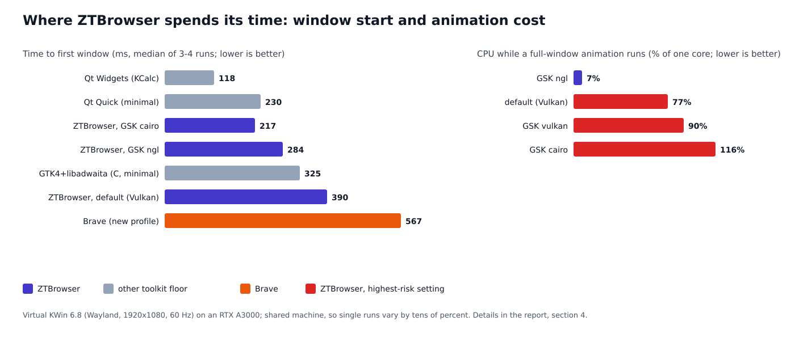

# Performance analysis: where ZTBrowser loses time, and what to change

Measured on 4 November 2026 (09:00–10:40 CET) on one Linux machine, with ZTBrowser 1.1.0. This document is an
analysis and a list of proposals. **Nothing in the code was changed**; each proposal says how its effect would be
verified before it is adopted.

## 1. What this report answers

The goal set for ZTBrowser is that it feels at least as fast as a browser on macOS: pages appear quickly, and the
window itself (tabs, menus, scrolling, resizing) never stutters. Three questions follow.

1. **Is the interface itself slow?** Measured without loading any page, and compared with other toolkits (GTK
   against Qt) on the same KDE compositor.
2. **Is page rendering slow, and does it use the graphics card as it should?** The question about video memory
   (VRAM), system memory (RAM) and the PCI Express bus is answered in §4.3 and §4.5.
3. **What is the overhead that ZTBrowser adds on top of WebKit** (filter lists, protections, the Rust code)?

The short answer is in §5; the proposals, ranked by gain, are in §6. What could not be measured, and what the
numbers do not prove, is in §7.

## 2. Vocabulary

| Term | Meaning |
|---|---|
| GTK 4, libadwaita | The toolkit ZTBrowser's window is made of. WebKitGTK, the only WebKit port for Linux, requires it, so it cannot be replaced without replacing the engine (see architecture overview). |
| Qt, Qt Quick, Qt Widgets | KDE's toolkit. Used here only as a yardstick: how fast can a trivial window appear on this desktop? |
| Compositor (KWin) | The program that puts every application's window on the screen. On KDE it is KWin. |
| Wayland | The protocol between applications and the compositor. A window is "drawn" when the application sends the compositor its first buffer. |
| GSK renderer | GTK draws its interface through a renderer: `ngl` (OpenGL), `vulkan` (Vulkan) or `cairo` (the processor, no graphics card). |
| DMABuf | A way for processes to share a buffer that lives in video memory without copying it. WebKit renders pages into DMABuf buffers; the compositor shows them. |
| VRAM / RAM / PCIe | Video memory on the graphics card / system memory / the bus between the processor and the card. |
| PSS | Proportional set size: a process's memory with shared libraries divided among the processes using them. The honest number for "how much memory does this use". |
| Speedometer 3.1 | A benchmark that runs real web-application workloads (JavaScript, DOM) and reports one score; higher is better. |
| Time to first window | From starting the program to the first non-empty buffer sent to the compositor. |
| Time to page | From starting the program to the first painted frame of a page served from the local machine (no network). |

## 3. How it was measured

**The machine.** Intel Core i9-11950H (8 cores, 16 threads), NVIDIA RTX A3000 Laptop GPU (6 GB VRAM, driver
580.196.07) plus the processor's Intel UHD graphics, 125 GB RAM, Linux 6.18, KWin 6.8.2, GTK 4.24.1, libadwaita
1.10.0, WebKitGTK 2.54.2, Mesa 26.2.4, Brave 1.98.63 (Chromium 156). KWin on the real desktop of this machine
renders on the NVIDIA card (checked with `nvidia-smi`).

**The compositor.** The development account has no access to the user's desktop session, so a private
`kwin_wayland --virtual` ran next to it: the same KWin, a virtual 1920×1080 screen at 60 Hz, real GPU
compositing on the NVIDIA card. Every program ran on it as a native Wayland client with its own temporary
`XDG_*` directories, so no real profile was touched.

**Time to first window.** `WAYLAND_DEBUG=1` prints every protocol message with a timestamp. The program was
started, and the time to its first `wl_surface.attach` of a non-empty buffer followed by `commit` was taken. No
code in any program was modified for this.

**Time to page.** A tiny local web server served a page that, after the first two animation frames following
`load`, reports back. The time from starting the browser to that report is the time to page. The same page and
method were used for ZTBrowser, Brave and a bare WebKitGTK window (`WebKit.WebView`, no protections).

**Animation cost.** A page animating a full-window element with `requestAnimationFrame` for six seconds; the
page counts its frames, and the processor time of every process of the browser is read from `/proc`. Run in a
bare WebKitGTK window with `GSK_RENDERER` set to each renderer.

**Engine speed.** Speedometer 3.1, run to completion; WebKitGTK driven by a small program with
`WebKit.WebView`, Brave driven over the Chrome DevTools Protocol.

**Memory.** PSS from `/proc/<pid>/smaps_rollup`, summed over the browser's process tree, after the program had
been idle for 6–10 seconds (sampled every 3 s for 42 s once: stable within 2 %).

**Limits of the method.** The machine is shared: other users' programs (an IDE, Brave, Teams) ran at the same
time, so a single run varies by tens of percent. Conclusions below rest only on differences larger than that
noise, and each number is a median of 3–4 runs unless stated. The profiling binary was built with the release
profile plus symbols (same optimisation, `strip = false`).

## 4. Results

### 4.1 Start-up

| Program | Time to first window | Time to page | Idle memory (PSS) |
|---|---|---|---|
| ZTBrowser, new tab (default settings) | 380–660 ms | 630–1060 ms | 656 MB, 3 processes + sandbox helpers |
| ZTBrowser, local page | | | 475 MB |
| Bare WebKitGTK window (Python, `about:blank`) | 950 ms (includes starting Python) | 540–920 ms | 341 MB |
| Brave, new profile | 405–950 ms | 330–555 ms | 385 MB (local page) |

Two facts matter more than the absolute numbers.

- **The web page's process starts at the same moment the first window appears, not before.** In the process
  timeline, `WebKitWebProcess` and its sandbox (`bwrap`, `xdg-dbus-proxy`) are created 25–40 ms after the first
  frame. The time from the window to the page (about 200–250 ms) is mostly that process starting.
- **ZTBrowser's own overhead over a bare WebKit window is about 100–200 ms to page and about 90 MB of memory**
  (475 MB against Brave's 385 MB on the same page; the main process holds about 160 MB of private memory against
  about 90 MB in the bare window). The protections (content-scope scripts, compiled rule lists, tracker data)
  explain it plausibly, but this was not profiled down to functions: see §7.

### 4.2 Is GTK in KDE too slow? (the interface without pages)

| Minimal window, Wayland, KWin | Time to first window |
|---|---|
| Qt Widgets (KCalc) | 80–150 ms |
| Qt Quick (empty window) | 176–275 ms |
| GTK 4 + libadwaita (a C program, empty window) | 319–472 ms (median 325) |
| ZTBrowser | 378–397 ms (same batch, default renderer) |

GTK 4 is about 100–200 ms slower than Qt to show its first window on this machine, and it is not the application
that makes it so: a C program with one label and a header bar takes the same 325 ms. ZTBrowser adds only about
65 ms to that floor with the default renderer. So the toolkit costs a fixed, modest amount that the program
cannot remove, and the remaining question is how it is configured (§4.3). Qt would start faster, but the
interface toolkit is not what decides the speed of a browser; and Slint cannot embed WebKitGTK at all.

### 4.3 Rendering and the graphics card

**WebKit already renders on the graphics card.** WebKit's own `webkit://gpu` page reports: hardware acceleration
policy `always`, WebGL enabled, 2D canvas accelerated, renderer **DMABuf** with hardware buffers on
`/dev/dri/renderD128` (the NVIDIA card). Pages are drawn into video memory and handed to the compositor without a
copy through the processor. There is therefore no unused VRAM to put to work, and the PCIe bus is not on the
path of a frame; `nvidia-smi` showed the link idle at Gen 1 ×16 (it raises itself when needed). Using more VRAM
or RAM would only matter for something the browser does not do: it is bound by a single thread's JavaScript and
layout speed and by how few copies a frame needs, not by memory size or bus bandwidth.

**But GTK draws its own interface with the wrong renderer for this machine.** GTK 4.24.1 chose
`GskVulkanRenderer` by default here (confirmed with `GSK_DEBUG=renderer`). The animation test, six seconds in a
full 1600×900 window:

| `GSK_RENDERER` | Frames per second | Processor use (of one core) | Time to first window |
|---|---|---|---|
| default (= vulkan) | 47–51 | 75–78 % | 378–397 ms |
| `ngl` | 58–60 | **6–8 %** | 245–284 ms (one 643 ms outlier) |
| `vulkan` | 58–60 | 86–93 % | 413–426 ms |
| `cairo` | 60 | 98–134 % | 214–220 ms |

`ngl` is about ten times cheaper than the default and loses no frames, and it also starts the window about
100 ms sooner. `cairo` starts fastest and saves about 95 MB of memory (the graphics driver is not loaded into the
interface process), but it spends a full core on the animation, so it is rejected. The cause
of the default's cost was proven later (§4.6): with the Vulkan renderer, GTK cannot import WebKit's page frames
and copies each one through main memory.

### 4.4 The engine itself

Speedometer 3.1, same machine, same compositor:

| Engine | Runs | Mean |
|---|---|---|
| WebKitGTK 2.54.2 (a bare window, so without ZTBrowser's protections) | 14.7, 17.5, 14.1 | 15.4 |
| Brave 1.98.63 (Chromium 156) | 21.8, 19.5 | 20.7 |

WebKit on Linux is about 25 % slower than Chromium on this benchmark. That gap sits in the engine, which
ZTBrowser does not control; it can only follow the distribution's WebKitGTK updates (§6, proposal 6).

### 4.5 Memory

| Process | PSS, new tab | PSS, local page |
|---|---|---|
| `ztbrowser` (interface, protections) | 458 MB first run, 302 MB when settled | 268 MB |
| `WebKitWebProcess` | 296–315 MB | 172 MB |
| `WebKitNetworkProcess` | 45 MB | 35 MB |
| Total | 656 MB (settled) | 475 MB |

The new-tab page loads a real search-engine page, which is why its web process is larger than for the trivial
local page. Memory is not what makes ZTBrowser feel slow: 125 GB of RAM is idle, and the figure is within 25 %
of Brave's on the same page.

### 4.6 A heavy real page: https://www.bpxglobal.com/ (the cause found)

The owner reported drastic stutter and slow scrolling on this page, much worse than in Brave. The page is a
WordPress site of a 1.6 MB document with a full-screen autoplaying 1080p H.264 video (13.9 Mbit/s, 38 MB, loop),
19 GSAP scroll animations, 36 `will-change` rules and 87 inline SVGs. A script scrolls it at 1400 px/s for eight
seconds in a 1600×900 window and records the gaps between `requestAnimationFrame` callbacks (the page's frames);
processor time is read per thread from `/proc`. The same script ran in Brave (CDP) in the same private compositor.

| Setup | Frames per second | 95th-percentile frame gap | Processor (of one core) |
|---|---|---|---|
| Brave 1.98 | 59.5 | 16.7 ms | 58–67 % |
| WebKitGTK, GTK default renderer (Vulkan) | 38–48 | 35–50 ms | **181–219 %** |
| WebKitGTK, OpenGL renderer (`gl`/`ngl`) | 49–60 | 19–35 ms | 56–66 % |
| ZTBrowser idle on the page (video playing) | | | 30–40 % (bare WebKitGTK: 50–61 %) |

**Cause.** `GDK_DEBUG=dmabuf` shows, for every frame (828–955 lines in eight seconds):
`Vulkan driver does not support format XR24:0x0300000000e08014` followed by `Used GskGLRenderer for downloading
1600x900 dmabuf`. `0x0300000000e08014` is an NVIDIA block-linear modifier. WebKit renders the page on the card
and hands GTK a buffer in that layout; the Vulkan renderer cannot import it, so GTK imports it into OpenGL,
**reads the frame back into main memory** and uploads it again. The per-thread view agrees: the interface
process's main thread used 65–69 % of a core and about sixteen `pool-*` threads 5 % each, where the web process
used 30 % and the compositor thread 12 %. With the OpenGL renderer the same log shows only
`Imported … dmabuf as GL_TEXTURE_2D` (no copy) and the interface process nearly disappears from the profile. The
interface process's main thread is also where scroll input arrives, so a saturated thread there also delays input
(inferred, not measured: no synthetic wheel input was available in the private compositor).

**Not the cause.** The background video (runs with and without it vary the same way, and the machine decodes H.264
on the card: `nvh264dec` and `vah264dec` outrank `avdec_h264`); software decoding (disabling the hardware decoders
changed nothing measurable); ZTBrowser's own protections (idle on this page it uses less than a bare WebKitGTK window
because it blocks trackers); the Skia painting thread counts and `WEBKIT_DISABLE_COMPOSITING_MODE` (no gain).

**Second cause (found after the first fix): Guard's page script.** With the OpenGL renderer ZTBrowser still scrolled
this page at 4 fps with frame gaps of 0.8–1.4 s, while bare WebKitGTK managed 47 fps. The web process's main thread
was at 95 % (bare: 35 %). Switching off one layer at a time (a temporary build, not kept) pinned it down:

| Switched off | Frames per second | 95th-percentile frame gap | Web process main thread |
|---|---|---|---|
| nothing | 4.2 | 760 ms | 95 % |
| Content Scope Scripts | 4.0 | 1090 ms | 94 % |
| content-blocker rules | 51.5 | 34 ms | 34 % |
| Guard's page script | 58.2 | 19 ms | 37 % |

(Without the rules Guard's script finds no list and returns at once, so those two rows measure the same thing.)
`generic-hiding.js` watches every change of an `id` or `class` and, every 50 ms, tests each changed element against
all generic selectors that name no class or id (`matches` and `querySelector` with one very long selector list).
The page's 19 scroll animations change classes on every frame, and the same element was queued again for every
change, so the tests ran thousands of times over states already tested.
**Fix:** the queue is a `Set`, and a changed element is queued only when its `id|class` state was never tested
before (hiding is permanent, so a repeated state cannot hide anything new). Same page, same protections: 57–59 fps,
95th-percentile gap 18 ms, web process main thread 18–20 %, as good as Brave (59.5 fps). Hiding still works,
including for a class that changes after load. The script has no automated test of its own yet; the check was a
page that adds, removes and re-adds `ad-banner` and reads the computed `display`.

**Left over.** With the OpenGL renderer a run lands in one of two modes, about 59 fps (p95 19 ms) or about 49 fps
(p95 34 ms, one frame in eight takes two refreshes), with or without the video, while Brave stays at 59.5 in every
run. The private compositor is a virtual 60 Hz output driven by a timer, so part of this may be an artefact of the
measurement; it has to be confirmed on the real session before any further work.

**Applied.** Proposal 1 (§6): ZTBrowser now restarts itself once with GTK's OpenGL renderer (`gl` from GTK 4.16,
`ngl` before) unless `GSK_RENDERER` is already set. In the real application the log shows `Using renderer
'GskGLRenderer'` and zero `downloading` lines; with `GSK_RENDERER=vulkan` forced, 919 of them return.

## 5. What the measurements say

1. **The biggest single cost is a configuration choice, not code.** The default GTK renderer burns about 75 % of
   a core on a trivial animation where `ngl` burns 7 %. Any scrolling, resizing or video inside the window
   goes through this path.
2. **The toolkit has a fixed start-up floor of about 325 ms** (GTK 4) against 120–230 ms for Qt. ZTBrowser adds
   only about 65 ms to it; the rest of the first-window time is the toolkit.
3. **The page appears 200–250 ms after the window because the web process is only started then.** That start-up
   can overlap with building the window.
4. **WebKit is about 25 % behind Chromium in raw JavaScript speed on this hardware.** ZTBrowser cannot change that.
5. **The graphics card, VRAM and PCIe are already in use the right way.** There is nothing to unlock there.
6. **ZTBrowser's own overhead is moderate** (100–200 ms to page, about 90 MB), real but secondary.

## 6. Proposals, ranked by expected gain

| # | Proposal | Expected gain | Cost and risk | How to verify |
|---|---|---|---|---|
| 1 | **Applied (§4.6).** Use the OpenGL GSK renderer (`gl`, `ngl` before GTK 4.16) unless the user set `GSK_RENDERER` themselves. | About 10× less processor use in the window, steady 60 fps, about 100 ms faster first window. | Small. Under `unsafe_code = forbid` the program cannot call `set_var`, so it starts itself again once with the variable set (safe `CommandExt::exec`); the `.desktop` files and the AppImage's `AppRun` set it too. Where OpenGL is unusable GTK falls back by itself. | Repeat §4.3 on the real KDE session (real monitor, perhaps 144 Hz, both the NVIDIA and the Intel card), with a scrolling real page as well. |
| 2 | Create the web view and start loading the first page before the rest of the window is built, so `WebKitWebProcess` starts in parallel with GTK's layout. | Up to 200 ms to page. | Small to medium: the order of start-up in `BrowserWindow` changes; the Tor window must still not load anything before Tor is connected. | Time to page (§3) before and after, 10 runs each. |
| 3 | Find the 90 MB and the 100–200 ms that ZTBrowser adds over a bare WebKit window, by profiling with the symbols-enabled build (sampling profiler such as `perf` or `samply`, plus a heap profiler). | Unknown until profiled; candidates are the tracker data and rule lists held in the interface process, and the scripts injected into every frame. | Needs `perf` or `samply` and a heap profiler installed (not available on the measuring machine). | Same memory and time-to-page measurements. |
| 4 | Keep the `cairo` renderer out of the product. | Avoids a trap: it starts fastest and uses the least memory, but burns a full core per animation. | None. | Already measured. |
| 5 | Do not force the discrete GPU for web content (`DRI_PRIME`). | Avoids battery cost with no gain: the compositor already renders on the NVIDIA card here; on a laptop where it does not, forcing it would move every frame across PCIe. | None. | Not needed. |
| 6 | Track WebKitGTK releases and document the minimum version; check each upgrade with the Speedometer procedure of §3. | Whatever WebKit gains. | None for the code. | Speedometer 3.1 before and after. |
| 7 | **Strategic, for the owner to decide:** a Chromium-based build (for example Qt WebEngine) would, if it matched Brave's result here, be about 35 % faster on this benchmark, but replaces the engine, drops the native-WebKit design of this project, and its privacy surface is different. | Up to about 35 % on JavaScript benchmarks (Brave's score here; a Qt WebEngine build was not measured). | A new product, not an optimisation. | Not proposed; stated so the trade-off is visible. |

Proposals 1 and 2 are small and independent. Proposal 3 needs tooling first. Release-profile settings (`lto =
"fat"`, `codegen-units = 1`) are already as aggressive as they get; `panic = "abort"` would shrink the binary and
is not expected to change speed measurably.

## 7. What was not measured, and the limits of these numbers

- **macOS was not available.** "Comparable with macOS" cannot be verified here. Safari on Apple silicon is a
  different engine build on different hardware; this report measures ZTBrowser against Brave on the same machine,
  which is the honest comparison available. Reaching macOS-level speed is bounded by WebKit's Linux port and by
  the hardware, and no proposal above promises it.
- **The compositor was a virtual one** (1920×1080, 60 Hz) on the same GPU as the real desktop. A real monitor
  at a higher refresh rate, two monitors, and fractional scaling can behave differently; proposal 1 must be
  confirmed on the user's real session before it is adopted.
- **No function-level profile.** `perf`, `strace`, `heaptrack` and `hyperfine` are not installed on the measuring
  machine, so §4.1's overhead is attributed by comparison (ZTBrowser against a bare window), not by profiling.
- **Per-frame interface latency** (menus, tab switching, resizing) was approximated by the animation test, not
  measured on the real interface.
- **Small samples** (2–4 runs) on a busy machine; the conclusions use only large differences.
- **Guard's cost on real sites** was not re-measured; the earlier report measured the render cost with Guard as
  equal to none.

## 8. How to repeat it

The scripts are small and live outside the repository (they only need Python with PyGObject, `gcc`, a private
`kwin_wayland --virtual --socket NAME`, and `WAYLAND_DEBUG=1`). The procedure of §3 is complete enough to
rewrite them; if they are wanted in the repository as a development tool, say so.
