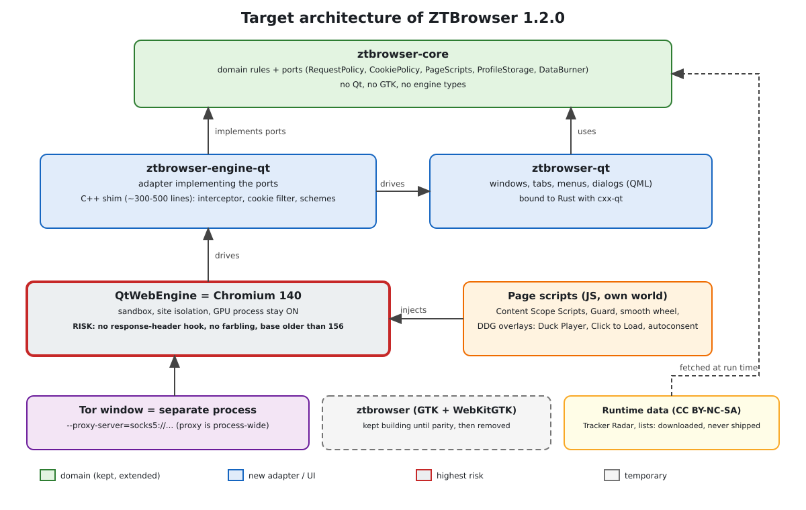

# Design: ZTBrowser 1.2.0 on QtWebEngine (Chromium)

Status: **draft for approval (builder check done, owner answers included)** · Branch: `feature/1.2.0` · Date: 2026-11-04 · Polish mirror:
`docs/pl/specs/2026-11-04-qtwebengine-migration-design.md`

## 1. Why this exists

ZTBrowser 1.1.2 is built on **WebKitGTK**, the web engine of GNOME. Over many iterations its page rendering never
felt like Brave's. Three real causes were found and fixed (a slow graphics renderer, a page script re-testing
elements on every animation frame, WebKit's abrupt mouse-wheel animation), but the last measurement, on the
owner's resolution (see §3), still shows the engine itself as the limit:

| Test (bpxglobal.com, 8 s scripted scroll, real GPU, fullscreen 3840×2160) | Brave 156 | QtWebEngine (Chromium 140) | ZTBrowser 1.1.2 (WebKitGTK) |
|---|---|---|---|
| frames per second | 59.8 | 57.7 | 43.8 |
| 95th-percentile frame gap | 16.8 ms | 16.7 ms | 35 ms |
| frames longer than 33 ms | 1 | 3 | 56 |
| memory (PSS, whole process tree) | 822 MB | 945 MB | 941 MB |

The owner decided to move to a **Chromium-based engine** and asked for a browser that is "as fast and light as
Brave, with all the optimisations and the UI exactly as it is now", whose protections go **beyond DuckDuckGo's and
Brave's** against tracking and for anonymity. The chosen route is **QtWebEngine**, which is Chromium packaged
for Qt, with the user interface rewritten in Qt.

## 2. Domain vocabulary

| Term | Meaning |
|---|---|
| **Engine** | The software that loads and draws web pages (WebKit, Chromium). |
| **QtWebEngine** | Qt's packaging of Chromium. It exposes a small API (profiles, views, interceptors) instead of Chrome's whole browser. |
| **Profile** | One person's separate world of cookies, storage, cache and permissions. ZTBrowser runs one process per profile. |
| **Interceptor** | A callback the engine calls for every network request *before* it is sent, which may let it pass, block it or redirect it. |
| **Farbling** | Brave's technique of adding small, per-site random noise to values a page can read (canvas, audio, WebGL), so a browser cannot be recognised by them. It needs patches inside Chromium. |
| **Fingerprinting** | Recognising a browser by the combination of its many technical details instead of by cookies. |
| **Storage partitioning** | Keeping what an embedded third-party frame stores separate for every site that embeds it, so it cannot link visits across sites. |
| **Content Scope Scripts** | DuckDuckGo's open-source JavaScript that hardens page APIs. ZTBrowser already runs it. |
| **Guard** | ZTBrowser's name for its generic element hiding and filter-list engine (built on the `adblock` crate). |
| **Port / adapter** | A *port* is an interface owned by the domain (`ztbrowser-core`); an *adapter* implements it for a concrete technology (GTK, Qt). |
| **Shim** | A thin C++ layer that gives Rust access to Qt classes that Rust bindings do not cover. |

## 3. Goals, non-goals, anti-goals

### Goals

1. **Rendering and scrolling as good as Brave on the owner's machine.** Measured by the benchmark in §8, at
   2560×1440 and at 3840×2160. The owner's target is *120 frames per second*. The owner's monitor is
   2560×1440 at **60 Hz** (stated by the owner), so what can be *seen* is 60; the 120 target is **kept as
   headroom** (the frame gap must be low enough to run at 120 on a 120 Hz output). *This reading is the
   author's; confirm it.*
2. **Light.** Memory and start-up within 20 % of Brave's on the same page.
3. **The interface exactly as it is now:** toolbar buttons, address bar, main menu with icons, downloads list
   and manager, preferences with the interface-language page, Tor window, web apps, profiles. Same words in
   all 66 languages.
4. **Everything ZTBrowser protects today keeps working:** tracker blocking, Guard, Content Scope Scripts, HTTPS
   upgrades, link cleaning, per-site unprotected list, burn data, GPC.
5. **Protections go beyond DuckDuckGo and Brave where the engine allows it** (§6): default-deny for third
   parties, strict storage partitioning, uniform fingerprint profile, per-site Tor isolation, hardened network
   layer, leak tests as part of the build.
6. **The smooth mouse-wheel animation of 1.1.2 stays** (it is plain JavaScript and works on Chromium; QtWebEngine
   itself scrolls 60 px per notch abruptly).

### Non-goals

- Extensions (QtWebEngine's extension support is Manifest V3 only, partial and off by default).
- Sync, accounts, a built-in password manager, built-in VPN.
- Windows and macOS builds in 1.2.0 (Linux only, as today).
- Matching Brave's *farbling* (needs Chromium patches; see §9).

### Anti-goals (would make it a failure even if it "works")

- A browser that is fast but **less private than 1.1.2**.
- Shipping an engine that is **materially behind on security fixes** without saying so and without a check
  (§7).
- Two half-working front ends: the GTK application must not be broken while the Qt one is unfinished (§10).
- Code in the new application that must be thrown away when the engine is changed again (§5.2).

## 4. Constraints

- Language: **Rust** (existing), plus the smallest possible **C++ shim** for Qt classes without Rust bindings.
- Rules of `docs/en/engineering-rules.md` and the global rules apply: object-oriented Rust, one file ≤ 1000
  lines, imports from the defining module, TDD/BDD scenario tests, no shortcuts, zero known vulnerabilities
  (`cargo audit` in CI).
- Layering (Clean Architecture): `ztbrowser-core` stays free of GUI and engine types. The engine and the toolkit
  are *adapters*.
- Distribution: deb/rpm/Arch packages depend on the distribution's Qt; AppImage bundles Qt (§10).
- Data licences: DuckDuckGo's data (Tracker Radar, blocklists, privacy configuration, Smarter Encryption list)
  is CC BY-NC-SA 4.0. As today, ZTBrowser **downloads it at run time and never ships it in the repository or the
  packages.** Code licences: Content Scope Scripts Apache-2.0, `autoconsent` MPL-2.0, `adblock` MPL-2.0.
- Work happens on branch `feature/1.2.0`; `main` and the released 1.1.2 stay untouched until 1.2.0 passes §8.

## 5. Architecture

### 5.1 Layers

- **`ztbrowser-core`** (kept, extended): domain rules and **ports**. It already holds protection rules, Guard
  lists, profiles, web apps, zoom, downloads, scrolling, Tor settings, language catalogues. It gains the ports
  `RequestPolicy` (decide pass/block/redirect for a request), `CookiePolicy` (decide per cookie access),
  `PageScripts` (which scripts run where), `ProfileStorage` and `DataBurner`. Nothing in it names Qt or GTK.
- **`ztbrowser-engine-qt`** (new): the QtWebEngine adapter. A C++ shim (≈ 300–500 lines estimated by the
  research) holds the Qt subclasses (`QWebEngineUrlRequestInterceptor`, the cookie filter, scheme handlers)
  and calls Rust through a stable C interface. The Rust side implements the ports above.
- **`ztbrowser-qt`** (new): the application: windows, tabs, menus, dialogs, built with Qt and bound to Rust
  with `cxx-qt` (KDAB, actively maintained, 0.10 at the time of writing). Reuses `ztbrowser-core` for every
  decision.
- **`ztbrowser`** (GTK, existing): kept building until §10 says it can go.
- **Tor window:** its own process with `--proxy-server=socks5://…`, because QtWebEngine's proxy is
  process-wide. This matches today's design (one process per window kind).

### 5.2 Why ports first

The engine has already been replaced once in this document's history. Every decision about *what* to block,
hide, strip or allow stays in `ztbrowser-core` behind ports so that a future change of engine (for example to
CEF, if Qt's Chromium stays old) rewrites only an adapter.

### 5.3 The interface toolkit (author's recommendation, to be confirmed by a short spike)

QML (Qt Quick Controls) with `cxx-qt` QObjects for state, styled to reproduce the current libadwaita look, over
Qt Widgets. Reasons: the 1:1 appearance needs custom styling anyway, QML makes it declarative and testable,
and `cxx-qt` is designed around QML. The spike must show that `WebEngineView` from QML can take the
interceptor, cookie filter and scripts from the shim. If it cannot, fall back to Qt Widgets with
`QWebEngineView`; the ports are unchanged either way.

**Spike result (2026-11-04, plan Task 2): QML + `cxx-qt` is confirmed.** On QtWebEngine 6.12 (Chromium 140),
in a private 2560×1440 session on the real GPU, a `WebEngineView` with the request interceptor, the cookie
filter and a user script all active scrolled bpxglobal.com at **58.0–58.6 fps, p95 gap 16.8 ms** (three runs);
Brave 156 in the same session reached 59.9 fps, p95 16.7 ms. The gate (≥ 58 fps, no worse than Brave − 2 fps)
is met, narrowly; one ≈ 167 ms gap per run (Brave: none above 33 ms) is to be investigated in Task 14. Hooks
verified: the interceptor saw every request (own, tracker, third-party, favicon) and blocked the tracker; the
cookie filter reported `thirdParty` with the first-party URL; a script ran in the top frame and in a
third-party subframe. From Rust: a `cxx-qt` QObject supplied the script source to QML, and the interceptor
asked a Rust function (passed as `rust::Fn`) for every decision. Consequences for the plan:
`QQuickWebEngineScriptCollection` is not a public C++ class, so scripts are declared in QML
(`userScripts.collection: [ { … } ]`, object literals, not `WebEngineScript {}`) with their source taken from
the Rust object; `QtWebEngineQuick::initialize()` must run before the `QGuiApplication` is created; the
engine crates cannot inherit the workspace's `unsafe_code = "forbid"` (the code generated by `cxx` contains
`unsafe`), so they use `deny` with a narrow `allow` on the bridge modules only.

## 6. Privacy design

Research (DuckDuckGo help pages and repositories, Brave's wiki, ungoogled-chromium and Vanadium, Qt
documentation) gave this map. "Hook" is how it is done on QtWebEngine.

| Protection | Hook on QtWebEngine | Status |
|---|---|---|
| Tracker blocking, Guard network rules | request interceptor: `block()` | works |
| HTTPS upgrade, link-parameter cleaning, de-AMP | interceptor: `redirect()` (GET only; loops handled by us) | works |
| Request headers: `Sec-GPC`, language reduction | interceptor `setHttpHeader` | partial (some headers are added later) |
| Cosmetic hiding, Guard's generic hiding, Content Scope Scripts | `QWebEngineScript` in every frame | works (not in workers) |
| Third-party cookies and storage | cookie filter (`firstPartyUrl`, `thirdParty`) | works; no partition key visible |
| Referrer trimming | script and interceptor | partial |
| Fingerprint hardening | Content Scope Scripts plus settings (canvas read, WebRTC) | **partial: detectable, no farbling** |
| Response header changes (CSP, `Set-Cookie`) | none | **impossible** |
| Burn data | cache and cookie APIs; storage by deleting the profile directory | works |
| Per-profile proxy | none (process-wide) | separate processes |
| Downloads, permissions, new windows, schemes | native signals | works |

### Page overlays are JavaScript (owner's decision)

DuckDuckGo's on-page overlays (the Duck Player overlay on video pages, Click to Load placeholders for blocked
embeds, the cookie pop-up handling of `autoconsent`) are page-level features in DuckDuckGo's own browsers too.
QtWebEngine has no native surface to draw them on, so ZTBrowser implements them as **scripts injected into the
page** (`QWebEngineScript`, own script world, so the page cannot read or tamper with them). The owner agreed
on 2026-11-04: *"the overlay known from DDG may be in JS since there is no other option"*. Consequences: they
cannot run inside workers, and a hostile page can notice (not alter) that the overlay is present; both are
accepted.

### Beyond DuckDuckGo and Brave (what 1.2.0 adds)

Chosen because they are possible with the hooks above and their breakage is controllable.

1. **Strict mode: default-deny third parties.** Third-party requests and scripts are blocked unless on a
   visible per-site allow list; a one-click *Allow here* on the toolbar. Cost: breakage on an estimated 10–20 %
   of sites (the research agent's estimate, **to be measured**); therefore it is a profile choice, off in the
   default profile, on in a new *Strict* profile.
2. **Strict storage partitioning and ephemeral third-party storage** via the cookie filter (third-party
   storage denied by default; embedded frames get no persistent state).
3. **Uniform fingerprint profile** in Content Scope Scripts (fixed window/screen buckets, language, cores,
   battery, plugins), applied to everyone instead of random noise.
4. **Network layer:** WebRTC limited to proxied/public interfaces, DNS-prefetch and hyperlink auditing off,
   Encrypted Client Hello and DNS-over-HTTPS available per profile with a no-log resolver of the owner's
   choice.
5. **Tor per site:** the Tor window can isolate each site on its own circuit (Tor stream isolation by
   SOCKS credentials), as an option.
6. **Leak tests in the build:** tests that start the Tor process and assert no direct DNS and no WebRTC
   address leaks.
7. **Reference tests:** DuckDuckGo's open `privacy-reference-tests` (request blocking, GPC, URL parameters,
   referrer, HTTPS upgrades, first-party cookie expiry) run against `ztbrowser-core`, so parity with DuckDuckGo
   is *checked*, not claimed.

### Honest limits (stated in the product's documentation too)

- No farbling: canvas/audio/WebGL values are made uniform or blocked by script, which a hostile page may
  detect.
- No response-header rewriting: header-level defences are done in scripts.
- Chromium 140 base (§7).

## 7. Security and the engine version

QtWebEngine 6.11 reports **Chromium 140** (the installed Brave and Chromium are **156**). Qt backports security
fixes to its base, but not all at once, and Qt has announced that WebEngine becomes a separate product that stays
on the 140 base for its next release. For a privacy browser this is a real risk. Therefore:

- At start-up the application reads the engine's version and compares it with a **minimum** it knows to
  contain the latest backports; below it, a visible notice (not a silent run).
- The packaging depends on the **newest** distribution Qt WebEngine; the release process checks Qt's security
  announcements for each release.
- Site isolation, the sandbox and GPU process isolation stay **on**; `--no-sandbox` is never used outside tests.
- If Qt stays behind for longer than one release cycle, §5.2 is why changing the engine will be affordable.

## 8. Success criteria and how they are measured

The benchmark of this document is kept **in the repository** (a dev tool crate beside `ztbrowser-test-report`),
not in `/tmp`, and run on the owner's resolutions.

| Criterion | Pass if |
|---|---|
| Scripted scroll on bpxglobal.com, 2560×1440 and 3840×2160 | ≥ 58 fps and p95 gap ≤ 17 ms; **no worse than Brave − 2 fps** |
| 120 fps headroom | p95 gap ≤ 8.4 ms on a 120 Hz output where one is available (not on the owner's monitor) |
| Mouse-wheel notch | the 1.1.2 profile: 120 px in 11–12 frames, first frame ≤ 4 px |
| Page loaded (same page) | within 10 % of Brave |
| Memory (PSS) | within 20 % of Brave |
| Start to window | not slower than 1.1.2 |
| Protections | `privacy-reference-tests` pass for the implemented features; Content Scope Scripts active in every frame |
| Leaks | Tor window: zero direct DNS, zero WebRTC address leaks |
| Behaviour | every scenario of 1.1.2's tests that concerns the core still passes unchanged |

## 9. Alternatives considered

| Option | Why not |
|---|---|
| Stay on WebKitGTK | measured 44 fps at 4K, no setting for tile preparation or wheel animation; three fixes in and the gap remains |
| CEF with current Chromium 156 | newest engine and more hooks, but embedding in a toolkit is hard (X11 child window or off-screen frames that copy every frame again), ~250 MB in the package, own engine updates; kept as the **fallback engine** behind §5.2 |
| Fork Brave / ungoogled-chromium | the only way to real farbling, but a Chromium build and a rebase every ~4 weeks forever; not realistic for one maintainer |
| QtWebEngine with GTK | not possible; it is a Qt widget |

## 10. Migration path

The GTK application stays releasable until the Qt one passes §8.

1. **Spike (throw-away):** QML `WebEngineView` + interceptor + cookie filter + script from `cxx-qt` and the
   shim; confirms §5.3 and passes the performance gate of §11a. *Decision point.*
2. **Shell:** window, tabs, address bar, profile with persistent storage, same look.
3. **Protections:** ports in `ztbrowser-core`; interceptor, cookie filter, scripts, Guard, Content Scope Scripts;
   reference tests.
4. **Everyday features:** downloads (list, manager, clear), permissions, zoom, find in page, menu with icons,
   preferences, smooth wheel script.
5. **Interface languages:** the 66 catalogues and `tr!` messages kept; the Qt side reads the same catalogues.
6. **Special windows:** Tor process and bridges, web apps, burn data, profiles.
7. **Packaging:** deb/rpm/Arch depend on distribution Qt; the AppImage bundles Qt and QtWebEngine (**large:
   expect over 100 MB; the 1.1.2 AppImage is 14 MB**; the owner's "light" is about runtime, not disk, and this
   is the author's call, to be confirmed).
8. **Benchmarks and §8 sign-off; remove the GTK crate; release 1.2.0.**

## 11. Left to the builder

The exact C interface between the shim and Rust, the module layout inside the new crates, the QML component
structure, how the benchmark tool is packaged, and the order inside each step of §10.

## 11a. Calls made by the author (to be checked by the owner)

- **Performance gate in the spike.** Step 1 of §10 also runs the §8 scroll benchmark on the spike's
  `WebEngineView` at 2560×1440. If it does not reach ≥ 58 fps, the migration stops there and the fallback is
  CEF behind the same ports (§9), not more work on QtWebEngine. If the shim hooks cannot be reached from
  `cxx-qt`, the fallback is Qt Widgets first, CEF second.
- **Translations.** QML text is looked up through a small `cxx-qt` object that calls the existing `tr!`
  catalogues in `ztbrowser-core`. Qt's own `.ts`/`.qm` files are **not** used, so there is one source of
  strings and the "never a mix of languages" rule holds by construction.
- **Existing GTK-only state.** Whatever domain state (downloads list, zoom, permissions, find-in-page, tab and
  session state) is still tied to GTK types is extracted into `ztbrowser-core` as part of the Qt work. The GTK
  crate is *not* refactored for its own sake: it only follows when the extraction is a pure move.
- **Tor leak guarantee.** The Tor process starts Chromium with `--proxy-server=socks5://…` and
  `--host-resolver-rules="MAP * ~NOTFOUND, EXCLUDE <proxy host>"`, with WebRTC disabled; the leak tests of §8
  verify it. A stricter sandbox is not planned.
- **Reference tests.** `privacy-reference-tests` are fetched in CI at test time (never committed, because of
  CC BY-NC-SA); the required suites are those matching the features finished in §10 step 3, and the list grows
  with each feature.
- **Minimum engine version.** A constant in `ztbrowser-core`, raised per release. Below it: a visible warning in
  normal windows; **refusal to start** for the Tor window (anonymity is the point there).
- **Strict mode** is a separate *Strict* profile, off in the default profile (§6). The **120 fps** criterion is
  optional headroom (§3). The **AppImage** bundles Qt and is allowed to be large (§10 step 7).

## 12. Owner's answers to the builder's questions (2026-11-04)

1. **Interface fidelity: same features, words and layout.** The window looks like the current one (buttons,
   menu with icons, downloads popover) but may take the system (KDE/Qt) theme. No pixel-level libadwaita
   imitation. This keeps the QML-versus-Widgets choice open for the spike (§5.3) and the styling work small.
2. **All §6 extras are required in 1.2.0:** Strict mode (*Strict* profile), Tor per-site isolation, per-profile
   ECH/DoH, and the rest (uniform fingerprint profile, WebRTC limits, leak tests, reference tests). Release
   1.2.0 is not done until each has an acceptance test in §8 terms; the plan must size them accordingly.
