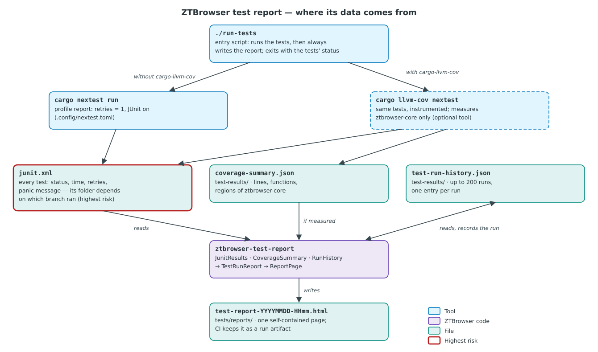

# HTML test report

`./run-tests` runs every ZTBrowser test and then always writes a test report:
`tests/reports/test-report-YYYYMMDD-HHmm.html`, named after the local time the run started. The page is one
self-contained HTML file (no network, no server) that can be opened from disk or attached to a message. Both
`tests/reports/` and `test-results/` (where the run history lives) are ignored by git, so a report is never
committed by accident. The script exits with the status of the tests, so it can gate a commit or a CI job.

## What problem it solves

`cargo test` prints its results to the terminal, where they scroll away. Nobody sees which tests got slower,
whether a test failed once last week, or how much of the domain the tests actually execute. The report keeps
that picture: every run is recorded, and the page shows the latest run next to the last twenty. It uses the
same layout as the house test report template used in our other projects, so a reader who knows one report
can read this one.

## Vocabulary

- **cargo-nextest** — a test runner for Rust that runs each test in its own process, can retry failing
  tests, and can write its results as JUnit XML. It runs the same `#[test]` functions as `cargo test`.
- **JUnit XML** — a common file format for test results, originally from Java's JUnit. One `<testcase>`
  element per test, with its time and, when it failed, the failure output.
- **Retry and flaky test** — the `report` profile in `.config/nextest.toml` retries a failing test once. A
  test that fails and then passes is **flaky**: it depends on something it should not (timing, order,
  shared state). The report shows it in yellow. The project tolerates no flaky tests, so the retry exists
  only to tell "flaky" from "broken", never to hide a failure.
- **Coverage** — the share of the code that the tests executed. LLVM, the compiler backend Rust uses,
  counts **lines**, **functions** and **regions** (a region is a span of code that runs as one piece, roughly
  a statement or one arm of a branch). `cargo-llvm-cov` builds the tests with this counting switched on.
- **Run history** — `test-results/test-run-history.json`, one entry per run with its counts and coverage.

## Running it

```sh
./run-tests                    # all tests, then the report; opens it in the browser outside CI
sudo pacman -S cargo-llvm-cov  # optional: adds ztbrowser-core's coverage to the report
```

`cargo-nextest` is required. Without `cargo-llvm-cov` the script runs `cargo nextest run`, and the coverage
card says **BRAK** (not measured) instead of showing a number. The [tests workflow](../../../.github/workflows/tests.yml)
installs both tools and keeps the report of every run as an artifact for 90 days, also when tests fail.

## Where the data comes from



`./run-tests` takes one of two paths. With `cargo-llvm-cov` installed it runs `cargo llvm-cov nextest`,
which builds the tests with coverage counting and writes `test-results/coverage-summary.json`. Without it, it
runs plain `cargo nextest run`. Either way nextest writes `junit.xml`. Its folder depends on the path
(`target/llvm-cov-target/nextest/report/` or `target/nextest/report/`), which makes it the most fragile
link: the script deletes both before the run and takes whichever exists afterwards, so a report can never be
built from a stale file.

`ztbrowser-test-report` (a workspace crate that is never packaged) then reads the three inputs, records the
run in the history, and writes the page.

## Report layout

From the top:

1. **Title and verdict** — branch and commit, the run's local time, and a badge. The badge shows the worst
   thing about the run: `FAILED` before `COVERAGE ≤90%` before `FLAKY` before `PASSED`.
2. **KPI strip** — number of suites, pass rate of the latest run, test count, recorded runs, tests failing
   now, and line coverage.
3. **Cards** — `Unit · cargo nextest` and `Coverage · llvm-cov`. Each has a status badge, the pass rate (or
   line coverage) over the last 20 runs, a sparkline, and a strip of the last 20 runs. Green means no
   failures, yellow flaky, red failed; for coverage, green means every measured metric is above 90 %. Empty
   slots are runs that do not exist yet.
4. **Latest run** — two donut charts (tests by status, lines covered), counters per status, and durations:
   the total of all tests, the average, the longest test, and the run's wall-clock time.
5. **Most frequent failures and most unstable features** — failures are grouped by kind (`assert_eq!`,
   `assert!`, `Option::unwrap`, `Result::unwrap`, timeout, other). A feature is one test binary, such as
   `ztbrowser-core::generic_hiding`, which is one domain type.
6. **Failed and flaky tests** — shown only when present, with the panic message and where it was raised.
7. **Features** — every test binary with its result bar, failing ones first.
8. **Slowest tests** — the top 10.

The **pass rate** counts flaky tests as passed and leaves skipped tests out of the whole. Percentages are
truncated, never rounded up, so one failure among thousands is never shown as 100.00 %.

## Coverage scope and threshold

Coverage is measured for `ztbrowser-core` only. The application crate (`ztbrowser`) is a set of adapters that
carry out the core's decisions in GTK and WebKit, and it has no unit tests by design. Counting it would only
say that GUI code does not run in a unit test. The report tool itself is left out too. A run's coverage is
sufficient when **every measured metric is above 90 %**. Branch coverage needs a nightly compiler; when it
was not measured, LLVM reports zero branches and the metric is left out instead of being shown as 0 %.

## Run history

Every report records its run in `test-results/test-run-history.json`. A run is identified by its suite and
its start time, so regenerating the report for the same run does not add it twice. The file keeps at most 200
runs per suite. A missing or damaged history starts a new one instead of stopping the report.

## Why this approach

- **nextest JUnit over `cargo test` output.** Stable `cargo test` prints neither per-test times nor a
  machine-readable format. Its JSON output (`--format json`) is unstable and needs a nightly compiler.
  nextest writes JUnit on a stable toolchain and adds retries, which is the only way to tell a flaky test
  from a broken one.
- **Our own generator, in Rust.** Report tools such as Allure need a Java runtime or fetch assets from the
  network, and the house template is a handful of pure transformations. Writing it in Rust keeps the
  project in one language and lets the tool follow the same object-oriented, scenario-tested rules as the
  browser.
- **The time zone comes from the JUnit file.** nextest writes the start time with its UTC offset, so the
  report reads the local date and time straight from the text and needs no time zone database.

## Known limits

- The file name has minute resolution: two runs started in the same minute write the same file. The history
  still records both.
- nextest leaves `#[ignore]` tests out of its JUnit file, so `SKIPPED` normally stays at zero.
- A test binary that does not compile produces no JUnit file. The script then stops with the compiler's
  error and no report, because there are no results to show.

## Code map

| Module (`crates/ztbrowser-test-report/src/`) | Responsibility |
|---|---|
| `junit_results.rs` | Reads nextest's JUnit file into `TestCase`s with status, time and failure. |
| `failure_message.rs` | Keeps a panic's message and location, and classifies the failure. |
| `coverage_summary.rs` | Reads cargo-llvm-cov's summary and judges it against the threshold. |
| `run_history.rs`, `recorded_run.rs`, `suite_summary.rs` | The run history and a card's view of it. |
| `test_run_report.rs` | Totals, features, rankings, durations and the verdict of the latest run. |
| `report_page.rs`, `report_widgets.rs`, `report_page.css` | The HTML page in the template's layout. |
| `report_command.rs`, `main.rs` | The command: files, git branch and commit, writing the page. |

Tests: `crates/ztbrowser-test-report/tests/`, one Given/When/Then scenario file per type.
