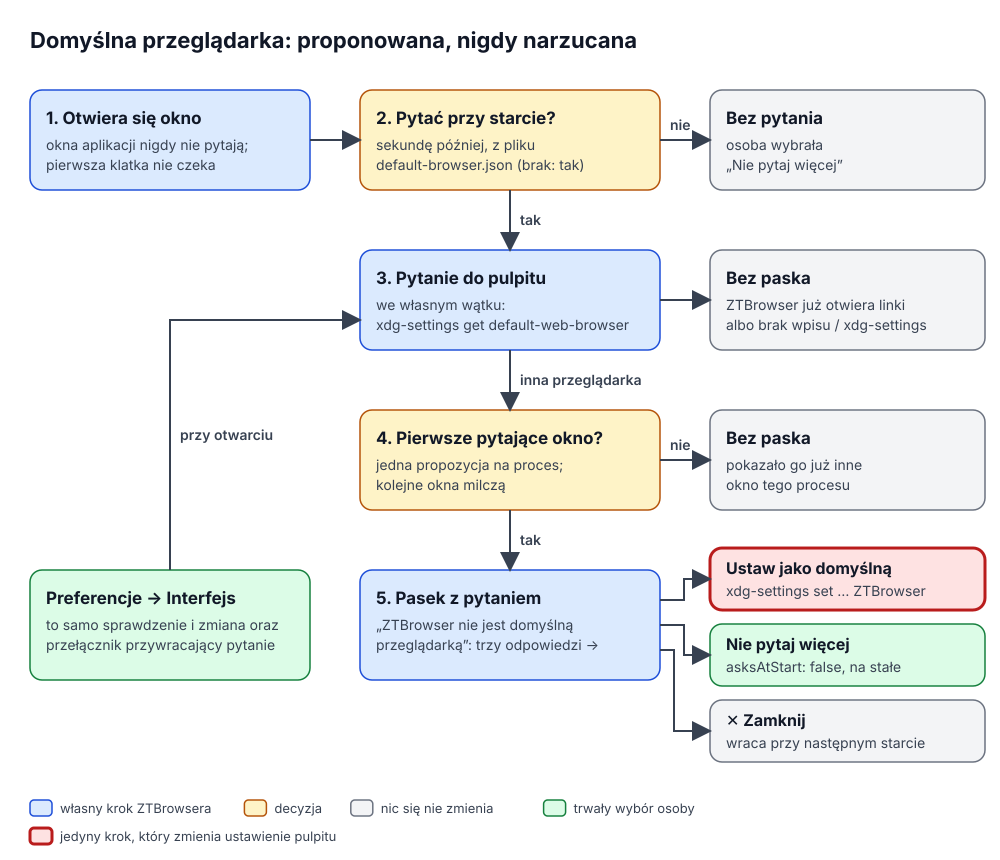

# Domyślna przeglądarka

ZTBrowser może zostać przeglądarką, która otwiera linki z innych programów: link w poczcie, wiadomości komunikatora
albo dokumencie. Ten dokument wyjaśnia, jak ZTBrowser proponuje tę zmianę, jak ją wykonuje i dlaczego nigdy nie robi
jej sam. Kod: `crates/ztbrowser-qt/src/default_browser.rs`, pasek `qml/DefaultBrowserBar.qml`, wiersze preferencji
w `qml/PreferencesDialog.qml`, pytanie na końcu `./install`. Testy: `crates/ztbrowser-qt/tests/default_browser.rs`
oraz `tests/default_browser_bar.rs` (z `tests/qml/tst_default_browser_bar.qml`).

## 1. Problem

Osoba, której ZTBrowser odpowiada, chce, żeby linki z innych programów otwierały się właśnie w nim, a znalezienie
odpowiedniego ustawienia pulpitu (*Domyślne aplikacje* w KDE, *Domyślne programy* w GNOME, plik `mimeapps.list`) nie
jest oczywiste. Przeglądarki rozwiązują to pytaniem, a wiele z nich pyta zbyt często albo zmienia ustawienie samo.
ZTBrowser ma uczynić zmianę łatwą i nigdy jej nie narzucać: decyduje osoba, nic się nie zmienia bez jej kliknięcia,
a „nie” obowiązuje, dopóki sama go nie cofnie. Pytanie nie może też nic kosztować przy starcie: pierwsza klatka musi
się pojawić w mniej niż 0,3 sekundy (zob. [optymalizacje startu okna](../plans/2026-11-06-window-startup-optimizations-plan.md)).

## 2. Słownik

| Pojęcie | Znaczenie |
|---|---|
| **Domyślna przeglądarka** | Program, który pulpit uruchamia dla linku klikniętego poza przeglądarką. Każdy pulpit trzyma ten wybór we własnym miejscu: KDE w `kdeglobals` (`BrowserApplication`), każdy pulpit zgodny z freedesktop w `mimeapps.list` (obsługa `x-scheme-handler/http`, `https` i `text/html`). |
| **`xdg-settings`** | Program z pakietu `xdg-utils`, który odczytuje i zmienia takie ustawienia pulpitu, z osobną implementacją dla każdego pulpitu (KDE, GNOME, Xfce, LXDE, Deepin i ogólną). `xdg-settings get default-web-browser` wypisuje wpis menu bieżącej przeglądarki; `xdg-settings set default-web-browser <wpis>` ustawia inny wpis jako domyślny. |
| **Wpis menu** | Plik `.desktop` w folderze `applications` (`/usr/share/applications`, `~/.local/share/applications`). Pulpit może wybrać tylko program, który taki wpis ma: pakiety instalują `io.github.ztbrowser.ZTBrowser.desktop`, AppImage zapisuje go sam dla siebie (zob. README), wersja uruchomiona ze źródeł nie ma żadnego. |
| **Pasek** | Pas pod paskiem narzędzi w stylu banera libadwaita: „ZTBrowser nie jest domyślną przeglądarką” z przyciskami *Ustaw jako domyślną*, *Nie pytaj więcej* i przyciskiem zamknięcia. |
| **Pytanie przy starcie** | Czy pasek w ogóle może się pojawić; zapisane w `default-browser.json` (`{"asksAtStart": false}`) w folderze danych ZTBrowsera, wspólne dla wszystkich profili. Brak pliku oznacza „pytaj”. |

## 3. Jak to działa

1. **Start.** `BrowserApplication::run` otwiera `DefaultBrowserChoice` z narzędziem pulpitu i folderami menu
   (`DefaultBrowser::for_environment`) i czyta `default-browser.json`. To jeden odczyt małego pliku; o nic jeszcze nie
   pyta.
2. **Sekundę po otwarciu okna przeglądarki** pasek sprawdza przez most, czy osoba chce pytania. Jeśli nie, nic więcej
   się nie dzieje. Okna aplikacji internetowych nigdy nie pytają: pokazują jedną witrynę i nie są przeglądarką.
3. **Pulpit jest pytany we własnym wątku.** `xdg-settings` to skrypt powłoki, który uruchamia kolejne programy; w KDE
   Plasma zajmuje to od 50 do 90 milisekund, dość, żeby strona się zacięła, gdyby wątek rysujący na to czekał. Pasek
   zamiast tego co 100 ms sprawdza, czy odpowiedź już jest. `DefaultBrowser::state` zwraca jedną z czterech odpowiedzi:
   - `ThisBrowser`: pulpit podaje wpis ZTBrowsera;
   - `OtherBrowser(nazwa)`: inny wpis, z jego `Name=`, gdy ZTBrowser ten wpis znajdzie (preferencje mogą wtedy
     napisać „Linki z innych programów otwiera Brave”), albo brak jakiegokolwiek wpisu;
   - `Unregistered`: w żadnym folderze menu nie ma `io.github.ztbrowser.ZTBrowser.desktop`, więc pulpit nie mógłby
     wybrać ZTBrowsera, nawet gdyby go o to poproszono (wersja uruchomiona ze źródeł); narzędzie w ogóle nie startuje;
   - `Unknown`: brak `xdg-settings` albo narzędzie zawiodło.
4. **Jedna propozycja na proces.** `DefaultBrowserChoice::takes_offer` odpowiada „tak” tylko pierwszemu oknu, które
   zapyta, gdy pulpit już podał inną przeglądarkę. Okno otwarte później w tym samym procesie albo okno, które pyta,
   zanim przyszła odpowiedź, paska nie dostaje.
5. **Osoba odpowiada.**
   - *Ustaw jako domyślną* uruchamia w wątku roboczym `xdg-settings set default-web-browser
     io.github.ztbrowser.ZTBrowser.desktop`, a potem znowu pyta, co mówi pulpit. Niepowodzenie pokazuje komunikat
     z własnym tekstem narzędzia.
   - *Nie pytaj więcej* zapisuje `{"asksAtStart": false}`: żaden późniejszy start nie pokaże paska.
   - Przycisk zamknięcia chowa pasek tylko w tym procesie; następny start zapyta ponownie.
6. **Preferencje → Interfejs** przy każdym otwarciu okna pokazują tę samą odpowiedź („ZTBrowser otwiera linki
   z innych programów”, „Linki z innych programów otwiera Brave”, „Linki z innych programów może otwierać tylko
   zainstalowany ZTBrowser”, „Środowisko pulpitu nie podaje, która przeglądarka otwiera linki”), proponują *Ustaw
   jako domyślną*, dopóki linki otwiera inna lub nieznana przeglądarka, i mają przełącznik *Pytaj przy uruchomieniu
   ZTBrowsera*, który przywraca pytanie.
7. **`./install`** pyta na końcu, tylko w terminalu: „Make ZTBrowser your default browser, so it opens links from
   other programs? [y/N]”. Enter zostawia obecną przeglądarkę. Skrypt nie pyta jako root (zmieniłby ustawienie roota)
   ani wtedy, gdy ZTBrowser już jest domyślny.

## 4. Decyzje i odrzucone alternatywy

- **`xdg-settings` zamiast samodzielnego zapisu plików.** Każdy pulpit trzyma to ustawienie gdzie indziej, a niektóre
  w dwóch miejscach naraz (KDE czyta `kdeglobals` i `mimeapps.list`). `xdg-utils` zna je wszystkie i jest obecny
  praktycznie na każdym pulpicie Linuksa; pakiety od niego zależą. Bezpośredni zapis `mimeapps.list` zadziałałby
  w GNOME i pominąłby własny klucz KDE.
- **Porównanie wyniku `get` z wpisem ZTBrowsera zamiast `xdg-settings check`.** `get` jednym wywołaniem mówi i to, czy
  ZTBrowser jest domyślny, i która przeglądarka nim jest (co pokazują preferencje); `check` wymagałby drugiego
  wywołania, żeby poznać nazwę.
- **Wątek roboczy i odpytywanie zamiast sygnału Qt.** Obiekty mostu nie mają jeszcze sygnałów; zegar co 100 ms, który
  czyta odpowiedź chronioną muteksem, to ten sam wzorzec, którego używa lista pobranych plików, a opóźnienie jest
  niewidoczne przy sekundzie czekania przed pytaniem. Odpowiedź może zapisać tylko najnowsze pytanie, więc
  sprawdzenie rozpoczęte przed zmianą nigdy nie nadpisze tego, co ustaliła zmiana.
- **Biblioteki AppImage są ukryte przed narzędziem.** AppImage kieruje `LD_LIBRARY_PATH`, `QT_PLUGIN_PATH` i ścieżki
  importu QML na własne Qt. `xdg-settings` w KDE uruchamia `kwriteconfig6` i `qtpaths`, zbudowane dla systemowego Qt,
  które z innym Qt nie startują; gdy ZTBrowser działa z AppImage, narzędzie startuje bez tych zmiennych.
- **Jedna propozycja na proces, nie natręctwo.** Chrome i Edge pytają w każdym oknie i według harmonogramu; Firefox
  pyta przy każdym starcie, dopóki nie odznaczy się pola. ZTBrowser pyta raz na start w pierwszym oknie, a *Nie pytaj
  więcej* to przycisk, nie ukryte pole wyboru. Ustawienie jest globalne, nie per profil, bo domyślna przeglądarka
  pulpitu też jest globalna.
- **Brak propozycji dla wersji bez wpisu menu.** `xdg-settings set` zapisałby nazwę, której pulpit nie umie uruchomić,
  i linki przestałyby się otwierać gdziekolwiek. `make_default` odmawia, zanim wywoła narzędzie.

## 5. Testy

`crates/ztbrowser-qt/tests/default_browser.rs` zastępuje `xdg-settings` skryptem w folderze tymczasowym: odpowiada na
`get` z pliku, zapamiętuje to, co wskazuje `set`, umie odmówić i zapisuje każde wywołanie. Żaden test nie czyta ani nie
zmienia domyślnej przeglądarki maszyny, na której działa. Scenariusze obejmują cztery odpowiedzi, nazwę innej
przeglądarki, wpis menu zapisany przez AppImage, zmianę i odmowę, jedną propozycję na proces, „nie pytaj więcej”
między procesami i jego cofnięcie oraz JSON, który czyta okno.

`tests/default_browser_bar.rs` uruchamia `qmltestrunner` na prawdziwym `DefaultBrowserBar.qml` z zastępczym mostem:
pasek pojawia się, gdy pulpit poda inną przeglądarkę, nie pyta, gdy osoba tego nie chce, ani w oknie aplikacji
internetowej, nie pokazuje się, gdy propozycję pokazało już inne okno, a każdy przycisk robi dokładnie jedną rzecz.
