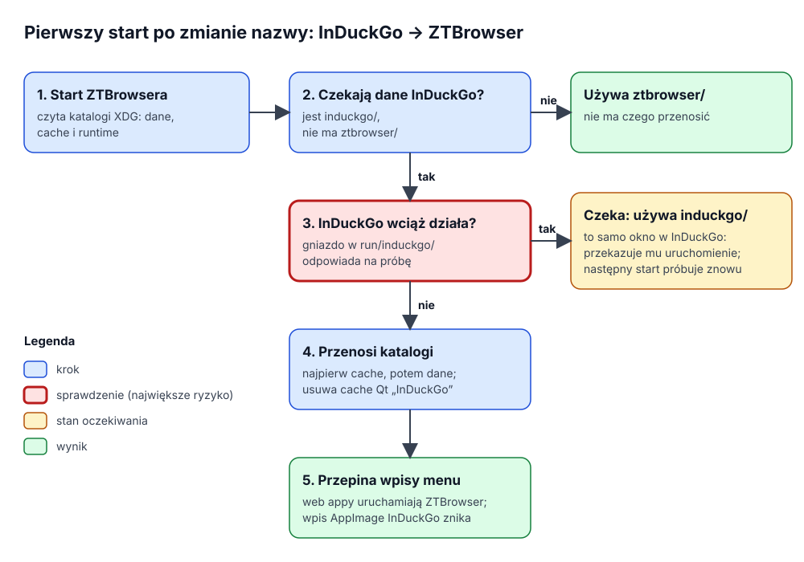

# Przejście z InDuckGo na ZTBrowser

Do wersji 1.2.4 ZTBrowser nazywał się **InDuckGo**. Ten dokument wyjaśnia, jak osoba, która używała InDuckGo,
zachowuje wszystko (profile, logowania, zainstalowane aplikacje internetowe, ustawienia), gdy ZTBrowser go
zastępuje, i dlaczego przeprowadzka działa właśnie tak. Kod: `crates/ztbrowser-qt/src/induckgo_migration.rs`,
testy: `crates/ztbrowser-qt/tests/induckgo_migration.rs`.

## 1. Problem

Nazwa przeglądarki jest częścią wielu nazw plików i identyfikatorów, nie tylko tekstu na ekranie:

- dane osoby leżą w katalogach nazwanych po programie: `~/.local/share/induckgo` (profile z ciasteczkami,
  logowaniami i danymi stron, zainstalowane aplikacje internetowe, ustawienia) oraz `~/.cache/induckgo` (pamięć
  podręczna stron, pobrane dane ochrony);
- pulpit znajduje ikonę okna przez **identyfikator aplikacji** (`io.github.induckgo.InDuckGo`), a każda
  zainstalowana aplikacja internetowa ma wpis menu `io.github.induckgo.InDuckGo.WebApp.<aplikacja>.desktop`, który
  uruchamia stary program i pokazuje ikonę ze starego katalogu danych;
- AppImage InDuckGo zapisywał dla siebie wpis menu `io.github.induckgo.InDuckGo.desktop`.

ZTBrowser używa katalogów `ztbrowser` i identyfikatorów `io.github.ztbrowser.ZTBrowser`. Bez migracji pierwszy
start wyglądałby jak świeża instalacja: bez profili, bez logowań, a wpisy menu aplikacji internetowych
uruchamiałyby program, którego już nie ma.

## 2. Słownik

| Pojęcie | Znaczenie |
|---|---|
| **Katalogi XDG** | Standardowe miejsca na pliki osoby w Linuksie: dane (`$XDG_DATA_HOME`, domyślnie `~/.local/share`), pamięć podręczna (`$XDG_CACHE_HOME`, domyślnie `~/.cache`) i katalog uruchomieniowy sesji (`$XDG_RUNTIME_DIR`, np. `/run/user/1000`). |
| **Identyfikator aplikacji** | Nazwa w odwróconej notacji domenowej, którą okno zgłasza pulpitowi; pulpit bierze ikonę okna z pliku `.desktop` o tej nazwie. |
| **Wpis menu** | Plik `.desktop` w `~/.local/share/applications`; menu aplikacji go wyświetla, a jego linia `Exec=` mówi, który program uruchomić. |
| **Gniazdo pojedynczej instancji** | Gniazdo Unix, na którym nasłuchuje każdy działający proces okna w katalogu uruchomieniowym; drugie uruchomienie tego samego profilu lub aplikacji przekazuje mu adresy i kończy się, więc pliki profilu nigdy nie są otwarte dwa razy. |
| **Oczekująca migracja** | Katalog danych InDuckGo istnieje, a katalog ZTBrowsera nie: dane osoby wciąż czekają pod starą nazwą. |

## 3. Jak to działa

Każdy start ZTBrowsera przechodzi te same kroki, na samym początku `BrowserApplication::run`, zanim cokolwiek
przeczyta plik:

1. **Czy migracja oczekuje?** Tylko gdy istnieje `~/.local/share/induckgo`, a nie istnieje
   `~/.local/share/ztbrowser`. Osoba, która nigdy nie używała InDuckGo albo której dane już przeniesiono, przechodzi
   to sprawdzenie dwoma wywołaniami `stat`.
2. **Czy jakiś proces wciąż działa na katalogach InDuckGo?** Każde działające okno InDuckGo nasłuchuje na gnieździe
   w `$XDG_RUNTIME_DIR/induckgo`. Jeśli któreś odpowie, katalogi zostają na miejscu (powód w punkcie 4), a ten proces
   ZTBrowsera używa katalogów InDuckGo, także katalogu uruchomieniowego, więc jego gniazdo leży obok gniazd InDuckGo
   i przeprowadzka czeka również na niego. Uruchomienie okna, które InDuckGo już pokazuje (ten sam profil lub ta sama
   aplikacja, rozpoznane po starym identyfikatorze), trafia do tego InDuckGo, tak jak drugie uruchomienie trafia do
   pierwszego. Następny start sprawdza ponownie.
3. **Przeniesienie katalogów.** Najpierw zmienia się nazwa katalogu pamięci podręcznej, potem katalogu danych.
   Zmiana nazwy katalogu danych kończy migrację: jeśli się nie uda, dane zostają pod starą nazwą, są używane stamtąd,
   a następny start próbuje znowu. Własna pamięć podręczna Qt ze skompilowanym QML i shaderami (`~/.cache/InDuckGo`)
   jest usuwana; Qt odbuduje ją pod nową nazwą.
4. **Przepięcie wpisów menu**, gdy dane należą już do ZTBrowsera, a język interfejsu jest znany. Każda aplikacja
   z katalogu, która wciąż ma wpis menu InDuckGo, dostaje wpis ZTBrowsera, zapisany tym samym typem `DesktopEntry`,
   którego używa instalator: uruchamia bieżący program (plik AppImage, gdy działa z niego) i pokazuje ikonę
   z przeniesionego katalogu. Wpis InDuckGo jest potem usuwany, więc menu pokazuje aplikację raz. Wpis, który AppImage
   InDuckGo zapisał dla siebie, znika razem z ikoną, ale tylko gdy ma znacznik `X-InDuckGo-AppImage`: wpis o tej
   nazwie napisany przez osobę zostaje.

## 4. Decyzje i odrzucone alternatywy

- **Zmiana nazwy, nie kopiowanie.** Stary i nowy katalog mają wspólny katalog nadrzędny, więc `rename` działa
  natychmiast i nie potrzebuje wolnego miejsca; kopiowanie gigabajtów danych profili przy starcie opóźniłoby
  pierwsze okno i mogłoby zapełnić dysk.
- **Nigdy pod działającym procesem.** Działający proces dalej używa ścieżek, które otworzył. Chromium zapisuje nowe
  pliki profilu po ścieżce, dopóki przeglądarka działa (dzienniki, wpisy pamięci podręcznej), więc po przeniesieniu
  te zapisy trafiłyby do odtworzonego, pustawego katalogu `induckgo`, a drugi proces otwierający przeniesiony profil
  dzieliłby bazy danych z pierwszym. W obu przypadkach giną dane. Aktualizacja pakietu przy otwartym InDuckGo jest
  częsta, więc przeprowadzka czeka.
- **Czekanie, nie odmowa startu.** Odmowa wymagałaby okna dialogowego, zanim istnieje jakiekolwiek okno, i blokowałaby
  osobę, dopóki nie znajdzie i nie zamknie InDuckGo. Używanie w tym czasie katalogów InDuckGo zostawia dostęp do
  wszystkich profili i aplikacji i jest dokładnie tak samo bezpieczne: dwa procesy nigdy nie dzielą profilu, bo
  sprawdzenie pojedynczej instancji obejmuje obie nazwy.
- **Próba, która wysuwa okna na wierzch.** Sprawdzenie, czy InDuckGo działa, łączy się z jego gniazdami; okno
  traktuje puste żądanie jako „pokaż się”. Rozpoznawanie procesów inaczej (czytanie `/proc`) zależałoby od nazw
  procesów i byłoby kruche. Efekt uboczny pojawia się tylko, dopóki InDuckGo jest otwarty.
- **Wpisy aplikacji renderowane od nowa, nie edytowane.** Edycja tekstu zostawiłaby starą ścieżkę `Exec=`, błędną po
  aktualizacji pakietu (`/usr/bin/induckgo` już nie istnieje) i groźną przy AppImage (stary plik AppImage wciąż
  uruchamiałby InDuckGo).
- **Istniejące katalogi ZTBrowsera wygrywają.** Jeśli osoba ma już dane ZTBrowsera (np. z próbnego uruchomienia),
  nic nie jest scalane, a katalogi InDuckGo zostają nietknięte; bezpieczne scalenie baz dwóch profili nie jest
  możliwe.

## 5. Pakiety

| Pakiet | Jak zastępuje InDuckGo |
|---|---|
| Arch (`PKGBUILD`) | `conflicts=('induckgo')` i `replaces=('induckgo')`: `pacman -U` (używany przez `./install`) proponuje usunięcie InDuckGo. |
| Fedora (`ztbrowser.spec`) | `Obsoletes: induckgo <= 1.2.4`: `dnf install` usuwa każdą wersję InDuckGo. |
| AppStream (`metainfo.xml`) | `<replaces><id>io.github.induckgo.InDuckGo</id></replaces>`: centra oprogramowania pokazują ZTBrowser jako następcę. |
| AppImage | Nie ma czego zastępować; stary plik AppImage można usunąć ręcznie. Jego wpis menu znika przy pierwszym starcie ZTBrowsera. |

`./uninstall` usuwa pakiet pod każdą z dwóch nazw, więc maszyna, na której wciąż jest zainstalowany InDuckGo, zostaje
wyczyszczona jednym uruchomieniem. `./uninstall --purge` kasuje też dane pod obiema nazwami: katalogi danych i pamięci
podręcznej, pamięć podręczną Qt, wpisy menu aplikacji internetowych i wpisy, które AppImage zapisał dla siebie (tylko
te ze znacznikiem `X-ZTBrowser-AppImage` lub `X-InDuckGo-AppImage`), więc czyszczenie jest pełne nawet wtedy, gdy
ZTBrowser ani razu nie wystartował po aktualizacji.

## 6. Testy

`crates/ztbrowser-qt/tests/induckgo_migration.rs` uruchamia każdy scenariusz we własnych tymczasowych katalogach
XDG: dane i pamięć podręczna się przenoszą; na czystej maszynie nic nie powstaje; nic się nie przenosi, dopóki
odpowiada gniazdo InDuckGo, a proces używa wtedy katalogów InDuckGo i nasłuchuje w nich; gniazdo po awarii InDuckGo
nie blokuje przeprowadzki; istniejące katalogi ZTBrowsera wygrywają; wpis aplikacji uruchamia ZTBrowser i pokazuje
przeniesioną ikonę; wpis AppImage InDuckGo znika tylko ze znacznikiem; uruchomienie trafia do InDuckGo, które
pokazuje to samo okno.

## 7. Kiedy usunąć ten kod

Po przeniesieniu danych migracja kosztuje kilka sprawdzeń plików przy każdym starcie: dwa sprawdzenia katalogów,
odczyt małego katalogu aplikacji, jedno sprawdzenie na zainstalowaną aplikację i jedno dla wpisu AppImage. Można ją
usunąć, gdy żadna wspierana instalacja nie powinna już mieć katalogów `induckgo`. To decyzja opiekuna projektu; do
tego czasu moduł i jego testy zostają bez zmian.
