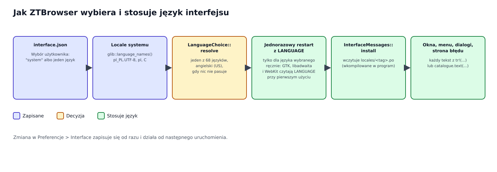

# Język interfejsu

Menu, okna dialogowe, komunikaty i strony błędów ZTBrowsera mówią w jednym języku naraz: wybranym w
*Preferencje → Interface* albo, domyślnie, w języku pulpitu. Ten dokument wyjaśnia, dlaczego to wymagało czegoś
więcej niż przetłumaczenia napisów, jak język jest wybierany i stosowany oraz jak dodać lub poprawić język.

## 1. Problem

Przed tą pracą interfejs był tylko po angielsku (przegląd architektury §9). Na polskim pulpicie i tak wychodziła
mieszanka, bo w jednym oknie biorą udział trzy różne zbiory tekstów:

1. **Własne teksty ZTBrowsera** (pozycje menu, pasek narzędzi, dialogi, strona błędu): wszystkie po angielsku.
2. **Teksty GTK i libadwaita** (przyciski okna „O programie”, „Anuluj”, elementy dialogów): tłumaczy je GTK
   według języka *systemu*, czyli po polsku.
3. **Teksty WebKit** (menu kontekstowe strony, okna certyfikatów i plików): też tłumaczone przez WebKit według
   języka systemu.

Okno z angielskimi przyciskami obok polskich elementów dialogu jest gorsze niż w całości angielskie. Cel jest
odwrotny: **każdy tekst każdego okna w jednym języku**, domyślnie wybranym z systemu, zmienianym przez
użytkownika, z tej samej listy języków, którą użytkownik zna z Chrome i Brave.

## 2. Słownik

| Termin | Znaczenie |
|---|---|
| Locale | Systemowe ustawienie języka, np. `pl_PL.UTF-8`: język, kraj i kodowanie znaków. |
| Znacznik BCP 47 | Krótka nazwa języka tak, jak piszą ją przeglądarki: `pl`, `pt-BR`, `sr-Latn`. |
| Endonim | Nazwa języka w tym języku (`Polski`, `Deutsch`), tak jak wypisuje go lista wyboru języka. |
| gettext, plik `.po` | Standardowy system tłumaczeń w Linuksie. Plik `.po` łączy każdy angielski komunikat z jego tłumaczeniem. |
| `LANGUAGE` | Zmienna środowiskowa, z której gettext wybiera język; GTK, libadwaita i WebKit używają gettext. |
| Komunikat | Jedno widoczne zdanie lub etykieta, zapisane po angielsku w miejscu użycia i pełniące rolę własnego klucza. |
| Symbol zastępczy | Nazwana dziura w komunikacie, `{host}`, wypełniana w czasie działania; tłumacz może ją przesunąć. |
| Mnemonik | Podkreślony klawisz etykiety przycisku (`_Cancel`); podkreślnik wskazuje literę. |

## 3. Lista języków

Lista to lista Brave: 68 języków, które dostarcza jego instalacja (`locales/*.pak`, każdy język policzony raz;
Chromium dostarcza 82). Jest dokładną kopią tego, co widzi użytkownik Brave, więc nikomu nie oferuje się mniej
języków niż w przeglądarce, z której przychodzi. Każdy jest wypisany swoim endonimem. Angielski ma dwa warianty
(`en-US`, `en-GB`); oba używają komunikatów tak, jak są napisane. Hiszpański (`es`, `es-419`), portugalski
(`pt-BR`, `pt-PT`), chiński (`zh-CN`, `zh-TW`) i serbski (`sr`, `sr-Latn`) mają osobne tłumaczenia, bo ich
warianty różnią się w codziennych słowach.

## 4. Jak język jest wybierany

**Wybór.** `LanguageChoice` to albo *System* (domyślnie), albo *Fixed(język)*, zapisany w `interface.json`
w katalogu danych ZTBrowsera. Jeden plik obsługuje każdy profil i aplikację webową, bo człowiek mówi jednym
językiem, a nie jednym na profil.

**Podążanie za systemem.** Lista języków systemu (najbardziej pożądane pierwsze, tak jak podaje GLib, np.
`pl_PL.UTF-8`, `pl`, `C`) jest przeglądana, aż jakiś locale pasuje do obsługiwanego języka. Dopasowanie jest
w `InterfaceLanguage::matching_locale` i obejmuje trudne przypadki: `pt_PT` to portugalski europejski, samo `pt`
to brazylijski; `es_MX` i inne kraje Ameryki Łacińskiej dostają `es-419`; `zh_TW`, `zh_HK` i `zh_MO` dostają
chiński tradycyjny; `sr@latin` to serbski w alfabecie łacińskim; `nn` i `no` to norweski bokmål; `tl` to filipiński;
stare kody `iw` i `in` to hebrajski i indonezyjski. Jeśli nic nie pasuje, interfejs jest po angielsku (USA).

**Stosowanie.** Na początku każdego procesu ZTBrowsera, zanim GTK cokolwiek utworzy:

1. `InterfaceLanguageSetting::activate` czyta wybór i ustala język.
2. Dla języka *ustalonego* proces sprawia, że GTK, libadwaita i WebKit mówią nim, ustawiając `LANGUAGE`. Program
   zabrania kodu `unsafe`, a zmiana własnego środowiska jest w Ruście `unsafe`, więc proces **uruchamia się sam
   jeszcze raz** z ustawioną zmienną (`exec`, bezpieczne, podmienia proces, zanim cokolwiek zrobił). Procesy
   pomocnicze WebKit dziedziczą zmienną. Dla *System* nic nie jest ustawiane: GTK i tak podąża za systemem.
3. `InterfaceMessages::install` wczytuje katalog języka (wkompilowany w program), żeby `tr!("…")` zwracało
   tłumaczenia.

Zmiana w preferencjach zapisuje się od razu i działa od następnego uruchomienia: każde okno, menu i dialog jest
budowane w języku swojego procesu, a przebudowywanie żywych okien byłoby drugą ścieżką kodu dla czegoś, co zmienia
się rzadko. Preferencje mówią o tym wprost („Applies the next time ZTBrowser starts”, w wybranym języku).

Strona błędu też podąża za językiem: `<html lang="…" dir="…">` jest wypełniane z niego, a arabski, perski,
hebrajski i urdu dostają stronę od prawej do lewej.

## 5. Komunikaty

W aplikacji komunikat to `tr!("Close {name} first", name = profile)`; w crate domenowym to `catalogue.text("…")`
albo `catalogue.text_with("…", &[("name", value)])`, bo ten crate nie zna GTK i dostaje katalog, którego ma
użyć. Kluczem jest angielski tekst, jak w gettext, więc nie trzeba wymyślać identyfikatorów, a czytelnik widzi,
co mówi ekran.

Zasady, które utrzymują tłumaczenia przy życiu:

- Komunikat to **całe zdanie**; teksty nigdy nie są sklejane z przetłumaczonych fragmentów, bo szyk wyrazów różni
  się między językami.
- Wartości trafiają do **nazwanych symboli zastępczych**, żeby tłumacz mógł je przesuwać.
- **Bez form liczby mnogiej**: zdanie przeformułowuje się zamiast liczyć.
- **Nazwy marek i protokołów** zostają bez zmian (ZTBrowser, DuckDuckGo, Tor, Snowflake, obfs4, nazwy list).
- Komunikat przychodzący z zewnątrz (błąd GLib lub WebKit, własny wiersz logu Tora, nazwa profilu) to dane,
  a nie interfejs, i jest pokazywany tak, jak przyszedł.

## 6. Dodawanie lub poprawianie języka

Każdy język to jeden plik, `crates/ztbrowser-core/locales/<tag>.po`, wkompilowany podczas budowania; dodanie pliku
dodaje język do programu. `locales/template.pot` wylicza wszystkie komunikaty dla tłumaczy.

1. Po dodaniu lub zmianie komunikatu w kodzie przepisz szablon:
   `ZTBROWSER_BLESS_TEMPLATE=1 cargo test -p ztbrowser-core --test message_catalogues`.
2. Dodaj nowy komunikat do każdego pliku `.po` (tłumacze mogą zacząć od szablonu).
3. `cargo test -p ztbrowser-core` musi przejść. Jego testy (`tests/message_catalogues.rs`) padają, gdy katalogowi
   brakuje komunikatu, trzyma on taki, którego kod już nie używa, albo gubi lub wymyśla `{symbol}`; to właśnie
   pilnuje, żeby okno nigdy nie mieszało dwóch języków.

## 7. Ograniczenia

| Ograniczenie | Dlaczego | Wrócić, gdy |
|---|---|---|
| Każde tłumaczenie (66 języków, także polski) jest maszynowe i nie czytał go native speaker. | Nie było recenzenta dla 66 języków. | Współtwórca poprawi plik `.po`; zmiana kodu nie jest potrzebna. |
| Zmiana języka działa od następnego uruchomienia. | Każdy widżet budowany jest raz, w języku procesu. | Przełączanie na żywo będzie warte drugiej ścieżki kodu. |
| Wpisy `.desktop` i opis AppStream podążają za językiem *systemu*, nie za wyborem. | Czyta je pulpit, a nie ZTBrowser. | Pakowanie wygeneruje je dla każdego języka. |
| Gdy locale systemu to `C` (brak `LANG`), system ignoruje `LANGUAGE`, a teksty GTK zostają po angielsku. | gettext honoruje `LANGUAGE` tylko dla prawdziwego locale. | Nigdy się tego nie spodziewamy na sesji pulpitu. |
| Własne komunikaty Tora o starcie są tłumaczone dla kroków, które Tor dokumentuje; nieznany krok, ostrzeżenia Tora i jego wiersze logu zostają tak, jak napisał Tor. | Pochodzą z programu `tor`. | Tor zacznie oferować przetłumaczone teksty stanu. |
