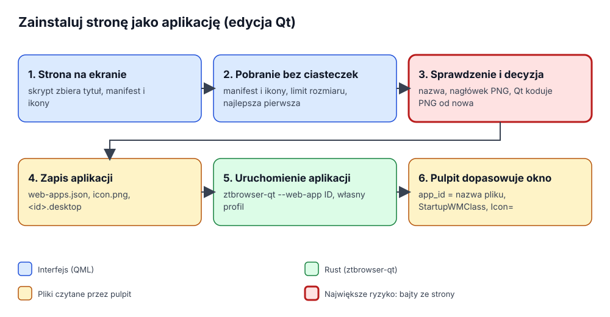

# Aplikacje internetowe w edycji Qt

Stronę można zainstalować jako osobną aplikację: dostaje wpis w menu aplikacji, ikonę, okno bez kart i paska adresu
oraz profil, który nie dzieli z przeglądarką ciasteczek ani logowań. Dokument opisuje, jak robi to edycja Qt (1.2);
zachowanie jest takie jak w edycji GTK, łącznie z tekstami.

## 1. Problem

Żeby zainstalowana aplikacja wyglądała na pulpicie poprawnie, muszą się zgodzić trzy rzeczy, a pierwsza wersja
każdej implementacji zwykle jedną pomija:

- **ikona** ma być dobrym obrazem strony (nie ikoną przeglądarki i nie rozmytą ikonką z karty, gdy strona ma 512 px);
- pulpit musi **dopasować działające okno do pliku `.desktop`**, który niesie tę ikonę, inaczej pasek zadań pokazuje
  ogólną ikonę Wayland albo Chromium;
- drugie uruchomienie (wpis w menu aplikacji już otwartej, link w aplikacji, który ma iść do przeglądarki) musi
  **dotrzeć do działającego procesu**, bo plików profilu Chromium nie da się otworzyć dwa razy.

## 2. Słownik

| Pojęcie | Znaczenie |
|---|---|
| **Manifest** | Plik JSON, do którego strona linkuje przez `<link rel="manifest">`: nazwa aplikacji, strona startowa, ikony. |
| **Identyfikator aplikacji** | `io.github.ztbrowser.ZTBrowser.WebApp.<slug>`. Okno go ogłasza (Wayland `app_id`, klasa okna X11), a pulpit szuka `<identyfikator>.desktop`. |
| **`StartupWMClass`** | Klucz `.desktop` z nazwą klasy okna X11; równa się identyfikatorowi aplikacji. |
| **Izolowany świat** | Osobne środowisko JavaScript tej samej strony: widzi jej DOM, strona go nie widzi. |
| **Jedna instancja** | Jeden proces na identyfikator; kolejne uruchomienia przekazują adresy i kończą się. |

## 3. Jak to się łączy

1. **Zebranie.** `PageMetadata::COLLECTOR_SCRIPT` działa w izolowanym świecie otwartej strony i zwraca tytuł, link do
   manifestu i linki do ikon (`WebAppInstallation.qml`).
2. **Pobranie.** Interfejs pobiera manifest i ikony przez `XMLHttpRequest`, który nie wysyła ciasteczek, z limitem
   rozmiaru (512 KiB manifest, 2 MiB ikona) i dziesięciosekundowym czasem oczekiwania.
3. **Decyzja i sprawdzenie** (`WebAppInstaller`, `web_app_bridge.rs`). Manifest wygrywa tam, gdzie ma zdanie, strona
   uzupełnia braki, a strona startowa musi zostać w tym samym pochodzeniu co strona (`WebAppDraft`). Ikony są
   próbowane od najostrzejszej (`SiteIconChoice`: zwykła przed maskowaną, większa przed mniejszą, manifest przed
   apple-touch przed favicon). Kandydat jest przyjęty tylko, gdy nagłówek PNG deklaruje rozsądne wymiary *oraz* gdy
   dekoder Qt go odczyta i zapisze od nowa (`reencode_png`): ładowarka ikon pulpitu widzi tylko bajty zapisane przez
   Qt. Ostatnią deską ratunku jest favicon strony; strona bez użytecznej ikony dostaje ikonę ZTBrowsera (`icon.svg`).
4. **Zapis.** Katalog (`web-apps.json`, wspólny z edycją GTK), `web-apps/<id>/icon.png` oraz
   `~/.local/share/applications/<identyfikator>.desktop`. Katalog zapisuje się jako ostatni, więc awaria w połowie
   nie zostawia aplikacji, która nie wystartuje. Każda wartość w pliku `.desktop` jest escapowana (`DesktopEntry`):
   nazwa pochodzi ze strony i nie może dopisać linii `Exec=`.
5. **Start.** `ztbrowser-qt --web-app <id>` (plik AppImage, gdy działamy z AppImage) otwiera okno aplikacji w profilu
   `app_<id>`. Przeglądarka zamyka wtedy karty, które pokazywały tę stronę.
6. **Dopasowanie.** Przy starcie proces ustawia nazwę aplikacji, nazwę pliku desktop i ikonę okna z danych aplikacji
   (`LaunchContext`, `BrowserApplication`), więc klasa okna równa się `StartupWMClass`, `app_id` Wayland równa się
   nazwie pliku, a okno ma własną ikonę aplikacji.

## 4. Okno aplikacji

Jedna strona, bez kart i paska adresu: wstecz, odśwież, tytuł strony nad jej hostem, znacznik powiększenia i menu
(powiększenie, „Chroń tę witrynę”, „Otwórz stronę w przeglądarce”, „Wyczyść dane aplikacji…”, „O programie
ZTBrowser”). Kliknięty link do innej witryny otwiera się w przeglądarce, a aplikacja zostaje, gdzie była;
przekierowania i nawigacje ze skryptów zostają, bo na nich polegają logowanie i 3-D Secure
(`WebAppNavigationPolicy`). Strona spoza witryny aplikacji pokazuje swój host w kolorze ostrzegawczym, żeby aplikacja
banku nie mogła pokazać strony wyłudzającej dane pod nazwą banku.

## 5. Decyzje i odrzucone alternatywy

- **Ikony dekoduje i koduje od nowa Qt, nie są kopiowane.** Skopiowanie bajtów ze strony do pliku, który dekoduje
  powłoka pulpitu, dałoby wrogie dane wejściowe dekoderowi poza piaskownicą przeglądarki.
- **Pobieranie w QML, decyzje w Rust.** QML ma klienta HTTP bez ciasteczek; Rust ma politykę i testy. Crate HTTP w Rust
  dodałby zależność i drugi stos sieciowy dla dwóch małych pobrań.
- **Gniazdo Unix dla jednej instancji, nie D-Bus.** Gniazdo nie wymaga demona ani biblioteki; leży w katalogu
  uruchomieniowym `0700` i przyjmuje tylko adresy `http(s)`.

## 6. Strona zainstalowanych aplikacji

*Zainstalowane aplikacje…* w menu głównym otwierają kartę z zainstalowanymi aplikacjami jako kafelkami (ikona, nazwa,
host, *Otwórz* i *Odinstaluj*), jak strony aplikacji w innych przeglądarkach. Strona to statyczny HTML budowany przez
`InstalledAppsPage` z rdzenia na podstawie katalogu i wczytywany jako tekst pod adresem `ztbrowser://apps`; każda ikona
jest wstawiona jako adres `data:`, więc strona nie potrzebuje dostępu do plików, a Content-Security-Policy nie pozwala
na skrypty ani sieć. Jej linki używają dwóch prywatnych schematów (`ztbrowser-app-open:<id>`,
`ztbrowser-app-uninstall:<id>`), które `BrowserTab` obsługuje zamiast nawigować, i to tylko gdy ta karta pokazuje stronę
aplikacji, więc żadna inna strona ich nie wywoła. Odinstalowanie najpierw pyta, potem usuwa wpis katalogu, wpis pulpitu,
ikonę oraz ciasteczka i dane aplikacji (`InstalledWebApps::uninstall`); odmawia, gdy okno aplikacji jest otwarte, co
rozpoznaje przez sondowanie gniazda pojedynczej instancji aplikacji. Otwarcie, instalacja i odinstalowanie aplikacji
odświeżają otwartą stronę aplikacji.

## 7. Jeszcze nie zrobione

Okna wyskakujące, które otwiera aplikacja (OAuth, potwierdzenie płatności), otwierają się w widoku samej aplikacji, a nie
w małym oknie powiązanym z otwierającym; brakuje też okna Tor. Do uzupełnienia przy zakończeniu zadania o aplikacjach w planie Qt (zadanie 12).
