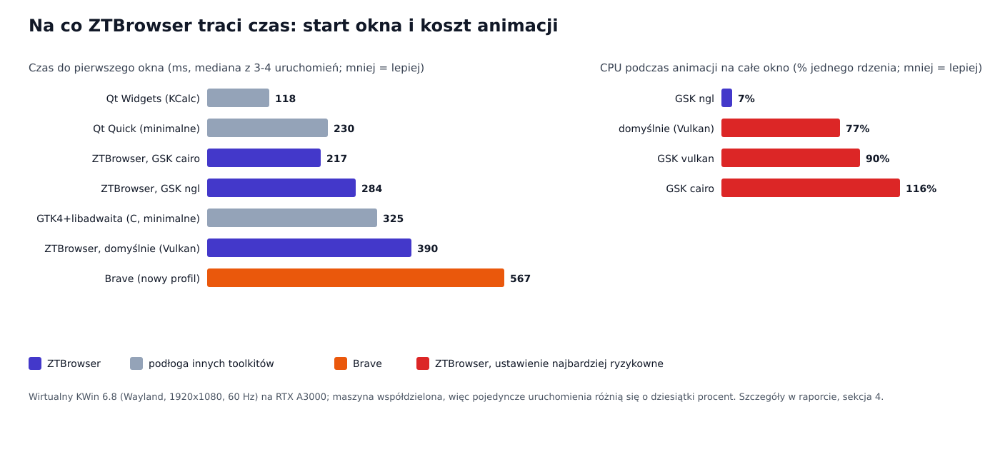

# Analiza wydajności: gdzie ZTBrowser traci czas i co zmienić

Zmierzone 4 listopada 2026 (09:00–10:40 CET) na jednej maszynie z Linuksem, dla ZTBrowsera 1.1.0. Ten dokument to
analiza i lista propozycji. **W kodzie nic nie zmieniono**; przy każdej propozycji jest opisane, jak sprawdzić jej
efekt, zanim zostanie przyjęta.

## 1. Na co odpowiada ten raport

Cel postawiony ZTBrowserowi: ma sprawiać wrażenie co najmniej tak szybkiego jak przeglądarka na macOS. Strony
pojawiają się szybko, a samo okno (karty, menu, przewijanie, zmiana rozmiaru) nigdy nie szarpie. Z tego wynikają
trzy pytania.

1. **Czy sam interfejs jest wolny?** Mierzony bez ładowania jakiejkolwiek strony i porównany z innymi toolkitami
   (GTK z Qt) na tym samym kompozytorze KDE.
2. **Czy renderowanie stron jest wolne i czy korzysta z karty graficznej tak, jak powinno?** Pytanie o pamięć
   wideo (VRAM), pamięć systemową (RAM) i magistralę PCI Express ma odpowiedź w §4.3 i §4.5.
3. **Jaki narzut ZTBrowser dokłada ponad WebKit** (listy filtrów, ochrony, kod w Ruście)?

Krótka odpowiedź jest w §5, propozycje uszeregowane według zysku w §6. To, czego nie dało się zmierzyć, i czego
liczby nie dowodzą, jest w §7.

## 2. Słownik

| Termin | Znaczenie |
|---|---|
| GTK 4, libadwaita | Toolkit, z którego zbudowane jest okno ZTBrowsera. WebKitGTK, jedyny port WebKita na Linuksa, go wymaga, więc nie da się go wymienić bez wymiany silnika (patrz przegląd architektury). |
| Qt, Qt Quick, Qt Widgets | Toolkit KDE. Tu użyty tylko jako miara: jak szybko może pojawić się trywialne okno na tym pulpicie? |
| Kompozytor (KWin) | Program, który układa okna wszystkich aplikacji na ekranie. W KDE to KWin. |
| Wayland | Protokół między aplikacjami a kompozytorem. Okno jest „narysowane”, gdy aplikacja wyśle kompozytorowi pierwszy bufor. |
| Renderer GSK | GTK rysuje interfejs przez renderer: `ngl` (OpenGL), `vulkan` (Vulkan) albo `cairo` (procesor, bez karty graficznej). |
| DMABuf | Sposób współdzielenia przez procesy bufora leżącego w pamięci wideo bez kopiowania. WebKit renderuje strony do buforów DMABuf, a kompozytor je pokazuje. |
| VRAM / RAM / PCIe | Pamięć wideo na karcie graficznej / pamięć systemowa / magistrala między procesorem a kartą. |
| PSS | Proportional set size: pamięć procesu, w której biblioteki współdzielone są podzielone między procesy, które z nich korzystają. Uczciwa liczba dla pytania „ile to zajmuje pamięci”. |
| Speedometer 3.1 | Benchmark uruchamiający realne obciążenia aplikacji webowych (JavaScript, DOM) i podający jeden wynik; więcej = lepiej. |
| Czas do pierwszego okna | Od uruchomienia programu do pierwszego niepustego bufora wysłanego do kompozytora. |
| Czas do strony | Od uruchomienia programu do pierwszej namalowanej klatki strony serwowanej z lokalnej maszyny (bez sieci). |

## 3. Jak mierzono

**Maszyna.** Intel Core i9-11950H (8 rdzeni, 16 wątków), NVIDIA RTX A3000 Laptop GPU (6 GB VRAM, sterownik
580.196.07) oraz grafika Intel UHD w procesorze, 125 GB RAM, Linux 6.18, KWin 6.8.2, GTK 4.24.1, libadwaita
1.10.0, WebKitGTK 2.54.2, Mesa 26.2.4, Brave 1.98.63 (Chromium 156). KWin na prawdziwym pulpicie tej maszyny
renderuje na karcie NVIDIA (sprawdzone przez `nvidia-smi`).

**Kompozytor.** Konto deweloperskie nie ma dostępu do sesji pulpitu użytkownika, więc obok działał prywatny
`kwin_wayland --virtual`: ten sam KWin, wirtualny ekran 1920×1080 przy 60 Hz, prawdziwa kompozycja na GPU na
karcie NVIDIA. Każdy program działał na nim jako natywny klient Wayland z własnymi tymczasowymi katalogami
`XDG_*`, więc żaden prawdziwy profil nie został dotknięty.

**Czas do pierwszego okna.** `WAYLAND_DEBUG=1` wypisuje każdy komunikat protokołu ze znacznikiem czasu.
Uruchamiano program i brano czas jego pierwszego `wl_surface.attach` z niepustym buforem, po którym następuje
`commit`. W żadnym programie nie zmieniano w tym celu kodu.

**Czas do strony.** Malutki lokalny serwer WWW serwował stronę, która po dwóch pierwszych klatkach animacji po
zdarzeniu `load` zgłasza się z powrotem. Czas od uruchomienia przeglądarki do tego zgłoszenia to czas do strony.
Tę samą stronę i metodę zastosowano dla ZTBrowsera, Brave i gołego okna WebKitGTK (`WebKit.WebView`, bez ochron).

**Koszt animacji.** Strona animująca element na całe okno przez `requestAnimationFrame` przez sześć sekund;
strona liczy klatki, a czas procesora wszystkich procesów przeglądarki jest czytany z `/proc`. Uruchamiane
w gołym oknie WebKitGTK z `GSK_RENDERER` ustawionym na każdy renderer.

**Szybkość silnika.** Speedometer 3.1 doprowadzony do końca; WebKitGTK sterowany małym programem z
`WebKit.WebView`, Brave sterowany przez Chrome DevTools Protocol.

**Pamięć.** PSS z `/proc/<pid>/smaps_rollup`, zsumowane po drzewie procesów przeglądarki, gdy program był
bezczynny 6–10 sekund (raz próbkowane co 3 s przez 42 s: stabilnie w granicach 2 %).

**Granice metody.** Maszyna jest współdzielona: w tym samym czasie działały programy innych użytkowników (IDE,
Brave, Teams), więc pojedyncze uruchomienie różni się o dziesiątki procent. Wnioski poniżej opierają się tylko
na różnicach większych niż ten szum, a każda liczba to mediana z 3–4 uruchomień, o ile nie napisano inaczej.
Binarka do profilowania była zbudowana profilem release plus symbole (ta sama optymalizacja, `strip = false`).

## 4. Wyniki

### 4.1 Start

| Program | Czas do pierwszego okna | Czas do strony | Pamięć w spoczynku (PSS) |
|---|---|---|---|
| ZTBrowser, nowa karta (ustawienia domyślne) | 380–660 ms | 630–1060 ms | 656 MB, 3 procesy + pomocnicze piaskownicy |
| ZTBrowser, strona lokalna | | | 475 MB |
| Gołe okno WebKitGTK (Python, `about:blank`) | 950 ms (z uruchomieniem Pythona) | 540–920 ms | 341 MB |
| Brave, nowy profil | 405–950 ms | 330–555 ms | 385 MB (strona lokalna) |

Dwa fakty ważą więcej niż same liczby.

- **Proces strony startuje w tej samej chwili, w której pojawia się pierwsze okno, a nie wcześniej.** Na osi
  czasu procesów `WebKitWebProcess` i jego piaskownica (`bwrap`, `xdg-dbus-proxy`) powstają 25–40 ms po pierwszej
  klatce. Czas od okna do strony (ok. 200–250 ms) to w większości start tego procesu.
- **Własny narzut ZTBrowsera ponad gołe okno WebKit to ok. 100–200 ms do strony i ok. 90 MB pamięci** (475 MB
  wobec 385 MB Brave na tej samej stronie; proces główny trzyma ok. 160 MB pamięci prywatnej wobec ok. 90 MB
  w gołym oknie). Ochrony (skrypty content-scope, skompilowane listy reguł, dane o trackerach) tłumaczą to
  wiarygodnie, ale nie rozbito tego na funkcje: patrz §7.

### 4.2 Czy GTK w KDE jest za wolne? (interfejs bez stron)

| Minimalne okno, Wayland, KWin | Czas do pierwszego okna |
|---|---|
| Qt Widgets (KCalc) | 80–150 ms |
| Qt Quick (puste okno) | 176–275 ms |
| GTK 4 + libadwaita (program w C, puste okno) | 319–472 ms (mediana 325) |
| ZTBrowser | 378–397 ms (ta sama seria, renderer domyślny) |

GTK 4 pokazuje pierwsze okno na tej maszynie o ok. 100–200 ms wolniej niż Qt i nie robi tego aplikacja: program
w C z jedną etykietą i paskiem nagłówka potrzebuje tych samych 325 ms. ZTBrowser dokłada do tej podłogi tylko ok.
65 ms przy domyślnym rendererze. Toolkit kosztuje więc stałą, skromną kwotę, której program nie usunie, a pytanie
sprowadza się do jego konfiguracji (§4.3). Qt wystartowałby szybciej, ale o szybkości przeglądarki nie decyduje
toolkit interfejsu; a Slint w ogóle nie potrafi osadzić WebKitGTK.

### 4.3 Renderowanie i karta graficzna

**WebKit już renderuje na karcie graficznej.** Własna strona WebKit `webkit://gpu` podaje: polityka akceleracji
sprzętowej `always`, WebGL włączony, canvas 2D przyspieszany, renderer **DMABuf** z buforami sprzętowymi na
`/dev/dri/renderD128` (karta NVIDIA). Strony są rysowane do pamięci wideo i przekazywane kompozytorowi bez
kopiowania przez procesor. Nie ma więc nieużywanej pamięci VRAM, którą dałoby się zagospodarować, a magistrala
PCIe nie leży na drodze klatki; `nvidia-smi` pokazał łącze w spoczynku jako Gen 1 ×16 (podnosi się samo, gdy
trzeba). Użycie większej ilości VRAM albo RAM miałoby znaczenie tylko dla czegoś, czego przeglądarka nie robi:
ogranicza ją szybkość JavaScriptu i układu strony w jednym wątku oraz liczba kopii potrzebnych na klatkę, a nie
rozmiar pamięci czy przepustowość magistrali.

**Ale GTK rysuje własny interfejs rendererem nietrafionym dla tej maszyny.** GTK 4.24.1 wybrał tu domyślnie
`GskVulkanRenderer` (potwierdzone przez `GSK_DEBUG=renderer`). Test animacji, sześć sekund w pełnym oknie
1600×900:

| `GSK_RENDERER` | Klatki na sekundę | Użycie procesora (jednego rdzenia) | Czas do pierwszego okna |
|---|---|---|---|
| domyślny (= vulkan) | 47–51 | 75–78 % | 378–397 ms |
| `ngl` | 58–60 | **6–8 %** | 245–284 ms (jedno odstające 643 ms) |
| `vulkan` | 58–60 | 86–93 % | 413–426 ms |
| `cairo` | 60 | 98–134 % | 214–220 ms |

`ngl` jest ok. dziesięć razy tańszy od domyślnego, nie gubi klatek i do tego pokazuje okno ok. 100 ms
wcześniej. `cairo` startuje najszybciej i oszczędza ok. 95 MB pamięci (sterownik graficzny nie jest ładowany do
procesu interfejsu), ale na animację zużywa cały rdzeń, więc odpada. Przyczynę kosztu domyślnego
renderera udowodniono później (§4.6): przy Vulkanie GTK nie potrafi zaimportować klatek strony od WebKit i
kopiuje każdą przez pamięć główną.

### 4.4 Sam silnik

Speedometer 3.1, ta sama maszyna, ten sam kompozytor:

| Silnik | Uruchomienia | Średnia |
|---|---|---|
| WebKitGTK 2.54.2 (gołe okno, więc bez ochron ZTBrowsera) | 14,7; 17,5; 14,1 | 15,4 |
| Brave 1.98.63 (Chromium 156) | 21,8; 19,5 | 20,7 |

WebKit na Linuksie jest w tym benchmarku o ok. 25 % wolniejszy od Chromium. Ta różnica leży w silniku, którego
ZTBrowser nie kontroluje; może tylko podążać za aktualizacjami WebKitGTK w dystrybucji (§6, propozycja 6).

### 4.5 Pamięć

| Proces | PSS, nowa karta | PSS, strona lokalna |
|---|---|---|
| `ztbrowser` (interfejs, ochrony) | 458 MB przy pierwszym uruchomieniu, 302 MB po ustabilizowaniu | 268 MB |
| `WebKitWebProcess` | 296–315 MB | 172 MB |
| `WebKitNetworkProcess` | 45 MB | 35 MB |
| Razem | 656 MB (po ustabilizowaniu) | 475 MB |

Nowa karta ładuje prawdziwą stronę wyszukiwarki, dlatego jej proces strony jest większy niż dla trywialnej strony
lokalnej. Pamięć nie jest tym, przez co ZTBrowser sprawia wrażenie wolnego: 125 GB RAM leży bezczynnie, a wynik
mieści się w granicach 25 % wyniku Brave na tej samej stronie.

### 4.6 Ciężka prawdziwa strona: https://www.bpxglobal.com/ (znaleziona przyczyna)

Właściciel zgłosił drastyczne przycinanie i wolne przewijanie tej strony, wyraźnie gorsze niż w Brave. To witryna
WordPress: dokument 1,6 MB, pełnoekranowe, automatycznie odtwarzane wideo 1080p H.264 (13,9 Mb/s, 38 MB, w pętli),
19 animacji GSAP przy przewijaniu, 36 reguł `will-change` i 87 wstawionych SVG. Skrypt przewija stronę z prędkością
1400 px/s przez osiem sekund w oknie 1600×900 i zapisuje odstępy między wywołaniami `requestAnimationFrame` (klatki
strony); czas procesora jest czytany per wątek z `/proc`. Ten sam skrypt uruchomiono w Brave (CDP) w tym samym
prywatnym kompozytorze.

| Konfiguracja | Klatki na sekundę | 95. percentyl odstępu klatek | Procesor (jednego rdzenia) |
|---|---|---|---|
| Brave 1.98 | 59,5 | 16,7 ms | 58–67 % |
| WebKitGTK, domyślny renderer GTK (Vulkan) | 38–48 | 35–50 ms | **181–219 %** |
| WebKitGTK, renderer OpenGL (`gl`/`ngl`) | 49–60 | 19–35 ms | 56–66 % |
| ZTBrowser w spoczynku na stronie (wideo gra) | | | 30–40 % (goły WebKitGTK: 50–61 %) |

**Przyczyna.** `GDK_DEBUG=dmabuf` pokazuje dla każdej klatki (828–955 wierszy w osiem sekund): `Vulkan driver does not
support format XR24:0x0300000000e08014`, a po nim `Used GskGLRenderer for downloading 1600x900 dmabuf`.
`0x0300000000e08014` to modyfikator NVIDIA (układ blokowy). WebKit rysuje stronę na karcie i oddaje GTK bufor w tym
układzie; renderer Vulkan nie umie go zaimportować, więc GTK importuje go do OpenGL, **odczytuje klatkę do pamięci
głównej** i wysyła ją z powrotem. Widok per wątek się zgadza: główny wątek procesu interfejsu zużywał 65–69 %
rdzenia, a około szesnastu wątków `pool-*` po 5 %, podczas gdy proces strony 30 %, a wątek kompozytora 12 %. Z
rendererem OpenGL ten sam log pokazuje tylko `Imported … dmabuf as GL_TEXTURE_2D` (bez kopiowania), a proces
interfejsu prawie znika z profilu. W głównym wątku procesu interfejsu lądują też zdarzenia przewijania, więc jego
zapchanie opóźnia również wejście (wniosek, niezmierzony: w prywatnym kompozytorze nie było syntetycznego kółka
myszy).

**Nie jest przyczyną.** Wideo w tle (przebiegi z nim i bez niego wahają się tak samo, a maszyna dekoduje H.264 na
karcie: `nvh264dec` i `vah264dec` mają wyższy priorytet niż `avdec_h264`); dekodowanie programowe (wyłączenie
dekoderów sprzętowych niczego wymiernie nie zmieniło); ochrony ZTBrowsera (w spoczynku na tej stronie zużywa mniej niż
goły WebKitGTK, bo blokuje trackery); liczba wątków malowania Skia i `WEBKIT_DISABLE_COMPOSITING_MODE` (bez zysku).

**Druga przyczyna (znaleziona po pierwszej poprawce): skrypt strony Guarda.** Z rendererem OpenGL ZTBrowser nadal
przewijał tę stronę z prędkością 4 klatek/s, z przerwami 0,8–1,4 s, podczas gdy goły WebKitGTK dawał 47 klatek/s.
Główny wątek procesu strony był zajęty w 95 % (goły: 35 %). Wyłączanie po jednej warstwie (tymczasowy build,
niezachowany) wskazało winowajcę:

| Wyłączone | Klatki/s | 95. percentyl przerwy | Główny wątek procesu strony |
|---|---|---|---|
| nic | 4,2 | 760 ms | 95 % |
| Content Scope Scripts | 4,0 | 1090 ms | 94 % |
| reguły blokera treści | 51,5 | 34 ms | 34 % |
| skrypt strony Guarda | 58,2 | 19 ms | 37 % |

(Bez reguł skrypt Guarda nie znajduje żadnej listy i od razu kończy, więc te dwa wiersze mierzą to samo.)
`generic-hiding.js` obserwuje każdą zmianę `id` i `class` i co 50 ms testuje każdy zmieniony element względem
wszystkich selektorów ogólnych bez klasy i id (`matches` i `querySelector` z jedną bardzo długą listą selektorów).
19 animacji przewijania na stronie zmienia klasy w każdej klatce, a ten sam element trafiał do kolejki przy każdej
zmianie, więc testy powtarzały się tysiące razy dla stanów już sprawdzonych.
**Poprawka:** kolejka to `Set`, a zmieniony element trafia do niej tylko wtedy, gdy jego stan `id|class` nie był
jeszcze testowany (ukrywanie jest trwałe, więc powtórzony stan nie ukryje niczego nowego). Ta sama strona, te same
zabezpieczenia: 57–59 klatek/s, 95. percentyl przerwy 18 ms, główny wątek procesu strony 18–20 %, na poziomie
Brave (59,5 klatki/s). Ukrywanie nadal działa, także dla klasy zmienionej po załadowaniu. Skrypt nie ma jeszcze
własnego testu automatycznego; sprawdziłem go stroną, która dodaje, zdejmuje i znów dodaje `ad-banner` i odczytuje
obliczone `display`.

**Co zostaje.** Z rendererem OpenGL przebieg ląduje w jednym z dwóch trybów: ok. 59 fps (p95 19 ms) albo ok. 49 fps
(p95 34 ms, co ósma klatka trwa dwa odświeżenia), z wideo i bez, podczas gdy Brave trzyma 59,5 w każdym przebiegu.
Prywatny kompozytor to wirtualne wyjście 60 Hz napędzane zegarem, więc część może być artefaktem pomiaru; trzeba to
potwierdzić na prawdziwej sesji, zanim zrobimy coś więcej.

**Zastosowano.** Propozycja 1 (§6): ZTBrowser uruchamia się teraz raz ponownie z rendererem OpenGL GTK (`gl` od GTK
4.16, wcześniej `ngl`), chyba że `GSK_RENDERER` jest już ustawione. W prawdziwej aplikacji log pokazuje `Using
renderer 'GskGLRenderer'` i zero wierszy `downloading`; po wymuszeniu `GSK_RENDERER=vulkan` wracają 919.

## 5. Co mówią pomiary

1. **Największy pojedynczy koszt to wybór konfiguracji, a nie kod.** Domyślny renderer GTK pali ok. 75 % rdzenia
   na trywialnej animacji, gdzie `ngl` pali 7 %. Każde przewijanie, zmiana rozmiaru czy wideo w oknie idzie tą
   ścieżką.
2. **Toolkit ma stałą podłogę startu ok. 325 ms** (GTK 4) wobec 120–230 ms dla Qt. ZTBrowser dokłada do niej tylko
   ok. 65 ms; reszta czasu do pierwszego okna to toolkit.
3. **Strona pojawia się 200–250 ms po oknie, bo proces strony jest startowany dopiero wtedy.** Ten start może
   nakładać się na budowę okna.
4. **WebKit jest ok. 25 % za Chromium w surowej szybkości JavaScriptu na tym sprzęcie.** ZTBrowser tego nie zmieni.
5. **Karta graficzna, VRAM i PCIe są już używane we właściwy sposób.** Nie ma tam nic do odblokowania.
6. **Własny narzut ZTBrowsera jest umiarkowany** (100–200 ms do strony, ok. 90 MB), realny, ale drugorzędny.

## 6. Propozycje, uszeregowane według spodziewanego zysku

| # | Propozycja | Spodziewany zysk | Koszt i ryzyko | Jak sprawdzić |
|---|---|---|---|---|
| 1 | **Zastosowano (§4.6).** Używać renderera OpenGL GSK (`gl`, przed GTK 4.16 `ngl`), chyba że użytkownik sam ustawił `GSK_RENDERER`. | Ok. 10× mniejsze użycie procesora w oknie, stabilne 60 fps, ok. 100 ms szybsze pierwsze okno. | Mały. Przy `unsafe_code = forbid` program nie może wywołać `set_var`, więc uruchamia się sam raz jeszcze z ustawioną zmienną (bezpieczne `CommandExt::exec`); pliki `.desktop` i `AppRun` w AppImage też ją ustawiają. Tam, gdzie OpenGL nie działa, GTK wraca sam do innego renderera. | Powtórzyć §4.3 na prawdziwej sesji KDE (prawdziwy monitor, może 144 Hz, obie karty: NVIDIA i Intel), także z przewijaną prawdziwą stroną. |
| 2 | Tworzyć widok WWW i zaczynać ładowanie pierwszej strony przed zbudowaniem reszty okna, żeby `WebKitWebProcess` startował równolegle z układem GTK. | Do 200 ms do strony. | Mały do średniego: zmienia się kolejność startu w `BrowserWindow`; okno Tor nadal nie może niczego ładować, zanim Tor się połączy. | Czas do strony (§3) przed i po, po 10 uruchomień. |
| 3 | Znaleźć te 90 MB i 100–200 ms, które ZTBrowser dokłada ponad gołe okno WebKit, profilując buildem z symbolami (profiler próbkujący, np. `perf` lub `samply`, plus profiler sterty). | Nieznany do czasu profilowania; kandydaci to dane o trackerach i listy reguł trzymane w procesie interfejsu oraz skrypty wstrzykiwane do każdej ramki. | Wymaga zainstalowania `perf` lub `samply` i profilera sterty (niedostępne na maszynie pomiarowej). | Te same pomiary pamięci i czasu do strony. |
| 4 | Nie wprowadzać renderera `cairo` do produktu. | Unika pułapki: startuje najszybciej i zajmuje najmniej pamięci, ale pali cały rdzeń na animację. | Brak. | Już zmierzone. |
| 5 | Nie wymuszać dyskretnego GPU dla treści stron (`DRI_PRIME`). | Unika kosztu baterii bez zysku: kompozytor już renderuje tu na karcie NVIDIA; na laptopie, gdzie tak nie jest, wymuszenie przeniosłoby każdą klatkę przez PCIe. | Brak. | Niepotrzebne. |
| 6 | Śledzić wydania WebKitGTK i udokumentować minimalną wersję; każdą aktualizację sprawdzać procedurą Speedometera z §3. | Tyle, ile zyska WebKit. | Brak po stronie kodu. | Speedometer 3.1 przed i po. |
| 7 | **Strategiczne, do decyzji właściciela:** wersja oparta na Chromium (np. Qt WebEngine) byłaby, gdyby dorównała wynikowi Brave tutaj, o ok. 35 % szybsza w tym benchmarku, ale wymienia silnik, porzuca natywny projekt oparty na WebKit i ma inną powierzchnię prywatności. | Do ok. 35 % w benchmarkach JavaScriptu (wynik Brave tutaj; wersji z Qt WebEngine nie mierzono). | Nowy produkt, a nie optymalizacja. | Nie proponuję; zapisane, by kompromis był widoczny. |

Propozycje 1 i 2 są małe i niezależne. Propozycja 3 wymaga najpierw narzędzi. Ustawienia profilu release (`lto =
"fat"`, `codegen-units = 1`) są już tak agresywne, jak się da; `panic = "abort"` zmniejszyłby binarkę i nie
oczekuje się, żeby zmienił szybkość w mierzalny sposób.

## 7. Czego nie zmierzono i granice tych liczb

- **macOS nie był dostępny.** „Porównywalny z macOS” nie da się tu zweryfikować. Safari na Apple silicon to inny
  build silnika na innym sprzęcie; ten raport mierzy ZTBrowser względem Brave na tej samej maszynie, i to jest
  dostępne uczciwe porównanie. Dojście do szybkości macOS jest ograniczone przez linuksowy port WebKit i przez
  sprzęt, a żadna z powyższych propozycji tego nie obiecuje.
- **Kompozytor był wirtualny** (1920×1080, 60 Hz) na tym samym GPU co prawdziwy pulpit. Prawdziwy monitor
  o wyższym odświeżaniu, dwa monitory i skalowanie ułamkowe mogą zachowywać się inaczej; propozycję 1 trzeba
  potwierdzić na prawdziwej sesji użytkownika, zanim zostanie przyjęta.
- **Brak profilu na poziomie funkcji.** `perf`, `strace`, `heaptrack` i `hyperfine` nie są zainstalowane na
  maszynie pomiarowej, więc narzut z §4.1 przypisano przez porównanie (ZTBrowser z gołym oknem), a nie przez
  profilowanie.
- **Opóźnienie interfejsu na klatkę** (menu, przełączanie kart, zmiana rozmiaru) przybliżono testem animacji,
  nie mierzono na prawdziwym interfejsie.
- **Małe próbki** (2–4 uruchomienia) na zajętej maszynie; wnioski opierają się tylko na dużych różnicach.
- **Koszt Guard na prawdziwych stronach** nie był mierzony ponownie; wcześniejszy raport zmierzył koszt renderowania
  z Guard jako równy zeru.

## 8. Jak to powtórzyć

Skrypty są małe i leżą poza repozytorium (potrzebują tylko Pythona z PyGObject, `gcc`, prywatnego
`kwin_wayland --virtual --socket NAZWA` i `WAYLAND_DEBUG=1`). Procedura z §3 jest dość pełna, by je napisać od
nowa; jeśli mają trafić do repozytorium jako narzędzie deweloperskie, wystarczy powiedzieć.
