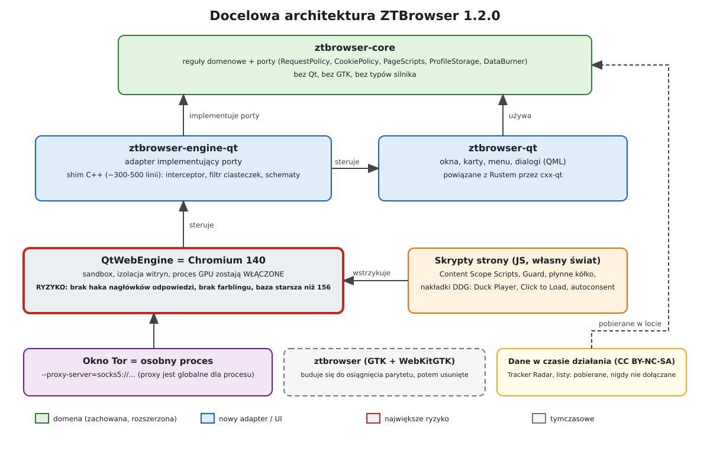

# Projekt: ZTBrowser 1.2.0 na QtWebEngine (Chromium)

Status: **szkic do zatwierdzenia (kontrola wykonawcy zrobiona, odpowiedzi właściciela uwzględnione)** · Gałąź: `feature/1.2.0` · Data: 2026-11-04 · Wersja kanoniczna (EN):
`docs/en/specs/2026-11-04-qtwebengine-migration-design.md`

## 1. Po co ten dokument

ZTBrowser 1.1.2 działa na **WebKitGTK**, silniku przeglądarkowym GNOME. Mimo wielu iteracji rysowanie stron nigdy
nie dorównało Brave. Znaleziono i naprawiono trzy realne przyczyny (wolny renderer graficzny, skrypt strony
sprawdzający elementy w każdej klatce animacji, gwałtowna animacja kółka myszy w WebKit), ale ostatni pomiar, na
rozdzielczości właściciela (zob. §3), nadal wskazuje sam silnik jako ograniczenie:

| Test (bpxglobal.com, 8 s przewijania skryptem, prawdziwe GPU, pełny ekran 3840×2160) | Brave 156 | QtWebEngine (Chromium 140) | ZTBrowser 1.1.2 (WebKitGTK) |
|---|---|---|---|
| klatki na sekundę | 59,8 | 57,7 | 43,8 |
| 95. percentyl odstępu między klatkami | 16,8 ms | 16,7 ms | 35 ms |
| klatki dłuższe niż 33 ms | 1 | 3 | 56 |
| pamięć (PSS, całe drzewo procesów) | 822 MB | 945 MB | 941 MB |

Właściciel zdecydował o przejściu na **silnik oparty o Chromium** i oczekuje przeglądarki „tak szybkiej i lekkiej
jak Brave, ze wszystkimi optymalizacjami i interfejsem dokładnie takim jak teraz”, której zabezpieczenia idą
**dalej niż DuckDuckGo i Brave** w ochronie przed śledzeniem i dla anonimowości. Wybrana droga to
**QtWebEngine**, czyli Chromium opakowane dla Qt, z interfejsem napisanym od nowa w Qt.

## 2. Słownik pojęć

| Pojęcie | Znaczenie |
|---|---|
| **Silnik** | Oprogramowanie ładujące i rysujące strony (WebKit, Chromium). |
| **QtWebEngine** | Pakiet Qt z Chromium. Udostępnia małe API (profile, widoki, interceptory) zamiast całej przeglądarki Chrome. |
| **Profil** | Osobny świat cookies, pamięci, cache i uprawnień jednej osoby. ZTBrowser uruchamia jeden proces na profil. |
| **Interceptor** | Funkcja wywoływana przez silnik dla każdego żądania sieciowego *przed* wysłaniem; może je przepuścić, zablokować lub przekierować. |
| **Farbling** | Technika Brave: drobny, losowy (per witryna) szum w wartościach dostępnych dla strony (canvas, audio, WebGL), aby nie dało się rozpoznać przeglądarki. Wymaga łatek wewnątrz Chromium. |
| **Fingerprinting** | Rozpoznawanie przeglądarki po zestawie wielu szczegółów technicznych zamiast po cookies. |
| **Partycjonowanie pamięci** | Oddzielne przechowywanie danych osadzonej ramki zewnętrznej dla każdej witryny, która ją osadza, aby nie łączyła wizyt między witrynami. |
| **Content Scope Scripts** | Otwartoźródłowy JavaScript DuckDuckGo utwardzający API stron. ZTBrowser już go uruchamia. |
| **Guard** | Nazwa w ZTBrowserze dla generycznego ukrywania elementów i silnika list filtrów (na bazie crate `adblock`). |
| **Port / adapter** | *Port* to interfejs należący do domeny (`ztbrowser-core`); *adapter* implementuje go dla konkretnej technologii (GTK, Qt). |
| **Shim** | Cienka warstwa C++ dająca Rustowi dostęp do klas Qt, których nie obejmują wiązania Rusta. |

## 3. Cele, nie-cele, anty-cele

### Cele

1. **Rysowanie i przewijanie tak dobre jak w Brave na maszynie właściciela.** Mierzone benchmarkiem z §8 w
   rozdzielczościach 2560×1440 i 3840×2160. Cel właściciela to *120 klatek na sekundę*. Monitor właściciela ma
   2560×1440 przy **60 Hz** (podane przez właściciela), więc *widoczne* jest 60; cel 120 jest **zachowany jako
   zapas** (odstęp między klatkami musi być na tyle niski, by działało 120 na wyjściu 120 Hz). *To interpretacja
   autora; do potwierdzenia.*
2. **Lekkość.** Pamięć i start w granicach 20 % wyników Brave na tej samej stronie.
3. **Interfejs dokładnie taki jak teraz:** przyciski paska, pasek adresu, menu główne z ikonami, lista i menedżer
   pobierania, preferencje ze stroną języka interfejsu, okno Tor, aplikacje webowe, profile. Te same słowa w
   66 językach.
4. **Wszystko, co ZTBrowser chroni dziś, nadal działa:** blokowanie trackerów, Guard, Content Scope Scripts,
   podnoszenie do HTTPS, czyszczenie linków, lista witryn bez ochrony, wypalanie danych, GPC.
5. **Ochrona wykracza poza DuckDuckGo i Brave tam, gdzie pozwala silnik** (§6): domyślna odmowa dla stron
   trzecich, ścisłe partycjonowanie pamięci, jednolity profil odcisku, izolacja Tor per witryna, utwardzona
   warstwa sieciowa, testy wycieków w buildzie.
6. **Płynne przewijanie kółkiem z 1.1.2 zostaje** (to zwykły JavaScript, działa na Chromium; sam QtWebEngine
   przewija o 60 px na ząbek, gwałtownie).

### Nie-cele

- Rozszerzenia (wsparcie QtWebEngine to tylko Manifest V3, częściowe i domyślnie wyłączone).
- Synchronizacja, konta, wbudowany menedżer haseł, wbudowany VPN.
- Buildy na Windows i macOS w 1.2.0 (tylko Linux, jak dziś).
- Dorównanie *farblingowi* Brave (wymaga łatek Chromium; zob. §9).

### Anty-cele (porażka, nawet jeśli „działa”)

- Przeglądarka szybka, ale **mniej prywatna niż 1.1.2**.
- Wypuszczenie silnika **wyraźnie spóźnionego z poprawkami bezpieczeństwa** bez powiedzenia o tym i bez kontroli
  (§7).
- Dwa na wpół działające frontendy: aplikacja GTK nie może być zepsuta, dopóki Qt jest niedokończone (§10).
- Kod w nowej aplikacji, który trzeba wyrzucić przy kolejnej zmianie silnika (§5.2).

## 4. Ograniczenia

- Język: **Rust** (istniejący) plus możliwie najmniejszy **shim C++** dla klas Qt bez wiązań Rusta.
- Obowiązują reguły `docs/en/engineering-rules.md` i reguły globalne: Rust zorientowany obiektowo, plik ≤ 1000
  linii, importy z modułu definiującego, testy scenariuszowe TDD/BDD, brak skrótów, zero znanych podatności
  (`cargo audit` w CI).
- Warstwy (Clean Architecture): `ztbrowser-core` pozostaje wolny od typów GUI i silnika. Silnik i toolkit to
  *adaptery*.
- Dystrybucja: paczki deb/rpm/Arch zależą od Qt dystrybucji; AppImage dołącza Qt (§10).
- Licencje danych: dane DuckDuckGo (Tracker Radar, listy blokowania, konfiguracja prywatności, lista Smarter
  Encryption) są na CC BY-NC-SA 4.0. Jak dziś, ZTBrowser **pobiera je w czasie działania i nigdy nie dołącza do
  repozytorium ani paczek.** Licencje kodu: Content Scope Scripts Apache-2.0, `autoconsent` MPL-2.0, `adblock`
  MPL-2.0.
- Praca na gałęzi `feature/1.2.0`; `main` i wydane 1.1.2 pozostają nietknięte, dopóki 1.2.0 nie przejdzie §8.

## 5. Architektura

### 5.1 Warstwy

- **`ztbrowser-core`** (zachowany, rozszerzony): reguły domenowe i **porty**. Ma już reguły ochrony, listy Guard,
  profile, aplikacje webowe, zoom, pobieranie, przewijanie, ustawienia Tor, katalogi języków. Dostaje porty
  `RequestPolicy` (decyzja: przepuść/zablokuj/przekieruj żądanie), `CookiePolicy` (decyzja per dostęp do cookie),
  `PageScripts` (które skrypty gdzie działają), `ProfileStorage` i `DataBurner`. Nic w nim nie wymienia Qt ani
  GTK.
- **`ztbrowser-engine-qt`** (nowy): adapter QtWebEngine. Shim C++ (≈ 300–500 linii wg badania) zawiera
  podklasy Qt (`QWebEngineUrlRequestInterceptor`, filtr cookies, obsługa schematów) i woła Rusta przez stabilny
  interfejs C. Strona Rusta implementuje powyższe porty.
- **`ztbrowser-qt`** (nowy): aplikacja: okna, karty, menu, dialogi, zbudowana w Qt i powiązana z Rustem przez
  `cxx-qt` (KDAB, aktywnie rozwijany, w chwili pisania 0.10). Używa `ztbrowser-core` do każdej decyzji.
- **`ztbrowser`** (GTK, istniejący): buduje się do czasu, aż §10 pozwoli go usunąć.
- **Okno Tor:** własny proces z `--proxy-server=socks5://…`, bo proxy w QtWebEngine jest globalne dla procesu.
  Zgadza się to z obecnym projektem (jeden proces na rodzaj okna).

### 5.2 Dlaczego porty najpierw

Silnik został już raz wymieniony w historii tego dokumentu. Każda decyzja, *co* blokować, ukrywać, wycinać lub
zezwalać, zostaje w `ztbrowser-core` za portami, aby przyszła zmiana silnika (np. na CEF, jeśli Chromium w Qt
zostanie w tyle) przepisywała tylko adapter.

### 5.3 Toolkit interfejsu (rekomendacja autora, do potwierdzenia krótkim spike’iem)

QML (Qt Quick Controls) ze stanem w obiektach `cxx-qt`, ostylowany tak, by odtworzyć obecny wygląd libadwaita,
zamiast Qt Widgets. Powody: wygląd 1:1 i tak wymaga własnego stylu, QML czyni go deklaratywnym i testowalnym, a
`cxx-qt` jest projektowany wokół QML. Spike musi pokazać, że `WebEngineView` z QML przyjmuje interceptor, filtr
cookies i skrypty z shimu. Jeśli nie, wariant zapasowy to Qt Widgets z `QWebEngineView`; porty zostają bez zmian.

**Wynik spike’u (2026-11-04, Zadanie 2 planu): QML + `cxx-qt` potwierdzone.** Na QtWebEngine 6.12 (Chromium
140), w prywatnej sesji 2560×1440 na prawdziwym GPU, `WebEngineView` z aktywnym interceptorem żądań, filtrem
cookies i skryptem użytkownika przewijał bpxglobal.com z **58,0–58,6 fps, p95 odstępu 16,8 ms** (trzy
przebiegi); Brave 156 w tej samej sesji miał 59,9 fps, p95 16,7 ms. Bramka (≥ 58 fps, nie gorzej niż
Brave − 2 fps) jest spełniona, na styk; jeden odstęp ≈ 167 ms na przebieg (Brave: żadnego powyżej 33 ms) do
zbadania w Zadaniu 14. Zweryfikowane haki: interceptor widział każde żądanie (własne, trackera, strony
trzeciej, favicon) i zablokował tracker; filtr cookies zgłaszał `thirdParty` z adresem pierwszej strony;
skrypt zadziałał w ramce głównej i w podramce strony trzeciej. Z Rusta: obiekt QObject z `cxx-qt` dostarczył
kod skryptu do QML, a interceptor pytał funkcję Rusta (przekazaną jako `rust::Fn`) o każdą decyzję.
Konsekwencje dla planu: `QQuickWebEngineScriptCollection` nie jest publiczną klasą C++, więc skrypty są
deklarowane w QML (`userScripts.collection: [ { … } ]`, literały obiektów, nie `WebEngineScript {}`) z kodem
pobieranym z obiektu Rusta; `QtWebEngineQuick::initialize()` musi działać przed utworzeniem `QGuiApplication`;
crate’y silnika nie mogą dziedziczyć `unsafe_code = "forbid"` z workspace (kod generowany przez `cxx` zawiera
`unsafe`), więc używają `deny` z wąskim `allow` tylko na modułach mostu.

## 6. Projekt prywatności

Badanie (strony pomocy i repozytoria DuckDuckGo, wiki Brave, ungoogled-chromium i Vanadium, dokumentacja Qt)
dało tę mapę. „Hak” to sposób realizacji w QtWebEngine.

| Ochrona | Hak w QtWebEngine | Status |
|---|---|---|
| Blokowanie trackerów, reguły sieciowe Guard | interceptor żądań: `block()` | działa |
| Podnoszenie do HTTPS, czyszczenie parametrów linków, de-AMP | interceptor: `redirect()` (tylko GET; pętle obsługujemy sami) | działa |
| Nagłówki żądań: `Sec-GPC`, redukcja języków | interceptor `setHttpHeader` | częściowo (część nagłówków dodawana później) |
| Ukrywanie kosmetyczne, generyczne ukrywanie Guard, Content Scope Scripts | `QWebEngineScript` w każdej ramce | działa (nie w workerach) |
| Cookies i pamięć stron trzecich | filtr cookies (`firstPartyUrl`, `thirdParty`) | działa; brak klucza partycji |
| Przycinanie referrera | skrypt i interceptor | częściowo |
| Utwardzanie odcisku | Content Scope Scripts plus ustawienia (odczyt canvas, WebRTC) | **częściowo: wykrywalne, brak farblingu** |
| Zmiana nagłówków odpowiedzi (CSP, `Set-Cookie`) | brak | **niemożliwe** |
| Wypalanie danych | API cache i cookies; pamięć przez usunięcie katalogu profilu | działa |
| Proxy per profil | brak (globalne dla procesu) | osobne procesy |
| Pobieranie, uprawnienia, nowe okna, schematy | natywne sygnały | działa |

### Nakładki na stronach to JavaScript (decyzja właściciela)

Nakładki DuckDuckGo na stronach (nakładka Duck Player na stronach wideo, zastępniki Click to Load dla
zablokowanych osadzeń, obsługa okien cookie przez `autoconsent`) są w przeglądarkach DuckDuckGo również
funkcjami warstwy strony. QtWebEngine nie ma natywnej powierzchni do ich rysowania, więc ZTBrowser realizuje je
jako **skrypty wstrzykiwane do strony** (`QWebEngineScript`, własny świat skryptów, aby strona nie mogła ich
czytać ani ruszać). Właściciel zgodził się 2026-11-04: *„nakładka znana z DDG może być w JS, skoro nie ma innej
możliwości”*. Konsekwencje: nie działają w workerach, a wroga strona może zauważyć (nie zmienić), że nakładka
jest obecna; oba skutki zaakceptowane.

### Ponad DuckDuckGo i Brave (co dodaje 1.2.0)

Wybrane, bo są możliwe przy powyższych hakach, a ich skutki uboczne dają się kontrolować.

1. **Tryb ścisły: domyślna odmowa dla stron trzecich.** Żądania i skrypty stron trzecich są blokowane, chyba że
   są na widocznej liście zezwoleń per witryna; jedno kliknięcie *Zezwól tutaj* na pasku. Koszt: psucie
   szacunkowo 10–20 % witryn (szacunek agenta badawczego, **do zmierzenia**); dlatego to wybór profilu: wyłączony
   w profilu domyślnym, włączony w nowym profilu *Ścisły*.
2. **Ścisłe partycjonowanie pamięci i ulotna pamięć stron trzecich** przez filtr cookies (pamięć stron trzecich
   domyślnie zabroniona; osadzone ramki nie dostają trwałego stanu).
3. **Jednolity profil odcisku** w Content Scope Scripts (stałe przedziały okna/ekranu, język, liczba rdzeni,
   bateria, wtyczki), stosowany wszystkim zamiast losowego szumu.
4. **Warstwa sieciowa:** WebRTC ograniczone do interfejsów proxy/publicznych, DNS-prefetch i hyperlink auditing
   wyłączone, Encrypted Client Hello i DNS-over-HTTPS dostępne per profil z resolverem bez logów wybranym przez
   właściciela.
5. **Tor per witryna:** okno Tor może izolować każdą witrynę na osobnym obwodzie (izolacja strumieni Tor przez
   dane logowania SOCKS) jako opcja.
6. **Testy wycieków w buildzie:** testy uruchamiające proces Tor i sprawdzające brak bezpośredniego DNS i
   wycieków adresów WebRTC.
7. **Testy referencyjne:** otwarte `privacy-reference-tests` DuckDuckGo (blokowanie żądań, GPC, parametry URL,
   referrer, podnoszenie do HTTPS, wygasanie cookies pierwszej strony) uruchamiane na `ztbrowser-core`, aby
   zgodność z DuckDuckGo była *sprawdzana*, a nie deklarowana.

### Uczciwe ograniczenia (podane też w dokumentacji produktu)

- Brak farblingu: wartości canvas/audio/WebGL są ujednolicane lub blokowane skryptem, co wroga strona może
  wykryć.
- Brak przepisywania nagłówków odpowiedzi: obrona na poziomie nagłówków jest realizowana skryptami.
- Baza Chromium 140 (§7).

## 7. Bezpieczeństwo i wersja silnika

QtWebEngine 6.11 zgłasza **Chromium 140** (zainstalowane Brave i Chromium mają **156**). Qt przenosi poprawki
bezpieczeństwa do swojej bazy, ale nie wszystkie naraz, a Qt zapowiedziało, że WebEngine stanie się osobnym
produktem, który w najbliższym wydaniu zostaje na bazie 140. Dla przeglądarki prywatności to realne ryzyko.
Dlatego:

- Przy starcie aplikacja odczytuje wersję silnika i porównuje ją z **minimum**, o którym wiadomo, że zawiera
  najnowsze backporty; poniżej minimum pokazuje widoczne ostrzeżenie (nie działa po cichu).
- Pakiety zależą od **najnowszego** Qt WebEngine dystrybucji; proces wydawniczy sprawdza komunikaty
  bezpieczeństwa Qt przy każdym wydaniu.
- Izolacja witryn, sandbox i izolacja procesu GPU pozostają **włączone**; `--no-sandbox` nigdy poza testami.
- Jeśli Qt zostanie w tyle dłużej niż jeden cykl wydawniczy, §5.2 sprawia, że zmiana silnika będzie tania.

## 8. Kryteria sukcesu i sposób pomiaru

Benchmark z tego dokumentu jest utrzymywany **w repozytorium** (crate narzędziowy obok
`ztbrowser-test-report`), nie w `/tmp`, i uruchamiany w rozdzielczościach właściciela.

| Kryterium | Zaliczone, gdy |
|---|---|
| Przewijanie skryptem na bpxglobal.com, 2560×1440 i 3840×2160 | ≥ 58 fps i p95 odstępu ≤ 17 ms; **nie gorzej niż Brave − 2 fps** |
| Zapas 120 fps | p95 odstępu ≤ 8,4 ms na wyjściu 120 Hz, gdzie jest dostępne (nie na monitorze właściciela) |
| Ząbek kółka | profil z 1.1.2: 120 px w 11–12 klatkach, pierwsza klatka ≤ 4 px |
| Załadowanie strony (ta sama strona) | w granicach 10 % Brave |
| Pamięć (PSS) | w granicach 20 % Brave |
| Start do okna | nie wolniej niż 1.1.2 |
| Ochrony | `privacy-reference-tests` przechodzą dla zaimplementowanych funkcji; Content Scope Scripts aktywne w każdej ramce |
| Wycieki | okno Tor: zero bezpośredniego DNS, zero wycieków adresów WebRTC |
| Zachowanie | każdy scenariusz testów 1.1.2 dotyczący rdzenia nadal przechodzi bez zmian |

## 9. Rozważone alternatywy

| Opcja | Dlaczego nie |
|---|---|
| Zostać przy WebKitGTK | zmierzone 44 fps w 4K, brak ustawienia dla przygotowania kafelków ani animacji kółka; trzy poprawki za nami, a różnica pozostaje |
| CEF z aktualnym Chromium 156 | najnowszy silnik i więcej haków, ale osadzenie w toolkicie jest trudne (okno potomne X11 albo ramki off-screen, które znów kopiują każdą klatkę), ~250 MB w paczce, własne aktualizacje silnika; zostaje jako **silnik zapasowy** za §5.2 |
| Fork Brave / ungoogled-chromium | jedyna droga do prawdziwego farblingu, ale build Chromium i rebase co ~4 tygodnie na zawsze; nierealne dla jednego opiekuna |
| QtWebEngine z GTK | niemożliwe; to widget Qt |

## 10. Ścieżka migracji

Aplikacja GTK pozostaje wydawalna, dopóki Qt nie przejdzie §8.

1. **Spike (jednorazowy):** QML `WebEngineView` + interceptor + filtr cookies + skrypt z `cxx-qt` i shimu;
   potwierdza §5.3 i przechodzi bramkę wydajności z §11a. *Punkt decyzyjny.*
2. **Powłoka:** okno, karty, pasek adresu, profil z trwałą pamięcią, ten sam wygląd.
3. **Ochrony:** porty w `ztbrowser-core`; interceptor, filtr cookies, skrypty, Guard, Content Scope Scripts;
   testy referencyjne.
4. **Funkcje codzienne:** pobieranie (lista, menedżer, czyszczenie), uprawnienia, zoom, szukanie na stronie,
   menu z ikonami, preferencje, skrypt płynnego kółka, nakładki DDG jako skrypty.
5. **Języki interfejsu:** 66 katalogów i komunikaty `tr!` zachowane; strona Qt czyta te same katalogi.
6. **Okna specjalne:** proces Tor i mosty, aplikacje webowe, wypalanie danych, profile.
7. **Pakowanie:** deb/rpm/Arch zależą od Qt dystrybucji; AppImage dołącza Qt i QtWebEngine (**duży: spodziewaj
   się ponad 100 MB; AppImage 1.1.2 ma 14 MB**; „lekkość” właściciela dotyczy działania, nie miejsca na dysku —
   to decyzja autora, do potwierdzenia).
8. **Benchmarki i odbiór wg §8; usunięcie crate GTK; wydanie 1.2.0.**

## 11. Zostawione wykonawcy

Dokładny interfejs C między shimem a Rustem, układ modułów w nowych crate’ach, struktura komponentów QML, sposób
spakowania narzędzia benchmarkowego i kolejność wewnątrz każdego kroku z §10.

## 11a. Decyzje autora (do sprawdzenia przez właściciela)

- **Bramka wydajności w spike’u.** Krok 1 z §10 uruchamia też benchmark przewijania z §8 na `WebEngineView` ze
  spike’u w 2560×1440. Jeśli nie osiągnie ≥ 58 fps, migracja kończy się tam, a rozwiązaniem zapasowym jest CEF
  za tymi samymi portami (§9), nie dalsza praca nad QtWebEngine. Jeśli haków shimu nie da się osiągnąć z
  `cxx-qt`, wariant zapasowy to najpierw Qt Widgets, potem CEF.
- **Tłumaczenia.** Tekst QML jest pobierany przez mały obiekt `cxx-qt` wołający istniejące katalogi `tr!` w
  `ztbrowser-core`. Własne pliki Qt `.ts`/`.qm` **nie** są używane, więc jest jedno źródło napisów, a zasada
  „nigdy mieszanki języków” działa z konstrukcji.
- **Istniejący stan związany z GTK.** Stan domenowy (lista pobierania, zoom, uprawnienia, szukanie na stronie,
  stan kart i sesji) wciąż powiązany z typami GTK jest wydzielany do `ztbrowser-core` w ramach prac nad Qt.
  Crate GTK **nie** jest refaktoryzowany dla samego refaktoru: podąża tylko, gdy wydzielenie to czyste
  przeniesienie.
- **Gwarancja braku wycieków w Tor.** Proces Tor uruchamia Chromium z `--proxy-server=socks5://…` i
  `--host-resolver-rules="MAP * ~NOTFOUND, EXCLUDE <host proxy>"`, z wyłączonym WebRTC; testy wycieków z §8 to
  weryfikują. Ostrzejszy sandbox nie jest planowany.
- **Testy referencyjne.** `privacy-reference-tests` są pobierane w CI w czasie testu (nigdy nie commitowane, ze
  względu na CC BY-NC-SA); wymagane zestawy odpowiadają funkcjom ukończonym w §10 krok 3, a lista rośnie z
  każdą funkcją.
- **Minimalna wersja silnika.** Stała w `ztbrowser-core`, podnoszona z każdym wydaniem. Poniżej: widoczne
  ostrzeżenie w zwykłych oknach; **odmowa startu** dla okna Tor (tam anonimowość jest celem).
- **Tryb ścisły** to osobny profil *Ścisły*, wyłączony w profilu domyślnym (§6). Kryterium **120 fps** to
  opcjonalny zapas (§3). **AppImage** dołącza Qt i może być duży (§10 krok 7).

## 12. Odpowiedzi właściciela na pytania wykonawcy (2026-11-04)

1. **Wierność interfejsu: te same funkcje, słowa i układ.** Okno wygląda jak obecne (przyciski, menu z ikonami,
   popover pobierania), ale może przejąć motyw systemu (KDE/Qt). Bez imitacji libadwaita co do piksela. Dzięki
   temu wybór QML kontra Widgets zostaje do spike’u (§5.3), a praca nad stylem jest mała.
2. **Wszystkie dodatki z §6 są wymagane w 1.2.0:** tryb ścisły (profil *Ścisły*), izolacja Tor per witryna,
   ECH/DoH per profil oraz reszta (jednolity odcisk, ograniczenia WebRTC, testy wycieków, testy referencyjne).
   Wydanie 1.2.0 nie jest skończone, dopóki każdy ma test akceptacyjny w sensie §8; plan musi je odpowiednio
   wycenić.
