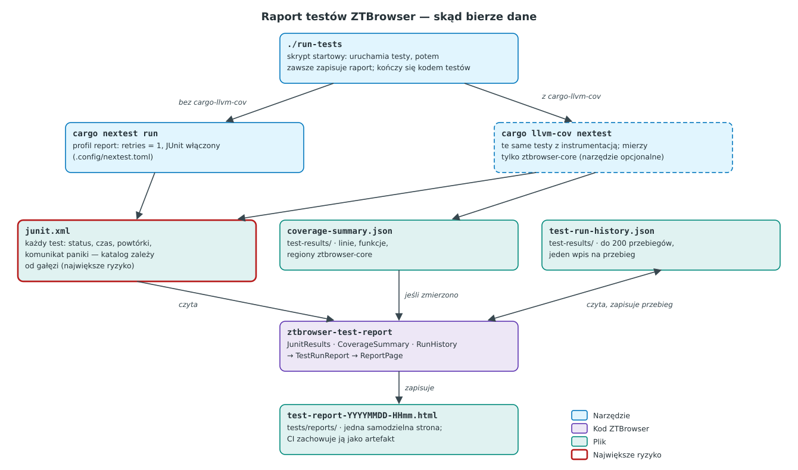

# Raport testów HTML

`./run-tests` uruchamia wszystkie testy ZTBrowsera, a potem zawsze zapisuje raport:
`tests/reports/test-report-YYYYMMDD-HHmm.html`, nazwany według lokalnego czasu startu przebiegu. Strona to
jeden samodzielny plik HTML (bez sieci, bez serwera), który można otworzyć z dysku albo dołączyć do
wiadomości. Katalogi `tests/reports/` i `test-results/` (tam leży historia przebiegów) są ignorowane przez
git, więc raport nigdy nie trafi do commita przypadkiem. Skrypt kończy się kodem wyjścia testów, więc może
blokować commit albo job CI.

## Jaki problem rozwiązuje

`cargo test` wypisuje wyniki w terminalu, gdzie przewijają się i znikają. Nikt nie widzi, które testy
zwolniły, czy jakiś test raz padł w zeszłym tygodniu ani jak dużą część domeny testy faktycznie wykonują.
Raport zachowuje ten obraz: każdy przebieg jest zapisywany, a strona pokazuje ostatni przebieg obok
dwudziestu poprzednich. Ma ten sam układ co firmowy szablon raportu testów z innych naszych projektów, więc
kto zna jeden raport, przeczyta też ten.

## Słownik

- **cargo-nextest** — narzędzie do uruchamiania testów Rusta. Każdy test działa w osobnym procesie,
  nieudane testy można powtórzyć, a wyniki zapisać jako JUnit XML. Uruchamia te same funkcje `#[test]` co
  `cargo test`.
- **JUnit XML** — popularny format pliku z wynikami testów, wywodzący się z javowego JUnit. Jeden element
  `<testcase>` na test, z czasem i, gdy test padł, z wyjściem błędu.
- **Powtórka i test niestabilny (flaky)** — profil `report` w `.config/nextest.toml` powtarza nieudany test
  jeden raz. Test, który padł, a potem przeszedł, jest **niestabilny**: zależy od czegoś, od czego nie
  powinien (czasu, kolejności, wspólnego stanu). Raport pokazuje go na żółto. Projekt nie toleruje testów
  niestabilnych, więc powtórka służy tylko do odróżnienia „niestabilnego” od „zepsutego”, nigdy do ukrycia
  błędu.
- **Pokrycie (coverage)** — część kodu, którą testy wykonały. LLVM, backend kompilatora używany przez Rusta,
  liczy **linie**, **funkcje** i **regiony** (region to fragment kodu wykonywany w całości, mniej więcej
  instrukcja albo jedno ramię rozgałęzienia). `cargo-llvm-cov` buduje testy z włączonym liczeniem.
- **Historia przebiegów** — `test-results/test-run-history.json`, jeden wpis na przebieg z licznikami i
  pokryciem.

## Uruchamianie

```sh
./run-tests                    # wszystkie testy, potem raport; poza CI otwiera go w przeglądarce
sudo pacman -S cargo-llvm-cov  # opcjonalnie: dodaje do raportu pokrycie ztbrowser-core
```

`cargo-nextest` jest wymagany. Bez `cargo-llvm-cov` skrypt uruchamia `cargo nextest run`, a karta pokrycia
pokazuje **BRAK** (brak pomiaru) zamiast liczby. [Workflow testów](../../../.github/workflows/tests.yml)
instaluje oba narzędzia i przechowuje raport z każdego przebiegu jako artefakt przez 90 dni, także gdy testy
padną.

## Skąd biorą się dane



`./run-tests` idzie jedną z dwóch dróg. Gdy `cargo-llvm-cov` jest zainstalowany, uruchamia
`cargo llvm-cov nextest`, który buduje testy z liczeniem pokrycia i zapisuje
`test-results/coverage-summary.json`. Bez niego uruchamia zwykłe `cargo nextest run`. W obu przypadkach
nextest zapisuje `junit.xml`. Jego katalog zależy od drogi (`target/llvm-cov-target/nextest/report/` albo
`target/nextest/report/`), co czyni go najsłabszym ogniwem: skrypt kasuje oba pliki przed przebiegiem i bierze
ten, który istnieje po nim, więc raport nigdy nie powstanie ze starego pliku.

Następnie `ztbrowser-test-report` (crate workspace, który nigdy nie trafia do paczek) czyta trzy wejścia,
zapisuje przebieg w historii i generuje stronę.

## Układ raportu

Od góry:

1. **Tytuł i werdykt** — gałąź i commit, lokalny czas przebiegu i odznaka. Odznaka pokazuje najgorszą rzecz w
   przebiegu: `FAILED` przed `COVERAGE ≤90%` przed `FLAKY` przed `PASSED`.
2. **Pasek KPI** — liczba zestawów, pass rate ostatniego przebiegu, liczba testów, zapisane przebiegi, testy
   padające teraz i pokrycie linii.
3. **Karty** — `Unit · cargo nextest` i `Coverage · llvm-cov`. Każda ma odznakę statusu, pass rate (albo
   pokrycie linii) z ostatnich 20 przebiegów, wykres liniowy i pasek ostatnich 20 przebiegów. Zielony to brak
   błędów, żółty niestabilność, czerwony błąd; dla pokrycia zielony znaczy, że każda zmierzona metryka jest
   powyżej 90 %. Puste miejsca to przebiegi, których jeszcze nie było.
4. **Ostatni przebieg** — dwa wykresy kołowe (testy według statusu, pokryte linie), liczniki statusów i czasy:
   suma wszystkich testów, średnia, najdłuższy test i czas całego przebiegu.
5. **Najczęstsze błędy i najbardziej niestabilne funkcjonalności** — błędy są grupowane według rodzaju
   (`assert_eq!`, `assert!`, `Option::unwrap`, `Result::unwrap`, timeout, inny). Funkcjonalność to jeden plik
   wykonywalny testów, np. `ztbrowser-core::generic_hiding`, czyli jeden typ domenowy.
6. **Testy nieudane i niestabilne** — tylko gdy występują, z komunikatem paniki i miejscem jej wystąpienia.
7. **Funkcjonalności** — każdy plik testów z paskiem wyników, nieudane najpierw.
8. **Najwolniejsze testy** — pierwsza dziesiątka.

**Pass rate** liczy testy niestabilne jako zaliczone i pomija testy pominięte. Procenty są obcinane, nigdy
zaokrąglane w górę, więc jeden błąd na tysiące testów nigdy nie pokaże się jako 100.00 %.

## Zakres i próg pokrycia

Pokrycie jest mierzone tylko dla `ztbrowser-core`. Crate aplikacji (`ztbrowser`) to zestaw adapterów, które
wykonują decyzje domeny w GTK i WebKicie, i celowo nie ma testów jednostkowych. Liczenie go mówiłoby tylko
tyle, że kod GUI nie działa w teście jednostkowym. Samo narzędzie raportu też jest pominięte. Pokrycie
przebiegu jest wystarczające, gdy **każda zmierzona metryka jest powyżej 90 %**. Pokrycie rozgałęzień
wymaga kompilatora nightly; gdy nie zostało zmierzone, LLVM podaje zero rozgałęzień, a metryka jest pomijana
zamiast pokazywać 0 %.

## Historia przebiegów

Każdy raport zapisuje swój przebieg w `test-results/test-run-history.json`. Przebieg rozpoznaje się po
zestawie i czasie startu, więc ponowne wygenerowanie raportu dla tego samego przebiegu nie dodaje go drugi
raz. Plik trzyma najwyżej 200 przebiegów na zestaw. Brakująca albo uszkodzona historia zaczyna się od nowa,
zamiast zatrzymywać raport.

## Dlaczego tak

- **JUnit z nextesta zamiast wyjścia `cargo test`.** Stabilny `cargo test` nie podaje czasów pojedynczych
  testów ani formatu do odczytu maszynowego. Jego wyjście JSON (`--format json`) jest niestabilne i wymaga
  kompilatora nightly. nextest zapisuje JUnit na stabilnym toolchainie i dodaje powtórki, a tylko one
  pozwalają odróżnić test niestabilny od zepsutego.
- **Własny generator, w Ruście.** Narzędzia raportowe takie jak Allure potrzebują środowiska Javy albo
  pobierają zasoby z sieci, a firmowy szablon to kilka czystych przekształceń. Rust trzyma projekt w jednym
  języku i pozwala, by narzędzie przestrzegało tych samych zasad obiektowych i testów scenariuszowych co
  przeglądarka.
- **Strefa czasowa pochodzi z pliku JUnit.** nextest zapisuje czas startu z przesunięciem względem UTC, więc
  raport czyta lokalną datę i godzinę wprost z tekstu i nie potrzebuje bazy stref czasowych.

## Znane ograniczenia

- Nazwa pliku ma dokładność do minuty: dwa przebiegi uruchomione w tej samej minucie zapisują ten sam plik.
  Historia i tak zapisuje oba.
- nextest pomija w pliku JUnit testy `#[ignore]`, więc `SKIPPED` zwykle wynosi zero.
- Plik testów, który się nie kompiluje, nie daje pliku JUnit. Skrypt zatrzymuje się wtedy z błędem
  kompilatora i bez raportu, bo nie ma wyników do pokazania.

## Mapa kodu

| Moduł (`crates/ztbrowser-test-report/src/`) | Odpowiedzialność |
|---|---|
| `junit_results.rs` | Czyta plik JUnit nextesta jako `TestCase` ze statusem, czasem i błędem. |
| `failure_message.rs` | Zachowuje komunikat i miejsce paniki oraz klasyfikuje błąd. |
| `coverage_summary.rs` | Czyta podsumowanie cargo-llvm-cov i ocenia je względem progu. |
| `run_history.rs`, `recorded_run.rs`, `suite_summary.rs` | Historia przebiegów i jej widok na karcie. |
| `test_run_report.rs` | Sumy, funkcjonalności, rankingi, czasy i werdykt ostatniego przebiegu. |
| `report_page.rs`, `report_widgets.rs`, `report_page.css` | Strona HTML w układzie szablonu. |
| `report_command.rs`, `main.rs` | Polecenie: pliki, gałąź i commit z gita, zapis strony. |

Testy: `crates/ztbrowser-test-report/tests/`, jeden plik scenariuszy Given/When/Then na typ.
